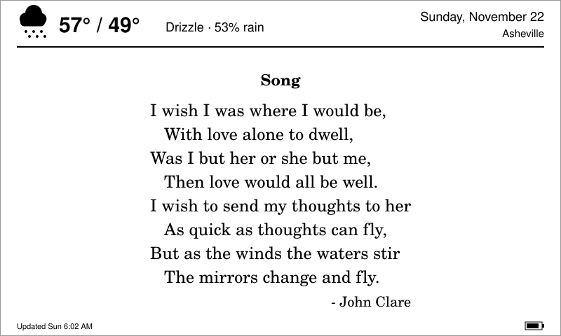
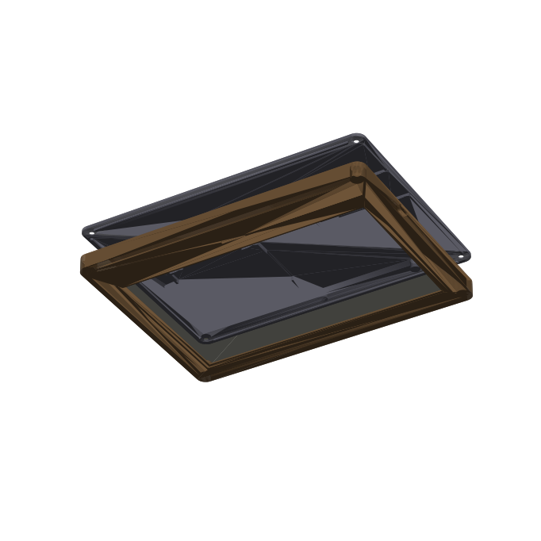

A little battery-powered e-paper frame to give as a gift. Twice a day it wakes, shows a one-line weather forecast at the top (icon, high/low, rain chance) and a short poem underneath, or a personal message if I've scheduled one for that day, then goes back to sleep. E-paper keeps its picture with no power, so the frame stays readable around the clock and a charge should last months.

There are three parts: a 3D-printed case (P1S, parametric), ESP32 firmware, and a small Cloudflare Worker that picks the poem, fetches the weather and lets me queue messages from my phone.

> **Status (2026-11-22):** designed, not yet built. The case passes its own fit checks, the firmware compiles, and the worker is tested locally, but nothing has been on real hardware yet. See [Verify before building a batch](#verify-before-building-a-batch).

## How it works

- **Frame:** wakes at the refresh times (default 6:00 am and 5:00 pm local), joins Wi-Fi, fetches one JSON payload, redraws, and deep-sleeps until the next slot. After 3 pm the weather line shows tomorrow.
- **Worker:** one poem per day for everyone, 4–14 lines long, filtered so it always fits the screen. A message dated for that day replaces it, and a pinned message replaces it every day until removed. The admin page at `/api/eink/admin` adds frames (type a town; it looks up the coordinates and time zone), queues messages, previews what a frame will show, and lists each frame's last check-in and battery voltage.
- **Recipient setup:** on first power-up the frame shows instructions and opens a Wi-Fi hotspot called `Poem-Frame-XXXX`. They join it on their phone, pick their home network and type its password, and the frame does the rest. If their Wi-Fi ever changes, the frame notices after two failed wakes and opens the hotspot again on its own.

Code: [`firmware/eink-frame/`](https://github.com/tommyorndorff/extra-ransom/tree/main/firmware/eink-frame) (PlatformIO) and [`workers/eink-frame/`](https://github.com/tommyorndorff/extra-ransom/tree/main/workers/eink-frame), each with a README covering wiring, flashing, deployment and the API.

## Bill of materials (per frame)

| Part | Qty | Example | Notes |
|---|---|---|---|
| 7.5″ e-paper raw panel, 800×480 black/white (V2) | 1 | [Waveshare 7.5inch e-Paper raw panel](https://www.waveshare.com/7.5inch-e-paper.htm) ([archive](https://web.archive.org/web/2024/https://www.waveshare.com/7.5inch-e-paper.htm)) | 170.2 × 111.2 × 1.18 mm outline; 163.2 × 97.92 mm active area (about 6.4 × 3.9″). Buy the bare panel, not the HAT kit. Glass: handle by the edges. |
| ESP32 board with LiPo charger and USB-C | 1 | [DFRobot FireBeetle 2 ESP32-E (DFR0654)](https://www.dfrobot.com/product-2195.html) ([archive](https://web.archive.org/web/2024/https://www.dfrobot.com/product-2195.html)) | 60 × 25.4 mm. Charges the LiPo at up to 500 mA over USB-C and has a PH2.0 battery socket. Get the version **without** soldered headers. |
| E-paper FPC adapter | 1 | [Good Display DESPI-C02](https://www.good-display.com/product/516.html) ([archive](https://web.archive.org/web/2024/https://www.good-display.com/product/516.html)) | Takes the panel's 24-pin ribbon and does the panel's high-voltage boost. Set its RESE switch for the 7.5″ panel. The larger Waveshare Universal Driver HAT also works electrically, but the case's adapter pad is sized for the DESPI-C02. |
| LiPo pouch cell, 3.7 V, about 7 × 50 × 60 mm | 1 | "705060" 2000–2500 mAh, **with protection circuit** and a PH2.0 (2.0 mm JST-PH) lead | **Check lead polarity against the FireBeetle's socket before plugging in**; sellers aren't consistent. Any cell up to 60 × 52 × 7.5 mm fits the cradle. |
| Hookup wire, 26–28 AWG silicone, 8 colors | ~1.5 m | | Adapter to FireBeetle: eight short runs, about 12 cm each. |
| M3 brass heat-set inserts, short (4.0 mm hole, ≤ 6 mm long) | 4 | CNC Kitchen-style "M3 short" | Press into the front frame's corner bosses with a soldering iron. |
| M3 × 8 countersunk screws | 4 | | Back cover to frame. |
| Foam tape, 0.5 mm, about 6 mm wide | ~0.6 m | | One strip around the panel's border between glass and bezel. |
| Foam pads, about 1 mm thick, 6 mm round | 7 | | One on each press post behind the panel. |
| Double-sided foam tape, about 1 mm | small piece | | Holds the FireBeetle, the adapter and the battery to the back cover. |
| Thin card or Kapton sheet, about 165 × 105 mm | 1 | | Optional. Sits behind the panel so nothing scratches the back of the glass. |
| Felt or rubber feet, 10 mm round | 4 | | In the recesses under the desk stand. |
| Filament (PLA or PETG) | about 300 g | | Frame about 45 cm³, back cover about 72 cm³, stand about 172 cm³ (it's solid; print it at 15% infill). |
| USB-C cable + 5 V charger | 1 | | For the gift box. Any phone charger works. |

Shared across all frames: a USB data cable to flash firmware, a soldering iron (for the wiring and to set the inserts), and a Cloudflare account with the `extra-ransom.net` zone (free tier is plenty).

## The case

- **Size:** 194.8 × 145.8 × 15.7 mm (7.7 × 5.7 × 0.6″), landscape.
- **Front frame:** 12 mm bezel on the sides and top and a 22 mm chin at the bottom that hides the ribbon bend and sits in the stand. The window has a 1 mm chamfer. Four M3 insert bosses, and a USB-C slot in the right-hand wall lined up with the FireBeetle's port.
- **Back cover:** screws on with four countersunk M3s. A skirt locates it inside the walls. On the inside it carries the battery cradle, rails for the FireBeetle (USB end against the right wall), a low outline for the adapter, and seven posts that press the panel forward through foam pads.
- **Desk stand:** a separate cradle the case drops into, leaning back 15°. Its front lip covers only the bottom 10 mm of the chin.

Downloads: [front_frame.stl](/static/eink-frame/front_frame.stl) · [back_cover.stl](/static/eink-frame/back_cover.stl) · [desk_stand.stl](/static/eink-frame/desk_stand.stl) · [generator script](/static/eink-frame/generate_eink_frame_stls.py)

The STLs come from `generate_eink_frame_stls.py`. Edit its parameter block (panel and board sizes, bezels, battery size, stand tilt) and re-run `python3 generate_eink_frame_stls.py` (needs `pip install manifold3d trimesh numpy matplotlib`). Every run checks that each part is watertight and that the panel, board, battery, adapter, back cover and frame don't collide, and it prints the case size.

### Printing on the P1S

| Part | Orientation | Notes |
|---|---|---|
| Front frame | **face down** | The textured PEI plate gives the bezel a nice finish. 0.2 mm layers, 3 walls. No supports: the USB slot and window chamfer print as bridges and 45° overhangs. |
| Back cover | outside face down | 0.2 mm, 3 walls, 15–20% infill. No supports. |
| Desk stand | as exported (base down) | 15% infill. The felt recesses on the base bridge fine. |

PLA is fine indoors. Use PETG if a frame might sit on a sunny windowsill or in a hot car on the way to someone.

## Assembly

1. Print all three parts. Press the four inserts into the frame bosses (soldering iron at about 220 °C, push straight down, let it set flush).
2. Wire the DESPI-C02 to the FireBeetle: 3V3, GND, SDI → GPIO23, SCK → GPIO18, CS → GPIO14, D/C → GPIO13, RES → GPIO26, BUSY → GPIO25 (GPIO numbers; check the FireBeetle pinout for the pad labels). Keep the wires just long enough to reach across the bottom of the back cover. Cut the FireBeetle's low-power pad to switch off its power LED (DFRobot's wiki shows where).
3. Flash and test on the bench before anything goes in the case (see [Setting up each gift](#setting-up-each-gift)).
4. Lay the frame face down on a soft cloth. Run the 0.5 mm foam strip around the bezel's inner ledge, then drop the panel in face down with the ribbon at the bottom, passing through the notch in the locating lip. Add the card sheet behind it if you're using one.
5. Stick the FireBeetle between its rails with its USB-C end against the right wall, the adapter on its outline, and the battery in its cradle, all with foam tape. Stick the foam pads on the seven press posts.
6. Fold the ribbon back and plug it into the adapter's connector (contacts toward the latch). Plug in the battery last.
7. Set the cover on, check the USB-C plug goes in through the side slot, and screw it down. Snug is enough: the posts only need to hold the panel against its foam.

## Setting up each gift

1. Deploy the worker once (`workers/eink-frame/README.md`).
2. Open `https://www.extra-ransom.net/api/eink/admin`, add the frame with who it's for and their town, choose °F or °C, and keep the default refresh times or change them.
3. Flash it with that frame's token: `cd firmware/eink-frame && EINK_TOKEN=<token> pio run -t upload`.
4. Bench test: it shows the Wi-Fi setup screen. Join `Poem-Frame-XXXX` and enter your own Wi-Fi. It should draw the poem within a minute, and the admin page should show the check-in with a battery voltage.
5. Before wrapping it, queue a message dated for the day they'll open it. The frame will forget your Wi-Fi when it can't find it at their house and show the setup screen; a one-line card in the box ("join the Poem-Frame Wi-Fi on your phone") covers the rest.

## Verify before building a batch

These are estimates or unconfirmed. Fix the parameter in the script or firmware if they're wrong.

- **Where the active area sits inside the panel outline** (`ACTIVE_Y0 = 9.0` mm from the bottom edge, est.). The vertical border isn't split evenly. Check against the mechanical drawing in the [Waveshare 7.5″ V2 spec](https://files.waveshare.com/upload/6/60/7.5inch_e-Paper_V2_Specification.pdf) ([archive](https://web.archive.org/web/2024/https://files.waveshare.com/upload/6/60/7.5inch_e-Paper_V2_Specification.pdf)) before printing.
- **Ribbon position**: assumed to leave the bottom long edge at the centre.
- **DESPI-C02 size**: the pad outline is 36 × 32 mm (est.). Measure the board.
- **USB-C height in the wall**: assumes the FireBeetle is stuck to the cover with 1 mm tape, component side toward the panel.
- **Battery sense pin**: GPIO34 through a 2× 1 MΩ divider according to most sources. Measure with a meter once.
- **Sleep current and battery life**: "months per charge" is arithmetic, not a measurement. Put a meter on the battery lead of the first frame.
- **Poem selection**: PoetryDB leans heavily on 19th-century English poets and Shakespeare sonnets (most 14-line poems are sonnets). If the mix gets repetitive, the worker's `src/poems.js` can hold a hand-picked list instead.
- **Cloudflare certificate authority**: the firmware trusts Google Trust Services, GlobalSign, Let's Encrypt and SSL.com roots. If Cloudflare ever switches the site to a CA outside that list, the frames will stop updating until re-flashed.

## Sources

- Panel dimensions: [Waveshare 7.5″ e-Paper V2 specification](https://files.waveshare.com/upload/6/60/7.5inch_e-Paper_V2_Specification.pdf) ([archive](https://web.archive.org/web/2024/https://files.waveshare.com/upload/6/60/7.5inch_e-Paper_V2_Specification.pdf)) and the [7.5inch e-Paper HAT manual](https://www.waveshare.com/wiki/7.5inch_e-Paper_HAT_Manual) ([archive](https://web.archive.org/web/2024/https://www.waveshare.com/wiki/7.5inch_e-Paper_HAT_Manual)).
- Why not Waveshare's own ESP32 driver board: it has no LiPo charger, and like most development boards its regulator and USB chip keep drawing current in deep sleep. See the [e-Paper ESP32 Driver Board wiki](https://www.waveshare.com/wiki/E-Paper_ESP32_Driver_Board) ([archive](https://web.archive.org/web/2024/https://www.waveshare.com/wiki/E-Paper_ESP32_Driver_Board)) and [JLCPCB's ESP32 power write-up](https://jlcpcb.com/blog/esp32-power-consumption-explained) ([archive](https://web.archive.org/web/2024/https://jlcpcb.com/blog/esp32-power-consumption-explained)).
- FireBeetle 2 ESP32-E: [DFRobot wiki](https://wiki.dfrobot.com/dfr0654/) ([archive](https://web.archive.org/web/2024/https://wiki.dfrobot.com/dfr0654/)).
- Weather: [Open-Meteo](https://open-meteo.com/) ([archive](https://web.archive.org/web/2024/https://open-meteo.com/)), free for non-commercial use ([terms](https://open-meteo.com/en/terms), [archive](https://web.archive.org/web/2024/https://open-meteo.com/en/terms)). Poems: [PoetryDB](https://poetrydb.org/) ([archive](https://web.archive.org/web/2024/https://poetrydb.org/)).
