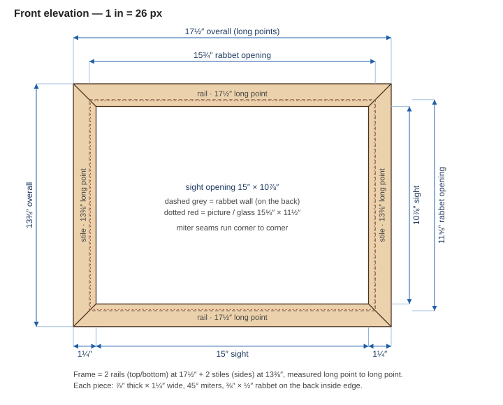
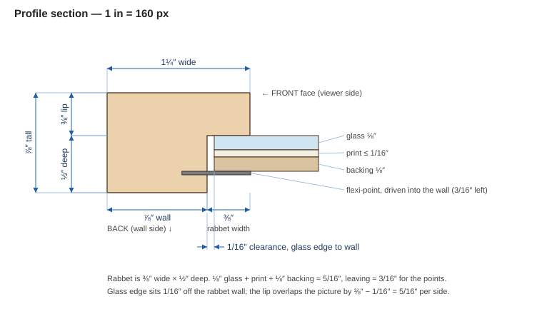
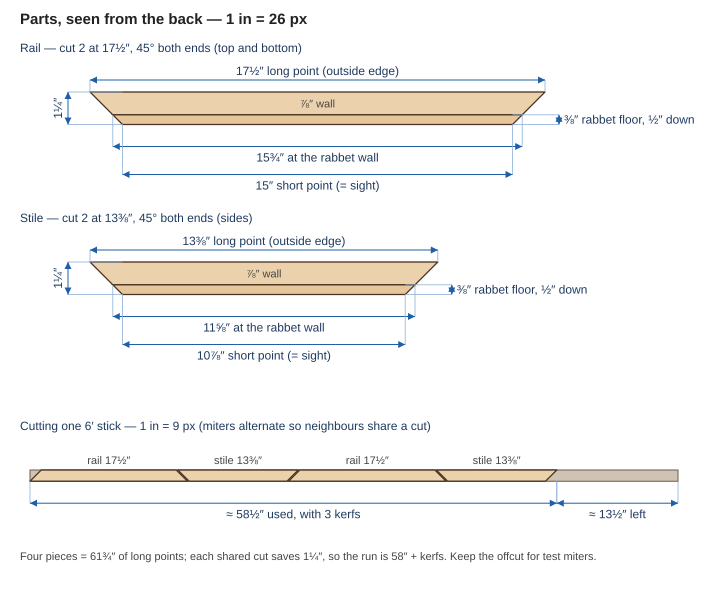

A plain, square-profile **mitered picture frame** made from stock that is **1¼″ wide and ⅞″ tall**, rabbeted on the back to hold glass, a picture and a backing board. The worked example is a picture **11½″ tall × 15⅝″ wide**; a formula and a size table at the bottom give the numbers for any other picture.

> **Provenance of the numbers.** **(stated)** = given by you: the stock profile and the picture size. **(chosen)** = a design decision I made because the profile alone doesn't settle it (rabbet size, glass clearance). **(derived)** = worked out from those so everything closes. Change a **(chosen)** value and the **(derived)** ones move with it. The *Alternate rabbet* section shows how.

## What is stated, what is chosen

| Item | Value |
|---|---|
| Stock profile | **1¼″ wide × ⅞″ tall**, square edges (stated) |
| Picture / glass | **11½″ tall × 15⅝″ wide** (stated); landscape |
| Rabbet | **⅜″ wide × ½″ deep**, cut on the back inside edge (chosen) |
| Glass-to-rabbet clearance | **1/16″ each side** (chosen) |
| Joint | Four 45° miters |

Why that rabbet: **½″ deep** holds ⅛″ glass + the print (≤ 1/16″) + a ⅛″ backing board ≈ 5/16″ and still leaves ≈ 3/16″ for the retaining points. That leaves a **⅜″-thick front lip** on the ⅞″ stock. **⅜″ wide** gives the lip a 5/16″ overlap on the picture edge (⅜″ − 1/16″ clearance). That is enough to hide a ragged edge and hold the picture, and it leaves a ⅞″ wall behind it.

## Drawings (true scale)

Drawn from the dimensions on this page. Click to open full size.

**Front elevation**

**Profile section**

**Parts and stick layout**

## The numbers

| Derived | Working | Result |
|---|---|---|
| Rabbet opening | picture + 2 × 1/16″ | **15¾″ × 11⅝″** (derived) |
| Sight opening (what you see) | rabbet opening − 2 × ⅜″ | **15″ × 10⅞″** (derived) |
| Outside size | sight + 2 × 1¼″ | **17½″ × 13⅜″** (derived) |
| Visible face width | stock width | **1¼″** all round |
| Picture hidden under the lip | ⅜″ − 1/16″ | **5/16″ per side** |
| Rabbet-opening diagonals (square check) | √(15¾² + 11⅝²) | **19.58″**, both equal |

**Shortcut for any picture:** every piece is cut to the picture dimension **+ 1⅞″**, measured long point to long point. 15⅝″ + 1⅞″ = **17½″**; 11½″ + 1⅞″ = **13⅜″**.

## Cut list

Finished stock is **⅞″ × 1¼″**, rabbeted *before* mitering. Lengths are **long point to long point**.

| Part | Qty | T × W × L | Notes |
|---|---|---|---|
| Rails (top, bottom) | 2 | ⅞″ × 1¼″ × **17½″** | 45° at both ends, long point on the outside edge |
| Stiles (sides) | 2 | ⅞″ × 1¼″ × **13⅜″** | Same |
| Glass | 1 | ⅛″ × **11½″ × 15⅝″** | Ask the glass shop for exactly this size; acrylic works and is lighter |
| Backing board | 1 | ⅛″ × 11½″ × 15⅝″ | Hardboard, thin ply or foam-core |
| Retainers | 6–8 | | Flexi-points or small turn buttons, about ⅛″ proud of the rabbet floor |
| Hanger | 1 set | | Two D-rings (screws ≤ ½″ long, since the wall is ⅞″ thick) + picture wire, or one sawtooth hanger for a light frame |

**Stock to buy:** the four pieces total 61¾″ of long-point length. Alternating the miters nests the pieces, so each shared cut saves 1¼″ and the stick only needs about 58½″ with kerfs (61¾″ − 3 × 1¼″ + 3 kerfs). **Buy one 6′ length** (5/4 stock milled to ⅞″ × 1¼″) so the corners share grain and about 13½″ is left for test cuts. Mill a little extra width for the rabbet setup pieces.

## Build sequence

1. **Mill** one straight stick to **⅞″ × 1¼″**, longer than needed. Pick the best face as the front.
2. **Cut the rabbet first, on the whole stick:** ⅜″ wide × ½″ deep on the back inside edge. Table-saw it in two passes, or use a router with a rabbeting bit. Test on an offcut: the leftover front lip should be **⅜″ thick**.
3. **Ease the front edges** with a light 1/16″ chamfer or sanding if you want. Do it now, while the stick is straight.
4. **Check the saw's 45°** with a square cut-off test: cut two scraps, join them, and measure against a 90° square. Fix it before cutting good stock.
5. **Cut the miters** on a miter saw or sled with a stop block. Set the stop for **17½″** and cut both rails with the same setting, then reset to **13⅜″** for the stiles. Measure on the outside (long-point) edge, with the rabbet side up or down, but the same way each time.
6. **Dry-fit** the four pieces. Check that the rabbet opening is **15¾″ × 11⅝″** and that its diagonals match at **19.58″**. If they don't, sneak up on the miters with a shooting board.
7. **Glue the miters.** End grain drinks glue, so size each miter with a thin coat, wait a minute, then apply glue and clamp with a band or corner clamps. Check the diagonals again before it sets.
8. **Reinforce the corners**, because a plain miter is a weak joint: ⅛″ splines (a contrasting wood looks good), loose tenons or at least a pair of 18-ga brads at each corner.
9. **Sand and finish** before the glass goes in. Keep finish out of the rabbet where the glass sits.
10. **Assemble:** glass, picture, backing, then the points or turn buttons. Fit the D-rings on the back of each stile **about a third of the way down** (the wall is ⅞″ thick, so use short screws) and run the wire.

## Other picture sizes

| Picture (H × W) | Rabbet opening | Sight opening | Outside (H × W) | Rail / stile long point |
|---|---|---|---|---|
| 5″ × 7″ | 5⅛″ × 7⅛″ | 4⅜″ × 6⅜″ | 6⅞″ × 8⅞″ | 8⅞″ / 6⅞″ |
| 8″ × 10″ | 8⅛″ × 10⅛″ | 7⅜″ × 9⅜″ | 9⅞″ × 11⅞″ | 11⅞″ / 9⅞″ |
| 11″ × 14″ | 11⅛″ × 14⅛″ | 10⅜″ × 13⅜″ | 12⅞″ × 15⅞″ | 15⅞″ / 12⅞″ |
| **11½″ × 15⅝″ (this plan)** | **11⅝″ × 15¾″** | **10⅞″ × 15″** | **13⅜″ × 17½″** | **17½″ / 13⅜″** |

Here rails are the long top and bottom pieces, and stiles are the shorter sides. With a mat, use the **mat's** outside size as the "picture".

For any other size, with or without a mat, use the [picture-frame calculator](/frame-calc/): it gives the outside and inside length of every member, a cut list and a mat bill of materials, and prints to PDF.

## Alternate rabbet

If a ⅜″-wide rabbet hides too much of the picture, a **¼″ rabbet** is fine (the stock is the same size). Everything shifts by **+¼″**: sight opening 15¼″ × 11⅛″, outside **17¾″ × 13⅝″**, so rails become 17¾″ and stiles 13⅝″ (formula: picture + **2⅛″**). The lip then overlaps the picture by only 3/16″ per side.

## Open questions

- **Rabbet size** is my choice, not part of your profile. If the profile you have in mind already includes a rabbet or a decorative bevel on the front, tell me and I'll redo the numbers.
- **Mat or no mat:** if the picture is to be matted, the "picture" in every formula is the mat's outside size, and the glass is cut to that.
- **Print thickness:** a thick print or a stretched canvas needs a deeper rabbet. ½″ allows about 5/16″ of glass + print + backing.
- **Hanging weight:** the D-ring setup suits anything up to the 5–10 lb range. A frame this size with glass weighs about 2–3 lb.
