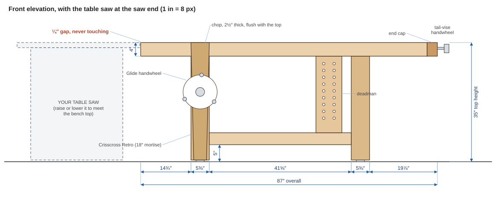
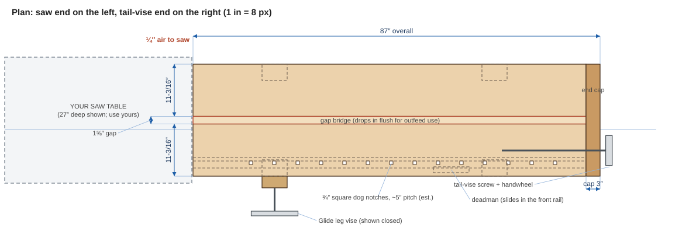
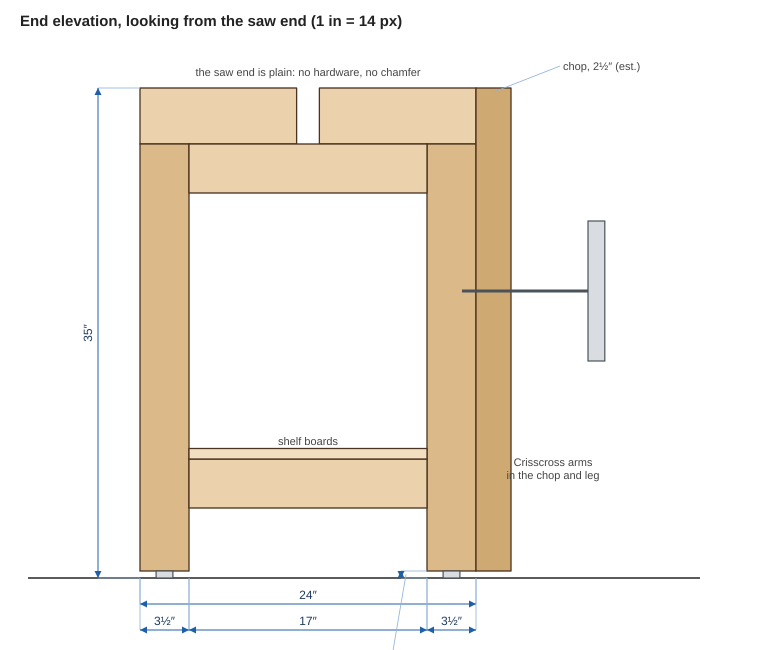
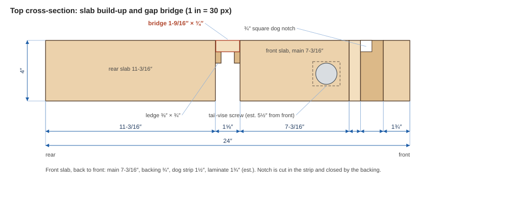
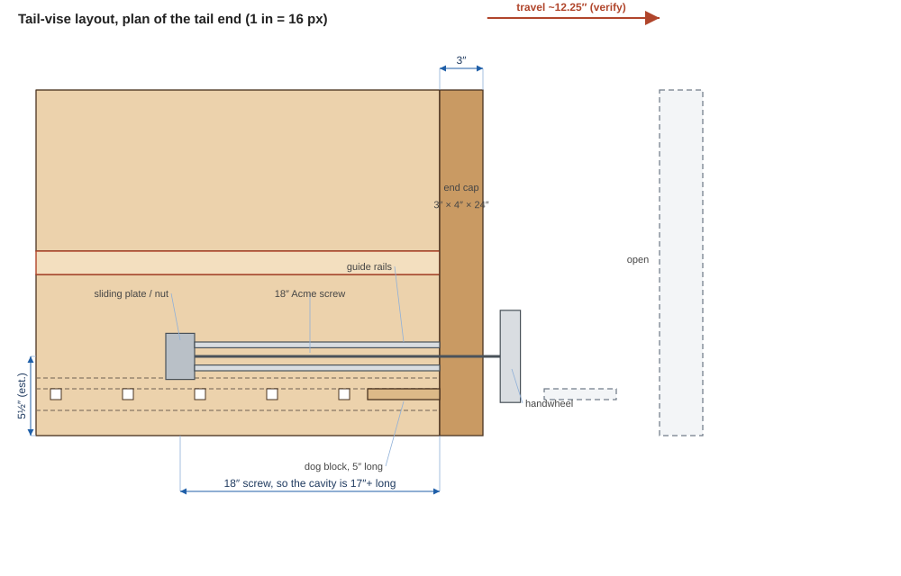

A **proposed** build: a Benchcrafted-style **split-top Roubo bench**, 87″ × 24″ × 35″, with a **Glide leg vise on a Crisscross Retro** (owned) and a **tail vise** (to buy), set up so it also works as the **outfeed table for a cabinet table saw**. The saw is raised or lowered to meet the bench, so the bench height is chosen for hand work and the saw does the matching.

Starting point: the [Benchcrafted Split-Top Roubo plan](https://benchcrafted.com/products/split-top-roubo-bench) ([archive](https://web.archive.org/web/2024/https://benchcrafted.com/products/split-top-roubo-bench)), from its preview drawings. This page does not replace the plan: it keeps the plan's envelope, adds what outfeed duty needs, and flags everything I could not read from a preview image.

> **Provenance of the numbers.** **(stated)** = read off the Benchcrafted preview drawings or product pages. **(chosen)** = my design decision for outfeed use. **(derived)** = worked out so the stated ones close. **(est.)** = measured off a preview image or a single reseller figure; confirm against the plan and the hardware manuals before cutting. Drawings come from `tools/woodworking/split_top_roubo_drawings.py`; change a constant and re-run.

## What changes for outfeed duty

1. **The saw end is plain.** The bench's left end faces the saw. It carries no vise, no end cap, no handwheel and no chamfer, so a long board slides off the saw table onto an uninterrupted surface. The tail vise goes at the far end, as in the Benchcrafted drawing, and the leg vise stays at the saw end of the front, so nothing sticks out where the work travels.
2. **The gap gets a bridge.** The split-top's 1⅝″ gap catches offcuts and the leading corners of panels. A loose **1-9/16″ × ¾″ bridge** rests on two ⅜″ × ¾″ ledges and sits flush, so the whole top is one surface for sawing. Lift it out and the gap is back for clamps and the gap-stop.
3. **Dogs come out, holes stay low.** The tail vise's dog notches are ¾″ square in the front strip. Pull the dogs before ripping. The deadman and the front dog row are the only openings, and neither is on the centerline where the cut stock travels.
4. **It is never touched to the saw.** Leave **¼″ of air** at the saw end. Saw vibration should not couple into a 350 lb bench, and planing forces should not move the saw's fence rails.
5. **Fine height trim.** A ½″ leveling foot under each leg (±⅜″ of travel) gives a trim to the saw table, and takes up an uneven floor. Check flatness with a straightedge across both tables, saw blade lowered; aim for the top **at or 1/64″ below** the saw table, never above (a board edge should not catch).
6. **Finish.** Oil and shellac only; no wax on the top. A waxed top is fast, but the wax gets onto every board and ruins glue-ups and finishes.

> **Match this to your saw:** the drawings show a generic 27″-deep cabinet-saw table 35″ off the floor. Measure yours with a straightedge. A 24″ bench is narrower than your saw table, so line the bench's centerline up with the blade, not with the table's edge, for ripping. Panels wider than about 20″ still want a side support; this is a bench-height outfeed, not a sheet-goods table.

## Drawings (true scale)

**Front elevation, with the saw at the saw end**

**Plan**

**End elevation, from the saw end**

**Top cross-section: slabs, gap bridge, front build-up**

**Tail-vise layout**

## Dimensions

| Item | Size | Source |
|---|---|---|
| Overall | 87″ × 24″ × 35″ | stated |
| Top | two slabs 11-3/16″ wide × 4″ thick, 1⅝″ gap | stated / derived |
| Slab length | 84″ plus a 3″ end cap = 87″ | chosen (cap per hardware guide) |
| Legs | 5⅜″ wide × 3½″ deep × 30½″, plus a ½″ leveling foot | stated / chosen |
| Leg spacing | overhangs 14¾″ (saw end) and 19⅞″ (tail end), 41⅝″ between the front legs | stated |
| Between front and back legs | 17″, legs flush with the top's front and back | stated |
| Lower rails | 3½″ tall, bottoms 5″ off the floor | stated / est. |
| Chop | 34½″ tall, ½″ off the floor, top flush with the bench, tapered 5⅜″ to ~3¾″ | stated / est. |
| Glide screw axis | ~14½″ below the top (movable up to 5″ per the plan's note) | est. |
| Crisscross mortise | 18″ long (V2), starts ~16″ below the top | stated / est. |
| Deadman | ~7⅝″ wide, ~22″ tall, two columns of ¾″ holes | est. |
| Weight | ~350 lb in hard maple | est. |

## Tail vise

Hardware: the [Benchcrafted Tail Vise](https://www.leevalley.com/en-us/shop/tools/workshop/workbenches/vises/70160-benchcrafted-tail-vise-hardware) ([archive](https://web.archive.org/web/2024/https://www.leevalley.com/en-us/shop/tools/workshop/workbenches/vises/70160-benchcrafted-tail-vise-hardware)): an 18″ Acme screw, a 1″ sliding plate/nut, guide rails and a dog block. Facts from the maker's pages: the vise was conceived for a top at least **4″ thick**; the guide recommends a **3″ end cap**; the **tenon shoulder / cavity must be at least 13½″** so the screw can't hit the end of its cavity; the sliding plate is reversible for a right- or left-hand bench. A reseller lists ~12¼″ of travel with a 2⅞″ cap and an 11¾″ capacity with a 5″ dog block; treat these as unconfirmed.

Layout used here:

- **Screw** 5½″ from the front face (est.), running inside the front slab behind a **dog strip** with ¾″ square notches on a ~5″ pitch (est. from the preview), 14 notches from 12″ to 77″.
- **Front slab** built back to front: main 7-3/16″, backing strip ¾″, dog strip 1½″, laminate 1¾″ (all est.). The notches are cut in the strip and closed by the backing.
- **End cap** 3″ × 4″ × 24″, bolted through the slab ends with barrel nuts; the guide-rail mortises in it are cut after it is attached.
- **Handwheel** on the far end only. At the saw end there is nothing.

The Benchcrafted plan has full dimensions for the end cap, rails and mortises, and the hardware ships with a template. **Use those, not my layout lines**, for the vise itself.

## Leg vise

You already own the Glide on a Crisscross **Retro** (the version that uses brackets, so no deep top-pivot hole). Notes from the maker's pages: the Crisscross takes **18″ of vertical space** in the leg and chop; the Glide gives **up to 9″ of jaw depth** depending on the bench; keep the chop long at the top and trim it flush with the benchtop last. Mount it so the chop face stands proud of the benchtop's front by the chop's thickness, as in a classic Roubo.

Because the vise is at the **saw end**, the chop and handwheel are near where you stand when you rip. They are on the front face and below the top, so they don't block the surface, but the screw end sticks out ~5″ and the open chop sticks out ~9″ more. Keep your feeding path clear of them, or move the vise to the other front leg (mirror the plan).

## Materials and drying

**Species.** Soft maple for the top, legs, rails and chop. Southern yellow pine is the budget route, but only if it's dry. Cherry is nice but expensive and gets dinged. Hard maple, beech or white oak go in the small wear parts. Weights are rough: ~350 lb in soft maple, ~290 lb in yellow pine.

| Part | Species | Notes |
|---|---|---|
| Top slabs, legs, rails, ledgers, chop, deadman | soft maple (or dense yellow pine) | the bulk of the bench |
| End cap, dog strip, dog block | hard maple, beech or white oak | take the wear and the screw loads |
| Gap bridge and its ledges | hard maple or oak | stays flat; replaceable |
| Shelf boards | pine or fir is fine | not structural |

**Board-foot estimate** (net, from the finished sizes, then ×1.4 for milling waste and defects; est.):

| Group | Net | With waste |
|---|---|---|
| Two top slabs, 84″ × 11-3/16″ × 4″ | 52 bf | |
| Four legs, 5⅜″ × 3½″ × 33″ (tenons included) | 17 bf | |
| Rails and ledgers (8 pieces, ~2″ thick), chop, deadman | 18 bf | |
| Shelf boards, ¾″ | 4 bf | |
| **Main species total** | **~91 bf** | **~130 bf** |
| Hard wear parts (end cap, dog strip, block, bridge) | ~5 bf | ~8 bf |

Order **~140 bf** of the main species and **~10 bf** of the hard one, so there's room to reject a bad board. Rail and ledger thicknesses are my estimates; check them against the plan's cut list.

**Buying.**
- **8/4 rough.** Buy 6″-plus widths so you can rip them. Ask for #1 common or better with few knots.
- **Top.** Rip 8/4 into 4¼″ strips and stand them on edge, about 7 strips per slab, edge-laminated. Alternate the growth rings to keep each slab flat.
- **Legs.** Face-laminate two 8/4 boards to 3½″ thick.
- **Yellow pine.** Ask for dense, tight-ringed, mostly heartwood stock. Big-box 2x lumber is typically only kiln-dried to about 19%, and it will twist as it dries.

**Drying and moisture.**
- **Target:** 6–8% moisture, checked with a pin meter. Check several boards, not just one.
- **Acclimate:** stack the stock flat with stickers in your shop for 3–4 weeks before milling.
- **Mill in stages:** rough-mill, let it sit another week or two, then final-mill. Thick stock moves most right after it's first cut.
- **Air-drying your own** takes about a year per inch of thickness, so I'd buy dry stock for the top and only dry non-critical parts yourself.
- **After the build:** the top will still move a little in its first season. That's why the final flattening comes after the bench is assembled, then the saw is set to meet it.

## Build outline

1. **Top slabs.** Laminate or use solid slabs to 4″ thick; flatten before gluing the front strips. Dog strip first (the notches are cut on the bandsaw or table saw before gluing the backing on).
2. **Legs and rails.** Drawbored mortise-and-tenons as in the Benchcrafted plan (3/8″ pins and barrel-nut bolts). Fit the leveling-foot inserts last.
3. **Vises.** Fit the Crisscross and chop to the leg and the tail vise to the front slab before the top goes on the base.
4. **Ledges and bridge.** Glue the ledges ¾″ below the top, 3/8″ wide; plane the bridge to fit with 1/32″ clearance each side and flush at the top.
5. **Flatten** the top once everything is assembled, **then** set the saw to meet it.

## Open questions

- **Your saw's table height and rear edge.** Does the rear of the saw have a rail or fence-rail tube that would clash with the bench end?
- **Which side does the saw's fence stand?** If you rip with the fence on the left, the cut stock leaves along the **rear** slab; check that the deadman and dogs are not in line.
- **Leg vise end.** Saw end (as drawn) or tail end?
- **Plan details I couldn't read:** the chop thickness, tail-vise screw offset, guide-rail and end-cap mortises, and the dog pitch are est. Confirm against the plan and the hardware manuals ([Crisscross Glide manual, 2025](https://info.highlandwoodworking.com/library/manuals/benchcrafted/Crisscross_Glide_Instructions_2025.pdf)).
- **Sheet goods.** The 24″ width won't support a full sheet. A drop-down side extension is a possible later add.
