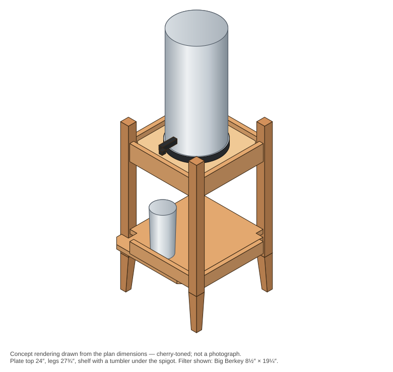
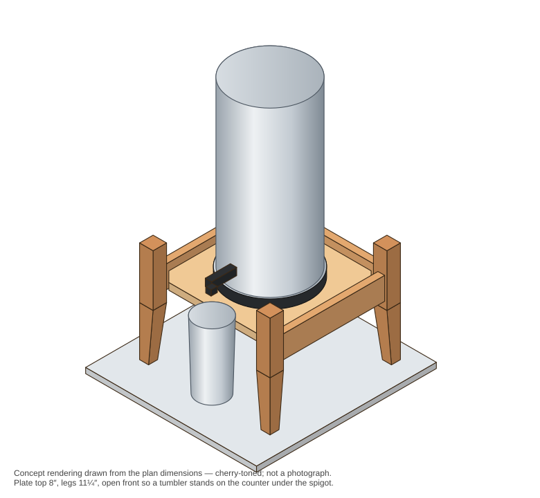
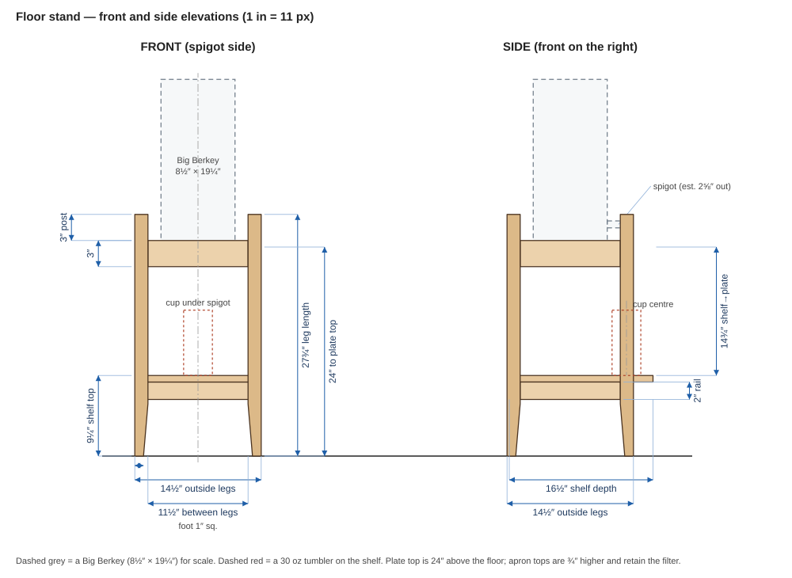
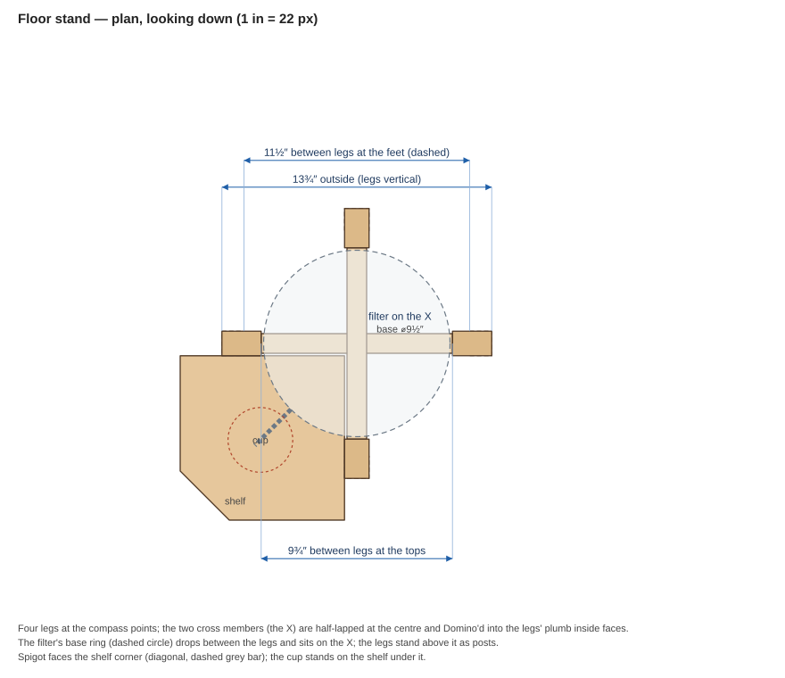
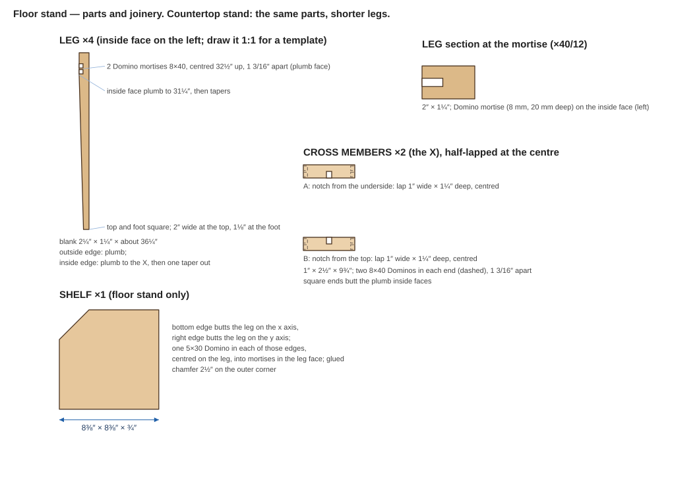
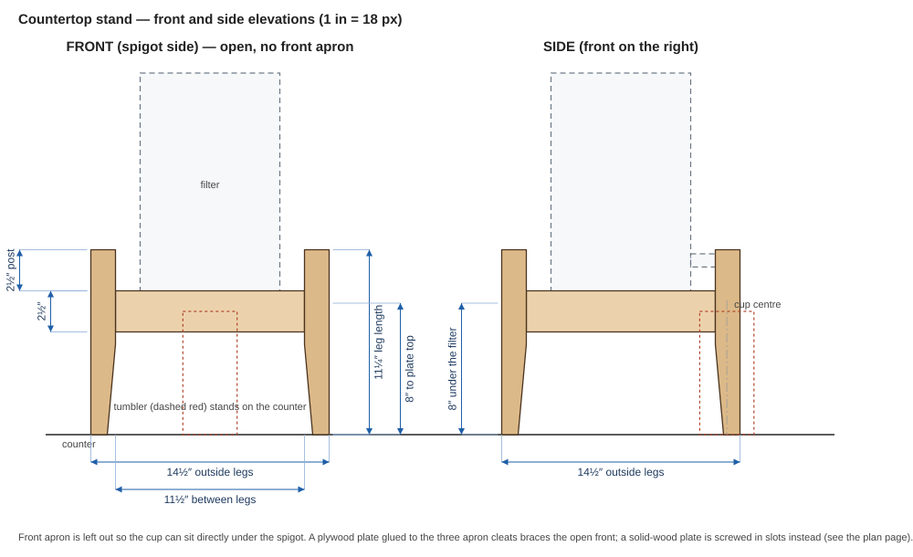
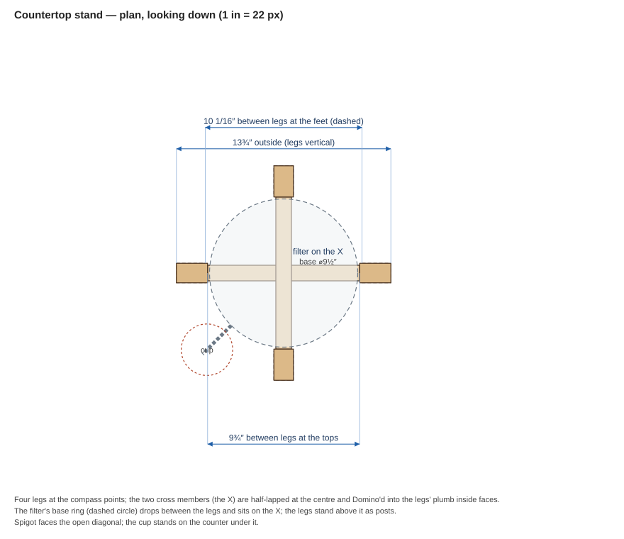

A **proposed** build: a hardwood stand for a gravity-fed stainless water filter (Berkey, British Berkefeld or anything of that size). It comes in two heights from **one construction**: a **floor stand** with a shelf for a tumbler or pitcher under the spigot, and a **countertop stand** that lifts the filter just high enough to get a glass under it. Everything is square stock, mortise-and-tenon and table-saw cuts, with no turning, no compound angles and no curves.

The look comes from your two reference photos: **four legs that rise past the platform as posts** to keep the filter from walking off (the cherry stand), and a **plain four-leg frame with the filter sitting down inside it** (the ceramic-crock stand). The shelf for a tumbler is borrowed from the cherry one too.

> **Provenance of the numbers.** **(stated)** = from you: a floor stand for a Berkey-sized filter, a countertop version too, built on a table saw. **(maker)** = the filter makers' published sizes, rounded; sources disagree by up to an inch, so **measure your own filter before cutting** (see *Fit*). **(chosen)** = a design decision of mine. **(derived)** = worked out from those so everything closes. **(est.)** = a guess I couldn't verify (spigot reach, weight), flagged in *Open questions*. The drawings come from `tools/woodworking/water_filter_stand_drawings.py`; change a constant there and the SVGs and cut-list numbers move together.

## Renderings

Concept views drawn from the plan dimensions (a Big Berkey is shown). They are illustrations, not photographs. Click any figure to open it full size.

**Floor stand**

**Countertop stand**

## Design in one paragraph

Four **1½″ square legs** sit **14½″ apart outside** (11½″ between). A **¾″ × 3″ apron** is tenoned between them, with its top edge **¾″ proud of a drop-in plate**, so the filter sits in a shallow tray whose walls are the aprons and whose four corners are the legs, which stand **3″ above the aprons** as posts. Under the plate the aprons carry ¾″ cleats. A **lower rail** frame at the floor stand's **6½–8½″** height supports a ¾″ **shelf** that reaches **9½″ to the front**, so a tumbler can stand directly under the spigot. The countertop stand is the same top frame on **8″** legs with **no front apron**, so the cup can sit on the counter in front of the stand.

The feet taper on their two inside faces from 1½″ to 1″, which is the only shaped cut on the legs.

## Fit: which filters this takes

The frame's opening (between the aprons) is **12½″ square**; the plate is 12⅜″. Filter sizes are the makers' published figures, rounded (the Berkey site gives its own sizes, and retailers disagree by about an inch on height).

| Filter | Dia. | Height | Gap to apron, each side | Total height, floor stand | Total height, countertop |
|---|---|---|---|---|---|
| Travel Berkey (1.5 gal) | 7½″ | 18″ | 2½″ | 42″ | 26″ |
| **Big Berkey (2.25 gal)** | 8½″ | 19¼″ | 2″ | 43¼″ | 27¼″ |
| Royal Berkey (3.25 gal) | 9½″ | 23″ | 1½″ | 47″ | 31″ |
| Imperial Berkey (4.5 gal) | 10″ | 26″ | 1¼″ | 50″ | 34″ |
| British Berkefeld stainless 8.5 L (~2.25 gal) | 10¼″ (260 mm; Doulton lists 224 mm) | ~19¼″ | 1⅛″ | 43⅜″ | 27⅜″ |
| British Berkefeld stainless 12 L | 9¾″ (246 mm) | ~23¾″ | 1⅜″ | 47¾″ | 31¾″ |
| Crown Berkey (6 gal) | 11″ | 30″ | ¾″ | 54″ | 38″ |

- **Up to the Royal / British Berkefeld 12 L** fits as drawn. **Crown and Imperial** are tight on width and very tall on the floor stand: widen the frame by 1″ (move the legs out ½″ each way: `IN_HALF = 6.25`) and, for the floor stand, drop the plate height to 20″ so the top lid stays under about 50″. The black base ring on a Berkey flares about ¼″ wider than the body, so check that too.
- **Why the 1″+ gap matters:** the filter should drop in without scraping, and the base ring and spigot need room. The posts, not the gap, keep it from walking, so a loose fit is fine.

## Drawings (true scale)

**Floor stand — front and side**

**Floor stand — plan**

**Floor stand — parts and joinery**

**Countertop stand — front and side**

**Countertop stand — plan**

## The numbers

| Item | Floor stand | Countertop stand |
|---|---|---|
| Leg | 1½″ square × **27¾″** | 1½″ square × **11¼″** |
| Outside / between legs | **14½″ / 11½″** (chosen) | same |
| Plate top above floor/counter | **24″** (chosen) | **8″** (chosen) |
| Apron top (¾″ above the plate) | **24¾″** | **8¾″** |
| Apron | ¾″ × **3″** (underside at 21¾″) | ¾″ × **2½″** (underside at 6¼″); **no front apron** |
| Posts above the apron top | **3″** | **2½″** |
| Lower rails / shelf top | rails 6½–8½″, shelf top **9¼″** | none |
| Under the spigot | shelf 9¼″ to the front apron's underside 21¾″ = **12½″** clear | **8″** plate + the spigot's height on the filter (est. 2″) = about **9½″** clear |
| Foot | tapers to 1″ square from 6″ up | tapers to 1″ square from 5½″ up |
| Inside faces are in | 5¾″ from the centre | same |

How the pieces close:

| Derived | Working | Result |
|---|---|---|
| Leg outside | 2 × (5¾″ + 1½″) | **14½″** |
| Apron outside face | leg outside − ¼″ setback | **14″** (¼″ reveal on each side) |
| Apron inside face | 14″ − 2 × ¾″ | **12½″** between aprons |
| Apron length | 11½″ between legs + 2 × ⅝″ tenons | **12¾″** |
| Mortise position | ¼″ setback + (¾″ − ⅜″) ÷ 2 | **7/16″** from the outside arris |
| Plate | 12½″ − 2 × 1/16″ clearance | **12⅜″** square, ¾″ thick |
| Corner clip | leaves about 3/16″ between the clip and the leg's inside corner | **1⅛″** at 45° |
| Plate top | apron top − ¾″ | **24″** (floor) / **8″** (counter) |
| Cleat top | plate top − ¾″ | **23¼″** / **7¼″** |
| Leg length (floor) | 24¾″ + 3″ | **27¾″** |
| Leg length (counter) | 8¾″ + 2½″ | **11¼″** |

Both mortises in a leg are cut ⅝″ + 1/16″ deep into adjacent faces. The apron setback puts them 7/16″ from the outside arris, so the two cavities touch at one corner point but never overlap. **All four legs are identical.**

## Cut list: floor stand

Stock: cherry, walnut, white oak or maple (the photos are cherry). Finished sizes; mill a little long and trim to length after the joinery is cut.

| Part | Qty | T × W × L | Notes |
|---|---|---|---|
| Legs | 4 | 1½″ × 1½″ × **27¾″** | Cut blanks 28¼″. Two mortises each (see the parts drawing); taper the inside faces below 6″; ease all arrises 3/16″ |
| Top aprons | 4 | ¾″ × **3″** × **12¾″** | Tenon ⅜″ × 2″ × ⅝″ both ends, centred. Same four, front and back included |
| Lower rails | 4 | ¾″ × **2″** × **12¾″** | Tenon ⅜″ × 1¼″ × ⅝″, centred. Top edge at 8½″ |
| Plate | 1 | ¾″ × **12⅜″** × 12⅜″ | Corners clipped 1⅛″ × 1⅛″ at 45° |
| Plate cleats | 4 | ¾″ × ¾″ × **10″** | Glued on each apron's inside face, top 1½″ below the apron top (at 23¼″) |
| Shelf | 1 | ¾″ × **14″** × 16½″ | Four leg notches (cut 1/16″ oversize), front corners chamfered 1¼″; see the parts drawing |

**Board feet:** about 7½ net; buy **about 10 bd ft** (8/4 for the legs, 4/4 for the rest). The countertop stand is about 3 net, so buy **4–5 bd ft**.

## Cut list: countertop stand

The same parts, with the front apron and lower rail frame left out and the legs and aprons shortened.

| Part | Qty | T × W × L | Notes |
|---|---|---|---|
| Legs | 4 | 1½″ × 1½″ × **11¼″** | Mortise ⅜″ × 1½″ × ¹¹⁄₁₆″, centre 7½″ up; taper from 5½″ up to 1″ |
| Aprons (left, right, back) | 3 | ¾″ × **2½″** × **12¾″** | Tenon ⅜″ × 1½″ × ⅝″. **No front apron** |
| Plate | 1 | ¾″ × 12⅜″ × 12⅜″ | Same shape as the floor stand's. Plywood glued down braces the open front; see *Plate* below |
| Plate cleats | 3 | ¾″ × ¾″ × **10″** | Under the plate on the left, right and back aprons. Cleat top at 7¼″ |
| Feet | 4 | felt or rubber pads | Protects the counter. A small dab of bumper adhesive is enough |

## Build sequence

1. **Mill** the legs to 1½″ square (glue up 8/4 or laminate two 4/4 pieces if you only have thin stock; the grain shows on all four faces, so quartersawn or rift stock looks best). Mill the aprons, rails, plate, cleats and shelf stock to ¾″.
2. **Lay out all mortises on one leg and copy to the others.** Both inside faces get one; they sit **7/16″ from the outside arris** on each face. Use a story stick so the four legs come out identical. Cut the mortises ⅜″ wide × the heights in the cut list × 11/16″ deep (router and a fence, a hollow-chisel mortiser, or drill and chisel).
3. **Cut the tenons on the table saw.** Make cheek cuts with a tenoning jig (the [miter-slot tenoning jig](/docs/woodworking/tenoning-jig/) on this site works) or a stack dado, then the shoulders on a crosscut sled with a stop block. Cut them ⅜″ thick, ⅝″ long. Fit to the mortise and ease the tenon's edges so the apron seats fully.
4. **Taper the feet.** Mark the line 6″ up the inside faces (5½″ for the counter stand) and the 1″ square at the foot. Use a table-saw taper jig for each inside face, or the band saw, and finish with a plane. Do this after the mortises, since the taper is below them.
5. **Cut the plate and shelf.** Clip the plate's corners 1⅛″ at 45° with the miter gauge. Cut the shelf to 14″ × 16½″, notch the four leg corners with a crosscut and a rip (or a jigsaw), and chamfer the front corners 1¼″. Notch 1/16″ oversize so it never binds on the legs.
6. **Glue the cleats** to the apron inside faces, ¾″ × ¾″ × 10″, with their top edge **1½″ below the apron top** (floor stand) or at **7¼″** (counter stand). Do this before assembly while the aprons are flat on the bench.
7. **Dry-fit, then assemble in two stages.** Glue the two **side frames** first (two legs, top apron, lower rail each), check them square and identical, then join them with the **front and back aprons and rails**. Check the diagonals of the top frame between the apron inside faces: they should match at about 17⅝″ (12½″ × √2). Clamp across the legs. A drawbore pin (⅛″ dowel) in each tenon is cheap insurance for a stand that gets bumped.
8. **Fit the plate.** Set it on the cleats and check the gap (1/16″ each side). Fasten it as described below. On the floor stand, fasten the shelf to the lower rails the same way.
9. **Sand and finish** before the filter goes on (see *Finish*).
10. **Check for rock.** Stand it on a flat floor or counter and shim or sand a foot if it rocks. Then wall-anchor it (see *Stability*).

### Plate

The plate needs to stay put without trapping seasonal movement:

- **Plywood** (¾″ hardwood-faced ply, edges banded or just oiled): **glue and screw** it to the cleats. It doesn't move, and on the countertop stand it braces the open front.
- **Solid wood** moves roughly ⅛″ across 12″ over a year. Screw it down with **slotted holes** in the cleats' long direction, never glue it, and keep 1/16″ clear of the aprons. The countertop stand's open front then relies on its glued and drawbored tenons alone. That is plenty for an 11″-tall stand, because there is little leverage to rack it, and a stretcher in the front would block the cup, so don't add one.

## Finish

Water **will** drip on this stand. Use something water-resistant: wipe-on or spray polyurethane, spar varnish, or a hardwax oil, with at least three coats on the plate, the shelf and the top edge of the aprons. Seal the **underside of the plate and shelf** as well as the top, or the unfinished side will cup. A stainless filter also sweats in a humid room; a thin cork or felt disk under the base ring keeps the finish from marking.

## Stability and safety

- **Load:** a full filter plus its water is roughly 30–65 lb depending on size (**est.**). The plate is ¾″ hardwood on cleats around all four edges; at that load it is plenty stiff. Don't build it thinner.
- **Tipping:** with a full Big Berkey on the plate (centre of mass about 32″ up), the floor stand tips at about **13°** from vertical, so a hard shove at the top could do it. **Anchor it to the wall:** two small L-brackets (or a ⅛″ brass strap) from a back leg to the wall stud.
- **Countertop:** it is low and stable on its own, but the total height is 27–34″, so check the clearance under any wall cabinet before choosing it. A Big Berkey is just over 27″ on it.
- **Posts:** the 3″ posts are retainers, not a restraint. A child can pull a filter off by the spigot; if that matters in your house, anchor the stand and add a strap or a bracket.

## Open questions

- **Spigot height and reach (est.):** I used a spigot that sticks out about 2⅝″ and whose underside is about 2″ above the filter's base. The front-apron top is ¾″ above the plate, which leaves about 1¼″ under the spigot. Measure yours with the filter in hand. If the spigot's underside is **less than about ½″** above the apron top, lower the front apron on the floor stand (make it 2″, or leave it out like the countertop stand).
- **Filter diameter and base ring:** the table is the makers' figures, rounded, and a base ring wider than the body can eat a ¼″ of the gap. Measure the widest point of your base.
- **Which filter and where it lives:** the Imperial and Crown on the floor stand put the lid at 50–54″. If you refill from a standing position, drop the plate to 20″ (move the aprons, cleats and shelf with it), or choose a 6 gallon-class filter for the counter stand.
- **Tumbler under the spigot:** the floor stand fits vessels up to **12½″ tall** (to the underside of the front apron); the cup circle in the drawings is a 30 oz tumbler, 3¼″ across.
- **Shelf overhang:** the shelf's front tongue reaches 2½″ past the front rail so a cup can sit under the spigot. It is ¾″ hardwood, fine for a cup or a pitcher, but don't load a gallon jug at the very edge.
- **Is the leg taper worth it?** It is the only shaped cut. Skip it (straight 1½″ legs) and the stand is a little heavier-looking but no weaker.
- **Hardware:** wall brackets, felt pads, plate screws and slotted-hole washers are not in the cut list.
