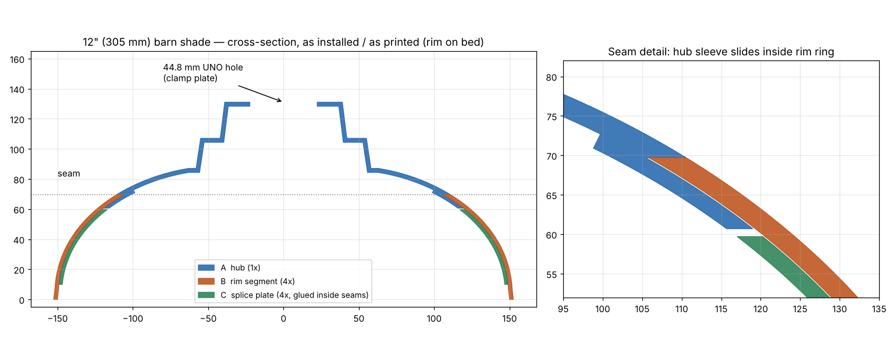

A barn-style outdoor lamp shade for a UNO-fitter socket, printed on a Bambu P1S and modeled on the shade of the [IKEA LÄGERVALL outdoor wall lamp](https://www.ikea.com/us/en/p/laegervall-wall-lamp-outdoor-black-60555978) (matte black, gooseneck arm). It has a stepped fitter cap, a bell dome and a short rim skirt. The top is a flat clamp plate with a 44.8 mm hole (1.75″ plus a little slip clearance). The shape and the STLs come from a parametric script, so any diameter or fitter size can be regenerated.

> **Status (2026-11-23):** designed, not yet printed. Every STL checks as watertight and manifold, but nothing has been through the printer, and the fitter hole has not been measured against the real fitter. Measure the fitter first (see [Open questions](#open-questions)).

## Files

- [`barn_shade_UNO_STLs.zip`](/static/barn-shade/barn_shade_UNO_STLs.zip): all three sizes (`12in/`, `13in/`, `250mm/`).
- [`make_shade.py`](/static/barn-shade/make_shade.py): the generator. It needs only numpy: `python3 make_shade.py`, with overrides like `hole_d=45.5 diameter=280`. `style=cone` gives a flatter schoolhouse cone. Edit the parameter block at the top (wall, hole diameter, cap and tier sizes, seam geometry) and re-run.

## Sizes

| Set | Rim diameter | Pieces | Notes |
|---|---|---|---|
| **12″ (recommended)** | 305 mm | 9: 1 hub, 4 rim segments, 4 splice plates | About 350 cm³, roughly 380 g in ASA |
| 13″ | 330 mm | 9, split the same way | Same parts, larger |
| One piece | 250 mm (9.8″) | 1 | No seams, but it fills the P1S bed edge to edge, so there is no room for a brim |

## The 12″ parts

| Part | Qty | What it is |
|---|---|---|
| **A_hub** | 1 | The fitter, both tiers and the upper dome, 238 mm across. A built-in sleeve reaches about 9 mm below the seam. |
| **B_rim_segment** | 4 | The lower rim in quarters, about 216 × 78 mm each, so two fit on one plate. They slide over the hub's sleeve, which lines up the seam and gives the glue a large overlapping surface. |
| **C_splice_plate** | 4 | Small curved strips glued inside the four vertical seams between rim segments. |

## Printing

- **Orientation:** print every piece rim-down, exactly as the files are oriented. All overhangs end up on the inside, so tree supports set to "build plate only" reach them through the open bottom and the outside surface stays clean.
- **Brim:** on, about 5 mm. The rim and the hub's sleeve sit on thin edges.
- **Supports:** the hub also needs a little exterior support under its seam lip. It is hidden once the shade is assembled.
- **Walls:** about 5–6 wall loops, so the 2.4 mm walls print solid.

## Assembly and finish

1. Glue the rim segments onto the hub's sleeve and to each other with CA or 5-minute epoxy.
2. Glue the splice plates over the vertical seams from inside.
3. Fill and sand the outside seams, then apply a gap-filling primer.
4. Paint. Matte black matches the LÄGERVALL. Gloss green outside with gloss white inside gives an enamel look, better suited to the `style=cone` schoolhouse variant.

## Material

Assuming the lamp is outdoors (the lamp is meant for siding), use **ASA**, which the P1S's enclosure handles well. PETG is the fallback. PLA painted black will sag in summer sun. Use an LED bulb either way.

## Open questions

- **Fitter hole and ring:** 44.8 mm is 1.75″ plus 0.35 mm clearance. Measure the outer diameter of the socket's threaded section and of the UNO ring. The cap is 78 mm outside and about 73 mm inside, which should clear a standard UNO ring, but confirm it against yours. If anything is off, re-run the script, e.g. `python3 make_shade.py hole_d=45.5 diameter=280`.
- **Not printed yet:** confirm the hub sleeve and rim segments slide together and that the 0.2 mm slip clearance suits the printer before gluing anything.
- **Match to the LÄGERVALL:** the proportions were eyeballed from the product photo, not measured, so the dome height and tier sizes are approximate.
