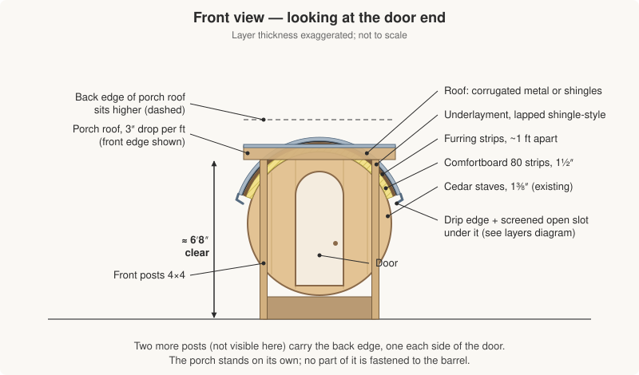
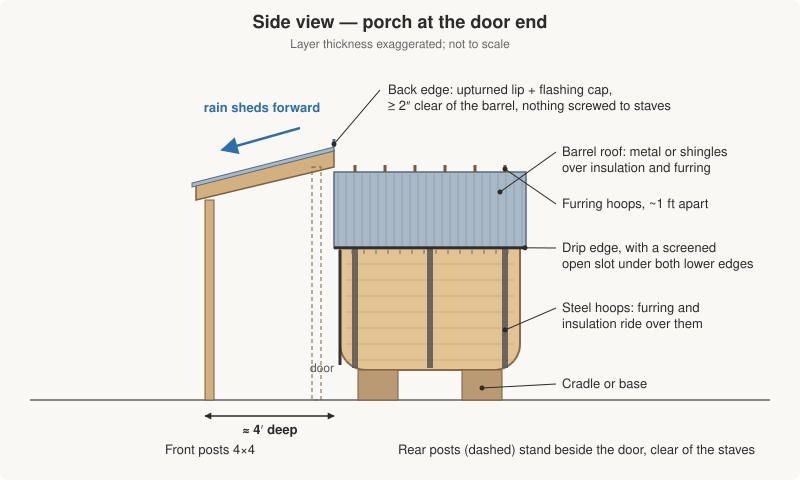
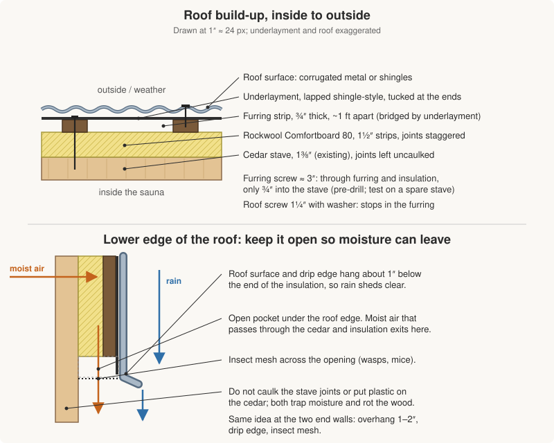

Plan for an Almost Heaven four-person cedar barrel sauna with an electric heater. Goals: stop rain drips through knots and seams, add insulation for cold-weather heating, and add a covered spot to change at the door.

> **Note:** This is general building guidance gathered from Almost Heaven's own roof suggestions, product listings, and common practice. It is not from the Almost Heaven manual, so confirm key details with Almost Heaven or a sauna builder before committing. Product and spec claims were checked against public listings on 2026-11-04 (see [Verification notes](#verification-notes)); anything still unconfirmed is marked **unverified**.

## Quick expectations

- Cedar swells when wet, so small drips through knots and seams are common. A roof greatly reduces them but may not eliminate them. Almost Heaven itself says some seepage is normal.
- Do not caulk or foam the tongue-and-groove joints. The wood moves with heat and moisture, and rigid fill will crack or split boards.
- Keep some airflow at the roof edges so moisture can escape. Trapped moisture causes mold and rot.
- In 30°F weather, expect a longer preheat, often 60 to 90 minutes (a rule of thumb, not a measurement). A roof with insulation helps more than sealing gaps, though the ends, door and floor still lose heat.
- Heater: 4-person Almost Heaven barrels are commonly listed with a 6 kW Harvia (some Watoga listings show 4.5 kW; the larger Essex lists 8 kW on a 240 V, 40 A hard-wired circuit). Check the label on your own heater and put it on a dedicated circuit; have an electrician confirm the wiring.

## The plan in pictures

The three diagrams below cover the whole job. Layer thicknesses are exaggerated, and the barrel dimensions are placeholders until you measure yours.

## Roof options from Almost Heaven's guidance

1. **Removable canvas rain jacket.** Easiest, clips on with bungees, can stay on while the sauna is running, and Almost Heaven sells one (listings show roughly $245 to $280). It is a cover and not insulation. Cheap, reversible first step.
2. **Corrugated metal roof** screwed on with short (about 3/4 inch) sheet metal screws. Their staves are 1-3/8 inch thick, so short screws are safe going straight into the staves.
3. **Roofing shingles** over underlayment, covering as much of the top as you like.
4. **A full shelter or structure** with a roof.

## Recommended build: insulated roof over the barrel

From the inside out:

1. **Barrel staves** (existing cedar, 1-3/8 inch).
2. **Insulation strips.** Rockwool Comfortboard 80, 1.5 inch (R-4.2 per inch, so about R-6.3), cut lengthwise into strips roughly 4 to 6 inches wide and laid along the barrel like extra staves. At that width a flat strip sits within about 1/8 inch of a 6 ft diameter curve, so the board does not need to bend. Stagger the end joints. Buy one pack first and test the fit.
3. **Furring strips** running around the curve (over the top from one side to the other, like hoops), spaced about 1 foot apart. They hold the insulation down and give the roof something to fasten to. Use thin, bendable strips, or rip quarter-inch plywood into narrow strips.
4. **Underlayment** (roofing felt or synthetic), which keeps the mineral wool dry.
5. **Roof surface:** corrugated metal or shingles, with a drip edge at the bottom so water sheds clear. Corrugated panels need to be curved with the ribs running around the barrel; shingles follow the curve more easily.

How it is fastened (this corrects the first draft, which only mentioned short screws):

- **Furring to staves:** the screw has to pass through the furring and the insulation, so use about 3 inch screws (3/4 inch furring + 1.5 inch insulation + about 3/4 inch into a 1-3/8 inch stave). Pre-drill, and test on a spare stave or a hidden spot so the tip does not reach the sauna interior.
- **Roof to furring:** 1 to 1-1/4 inch roofing screws with washers that stop in the furring. The original 3/4 inch screws are Almost Heaven's advice for fastening metal straight to the staves, not through a furring layer.

Cautions:

- Mineral wool loses insulating value when damp, so the underlayment and roof edges must shed water cleanly.
- Account for the steel hoops on the barrel. The flat strips and furring can ride over them; confirm they sit flat.
- Wear gloves, eye protection and a dust mask when cutting mineral wool; use a serrated blade.
- **Unverified:** I could not find a Rockwool maximum service temperature for Comfortboard 80, or a statement on sauna use. It sits on the cool, outer side of the cedar, but ask Rockwool technical service before ordering a lot of it.

## Sealing and airflow

Seal the outside against rain, and leave the inside and bottom edges able to breathe. These two goals pull in opposite directions, so each gets its own rule.

**Seal the outside:**

- Lap the underlayment shingle-style (upper layer over lower) so water sheds.
- Fit drip edge or flashing at the bottom edges.
- Seal roof fasteners and seams, since the metal or shingles are the actual waterproofing.
- Tuck or tape the underlayment at the ends so wind cannot blow rain up under it.

**Do not seal the inside face:**

- Do not caulk or foam the cedar joints. The wood moves with heat and moisture and will crack the seal or split boards.
- Do not put a plastic vapor barrier or foil directly on the cedar. It can trap moisture in the wood and cause rot. (The first draft suggested an optional foil layer under the insulation; that contradicts this rule, so it is dropped.)

**Leave the bottom edges open:**

- Sauna heat pushes moist air through the cedar into the insulation. If every edge is sealed, that moisture condenses and soaks the mineral wool and staves, leading to mold or rot.
- Let the roof surface and drip edge hang about 1 inch below the end of the insulation. That leaves an open pocket under the roof edge. The drip edge still sheds rain outward.
- Cover the opening with insect screen or mesh so wasps and mice cannot move in.
- Do the same at the two end walls: overhang 1 to 2 inches, drip edge, mesh.

## Insulation product names to search for

All from Rockwool (formerly sold as Roxul):

- **Comfortboard 80:** semi-rigid stone wool board, R-4.2 per inch. Thicknesses run from 1 inch up through 5 inches. Common sizes are 2 ft by 4 ft, 4 ft by 6 ft and 4 ft by 8 ft, and Rockwool's own charts differ on which thicknesses come in which size. A Canadian retailer lists 1.5 inch as a 24 x 48 inch pack of 48 square feet (six panels) and as a 48 x 72 inch pack of 24 square feet. Check dimensions on whatever you buy; the 2 x 4 ft size is easiest to cut into strips.
- **Comfortbatt R-15:** flexible batt, 3.5 inches thick, 15.25 or 23 inches wide, 47 inches long. Easy to find, but likely thicker than you want.
- **Safe'n'Sound:** 3 inch batts, 15.25 or 23 inches wide, 47 inches long. Same stone wool, but sold for sound and fire rating in interior walls. It has no official R-value (forum guesses are R-11 to R-13), so it is a poor pick for this job.

## Porch roof at the door

A separate freestanding porch roof, so you can dress and undress out of the rain and so weight stays off the barrel staves.

- **Size:** about 4 feet deep from the door, wider than the door (about 4 to 5 feet), with room to stand, hang a towel, and maybe fit a small bench.
- **Frame:** four posts: two at the front and two beside the door at the back (this fixes the first draft, which had no support at the back edge short of resting on the barrel). Put a beam across each pair and run rafters between them.
- **Slope:** 3 inches of drop per foot (3:12), draining forward and away from the barrel. The first draft said 1 inch per foot, which is too flat: corrugated metal generally wants 3:12 or more, and asphalt shingles need at least 2:12 with extra underlayment at low slopes (one code summary says 4:12, so check your local code). Taller front posts or a steeper pitch also give you more headroom.
- **Height:** aim for about 6 ft 8 in clear under the front edge. At 3:12 over 4 ft the back edge then ends up about 1 ft higher, which is above the top of a 6 ft barrel on its base. That is fine, because the porch then sits in front of the barrel instead of under its roof.
- **Barrel joint:** keep the back edge at least 2 inches clear of the barrel and its roof overhang. Give it an upturned lip and a metal cap flashing, and do not screw anything into the staves. Measure your barrel's height at the door end first and set the post heights from that.
- **Lumber:** cedar or pressure-treated 4x4 posts, 2x6 beams and rafters, with roof material to match the barrel roof. Set posts on piers or footings suited to local frost depth and code.

## Air circulation for cold feet

A heat-rated sauna fan can move air. Ordinary fans are not safe inside: motors and plastic can fail or become a fire risk at sauna temperatures. Check this section's assumptions before buying; the first draft overstated what the fan does.

- **Product to look for:** MMotors MM-S 100, a 4 inch (100 mm) sauna **exhaust** fan: about 105 m³/h, 16 W, IP44, rated for 140°C when running (180°C switched off) and 100% humidity, housing and back-draft damper in glass-filled polyamide. Listings include versions with a back valve. These specs come from retailer pages, not an official datasheet.
- **Where to buy:** the listings I found were European sauna shops (for example esaunashop.com and orotech.lt). The first draft named Sauna Experts, Saunainter and SaunaBee, which I could not confirm. **Unverified:** supply voltage. EU listings are often 230 V, so find a 120 V version or a different fan before ordering.
- **Not the SaunaBox Flow:** it is a cordless USB-C fan for SaunaBox models only (SmartSteam, Pulse PRO, Solara, Forge), and often sold out. Its "up to 30% more heat transfer" is a vendor claim.
- **Placement:** the first draft claimed a low fan near the heater pulls warm air down along the floor. I could not find support for that. The MM-S is sold as an exhaust fan, and mounting one means cutting a 4 inch hole in a stave, which may affect your warranty. Ask Almost Heaven before cutting.
- **Try first:** Almost Heaven barrels usually have a low intake vent and a high exhaust vent. If both are wide open in winter, cold air may be flooding in, so try partly closing the intake. That costs nothing.
- **Wiring:** use high-temperature (silicone) wire near the fan, and have an electrician check the wiring.

## Shopping list (starter)

- Rockwool Comfortboard 80, 1.5 inch (one pack to test, then more as needed)
- Thin furring strips or quarter-inch plywood to rip
- About 3 inch exterior screws for the furring (pre-drill)
- Roofing underlayment
- Corrugated metal panels or shingles, plus drip edge
- 1 to 1-1/4 inch roofing screws with washers, and sealant for the roof fasteners
- Insect mesh for the open slots
- Metal flashing and cap flashing for the porch back edge
- Porch lumber: four posts, two beams, rafters; piers or footings
- Dust mask, gloves and eye protection for the mineral wool
- Optional: heat-rated sauna fan (MMotors MM-S 100, in a voltage you can use) plus high-temperature wire

## Open questions

- Heater size and circuit (confirm kW rating against your model and barrel volume, and the circuit with an electrician).
- Barrel diameter and height at the door end, to set the porch post heights.
- Whether the barrel's steel hoops need notching or shimming under the furring.
- Rockwool's maximum service temperature for Comfortboard 80 and sauna suitability.
- Whether Almost Heaven allows cutting a fan hole or fastening a roof without voiding the warranty.
- Local permit rules for the porch roof and the heater circuit.

## Verification notes

Checked 2026-11-04 against public pages. Confirmed items are fine as written; corrections are in the sections above.

| Claim | Result |
| --- | --- |
| Almost Heaven rain jacket, can stay on during use | Confirmed ([listing](https://almostheaven.com/products/barrel-sauna-rain-jacket), [archive](https://web.archive.org/web/2024/https://almostheaven.com/products/barrel-sauna-rain-jacket)) |
| Corrugated metal and shingles as roof options | Confirmed in Almost Heaven's [roof blog post](https://almostheaven.com/blogs/news/when-should-i-cover-my-sauna) ([archive](https://web.archive.org/web/2024/https://almostheaven.com/blogs/news/when-should-i-cover-my-sauna)) |
| Stave thickness | 1-3/8 in per Almost Heaven's [Watoga page](https://almostheaven.com/products/watoga-2-4-person-barrel-sauna-kit) ([archive](https://web.archive.org/web/2024/https://almostheaven.com/products/watoga-2-4-person-barrel-sauna-kit)); resolves the earlier open question |
| Comfortboard 80, 1.5 in, about R-6 | R-4.2 per inch, so about R-6.3; 24 x 48 in pack of 48 sq ft listed by [BMR](https://www.bmr.ca/en/rockwool-rockwool-comfortboard-80-24-x-48-x-1-1-2-48-sq-ft-064-7041.html) ([archive](https://web.archive.org/web/2024/https://www.bmr.ca/en/rockwool-rockwool-comfortboard-80-24-x-48-x-1-1-2-48-sq-ft-064-7041.html)); Rockwool's [own page](https://www.rockwool.com/north-america/applications/products/comfortboard-80) ([archive](https://web.archive.org/web/2024/https://www.rockwool.com/north-america/applications/products/comfortboard-80)) lists sizes differently |
| Comfortbatt R-15 and Safe'n'Sound sizes | Confirmed (3.5 in and 3 in, 15.25 or 23 x 47 in); Safe'n'Sound has no official R-value |
| MMotors MM-S 100, 140°C rating | Confirmed by retailers ([orotech.lt](https://orotech.lt/en/sauna-exhaust-fan-mm-s-100/), [archive](https://web.archive.org/web/2024/https://orotech.lt/en/sauna-exhaust-fan-mm-s-100/)); it is an exhaust fan; voltage unverified |
| Sauna Experts, Saunainter, SaunaBee as suppliers | Not confirmed; replaced |
| SaunaBox Flow suits a barrel | Not so; it is for SaunaBox models ([maker](https://www.saunabox.com/products/saunabox-flow-dual-purpose-fan), [archive](https://web.archive.org/web/2024/https://www.saunabox.com/products/saunabox-flow-dual-purpose-fan)) |
| 6 kW heater typical | Commonly listed on 4-person models; varies by model |
| Porch slope 1 in per ft | Too flat; 3:12 for corrugated metal, 2:12 minimum for asphalt shingles ([GAF](https://www.gaf.com/en-us/blog/residential-roofing/minimum-slope-for-shingles-what-contractors-need-to-know-62ebb846-13b5-4619-80c4-d408b50e11e3), [archive](https://web.archive.org/web/2024/https://www.gaf.com/en-us/blog/residential-roofing/minimum-slope-for-shingles-what-contractors-need-to-know-62ebb846-13b5-4619-80c4-d408b50e11e3)); check local code |
| Comfortboard 80 temperature limit in a sauna | No source found; ask Rockwool |
