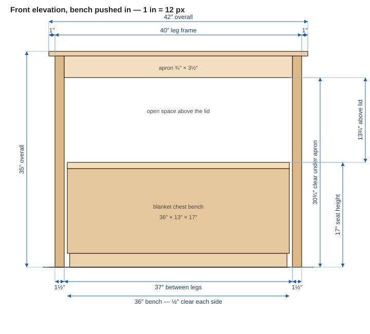
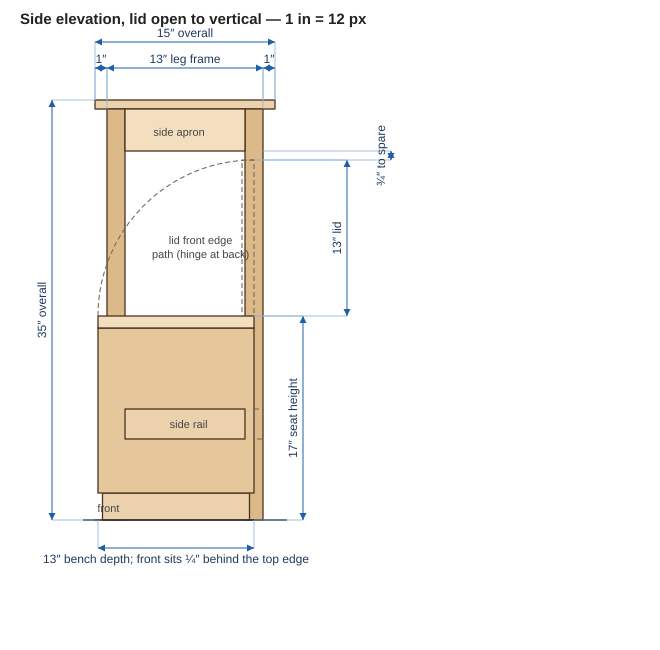
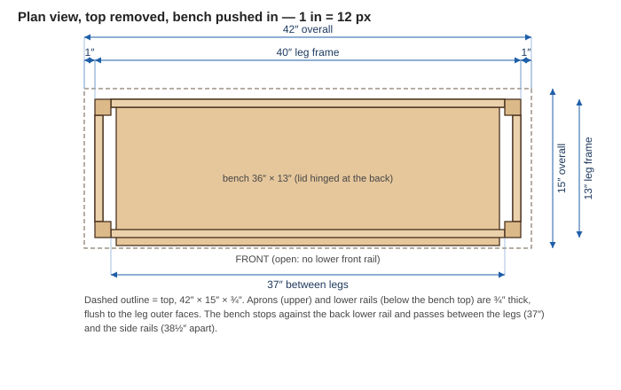
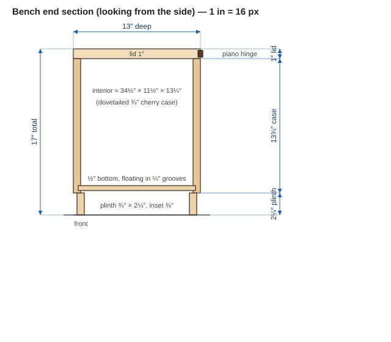

A **proposed** two-piece build: the [Cherry Hallway Console](cherry-hallway-console) reworked so its lower half is open, plus a separate **blanket chest that doubles as a seat** and slides underneath. Sit on the lid to put shoes on; push the chest in and the hallway looks like a plain console. Solid cherry, drawbored mortise-and-tenon frame, dovetailed chest.

Everything here is my own design, so there are no maker dimensions to match. Every number is a **design choice** or **derived** from one, and the fit checks below show how the two pieces close.

## What changes from the original console

| | Original | This version | Why |
|---|---|---|---|
| Overall | 42″ × 14″ × 34″ | **42″ × 15″ × 35″** | 1″ deeper so the seat is 13″ deep (shoe-tying depth); 1″ taller so the lid can open fully under the apron |
| Lower shelf | Yes, ≈ 10″ off floor | **Removed** | The chest lives there |
| Front lower rail | Yes | **Removed** | The chest slides in through the front |
| Back lower rail | Yes | **Kept** — now the chest's **stop** | |
| Side lower rails | Yes | **Kept** | The chest passes between them |
| Leg frame | 40″ × 12″ | **40″ × 13″** | |

## How the two pieces fit

| Check | Working | Result |
|---|---|---|
| Opening between front legs | 40 − 2 × 1½ | **37″** |
| Chest width | 37 − 2 × ½ clearance | **36″** |
| Side rails, inner faces | 40 − 2 × ¾ | 38½″ apart — chest never touches them |
| Clear height under the apron | 35 − ¾ top − 3½ apron | **30¾″** |
| Seat (lid top) height | design choice | **17″** — a normal bench height |
| Space above the lid | 30¾ − 17 | **13¾″** |
| Lid depth (hinged at the back) | | 13″ |
| Lid front edge, open to vertical | 17 + 13 | **30″**, so **¾″ below the apron** |
| Back stop | 15 − 1 − ¾ (back rail) | chest back at **13¼″** from the front edge |
| Chest front | 13¼ − 13 | **¼″ behind the top's front edge**, ¾″ proud of the legs |

**The lid opens all the way with the chest pushed fully under** — the lid's front edge swings up an arc of radius 13″ and clears the apron by ¾″. A deeper chest or a taller seat would break that, so the 17″ × 13″ pair is the limit for this console. For comfortable access to blankets, slide the chest out a few inches first.

## Drawings (true scale)

Drawn at 1″ = 12 px (the chest section at 1″ = 16 px). Click to open full size.

**Front elevation, chest pushed in**

**Side elevation, lid open to vertical**

**Plan view, top removed**

**Chest end section**

## Console

Joinery and finishing are the same as the [original plan](cherry-hallway-console): mortise-and-tenon, 1″ tenons, drawbored, floating top on buttons or figure-8s. See its **Drawboring** section for pin sizes and steps.

### Cut list

T × W × L, cut to length. Tenon lengths are baked in.

| Part | Qty | Stock | T × W × L | Notes |
|---|---|---|---|---|
| Legs | 4 | 8/4 | 1½″ × 1½″ × 34¼″ | |
| Long aprons (front, back) | 2 | 4/4 | ¾″ × 3½″ × 39″ | **37″** shoulder to shoulder |
| Short aprons (sides) | 2 | 4/4 | ¾″ × 3½″ × 12″ | **10″** shoulder to shoulder |
| Side lower rails | 2 | 4/4 | ¾″ × 2½″ × 12″ | Top edge ≈ 9¼″ off the floor, flush to the leg outer face |
| Back lower rail | 1 | 4/4 | ¾″ × 2½″ × 39″ | The chest's stop; glue a ¼″ felt strip on its inner face |
| Top | 1 | 4/4 | ¾″ × 15″ × 42″ | Floats; 1″ overhang all round |

### Stiffness without a front lower rail

With the front rail gone, the base is braced on three sides (two side rails and the back rail) and the top is a rigid box of four 3½″ aprons. That is enough for a hallway piece, but it relies on the joints: **drawbore the apron joints**, and dry-assemble to check there is no racking along the 42″ length before you glue. If the front legs still flex, add a hidden gusset block at each front leg-to-apron corner.

## Chest bench

### Cut list

Cherry for everything visible. T × W × L.

| Part | Qty | Stock | T × W × L | Notes |
|---|---|---|---|---|
| Lid | 1 | 5/4 | 1″ × 13″ × 36″ | Glue up from two boards; cleat underneath (below) |
| Case front, back | 2 | 4/4 | ¾″ × 13¾″ × 36″ | Through dovetails; ¼″ groove for the bottom |
| Case ends | 2 | 4/4 | ¾″ × 13¾″ × 13″ | Through dovetails; ¼″ groove for the bottom |
| Bottom | 1 | ½″ | ½″ × 11⅞″ × 35″ | Cherry or ply; floats in the grooves, grain along the length if solid |
| Plinth front, back | 2 | 4/4 | ¾″ × 2¼″ × 35¼″ | Mitered corners, inset ⅜″ all round |
| Plinth ends | 2 | 4/4 | ¾″ × 2¼″ × 12¼″ | Mitered corners |
| Lid cleats | 2 | 4/4 | ¾″ × 1¼″ × 11¼″ | Underside, 2″ in from each end; slotted screw holes so the lid can move |

Height is 1″ lid + 13¾″ case + 2¼″ plinth = **17″**. The interior is about 34½″ × 11½″ × 13¼″.

### Hardware

- **Hinge:** one 36″ continuous (piano) hinge, 1½″ open, mortised into the back edge of the lid and case.
- **Lid support:** two soft-close lid stays rated for the lid's weight (≈ 10 lb), so it can't slam on fingers.
- **Glides:** four PTFE or felt glide pads under the plinth so the chest slides on a hard floor.
- **Edges:** ease the lid edges ⅛″–¼″; they are where you sit.

### Build sequence

1. Mill case, lid and plinth stock and let it settle between passes.
2. Cut and fit the through dovetails on the case. Plow the ¼″ bottom grooves before assembly.
3. Glue up the case with the bottom dry (unglued) in its grooves.
4. Make the plinth, miter the corners, and glue it to the case bottom edge — long grain to long grain, so glue is fine.
5. Glue up the lid, add the cleats, and mortise the hinge into lid and case.
6. Hang the lid and fit the stays. Check the lid opens to vertical with the chest in place under the console.
7. Finish with hand-rubbed linseed oil and wax; add glides last.

## Open questions

- **Seat depth.** 13″ is comfortable for shoes but shallow for general sitting. Going deeper means a deeper, taller console so the lid still clears; the arc check above is the thing to redo.
- **Console leg section.** 1½″ legs were fine for the original shelf version; with the front rail gone you may prefer 1¾″.
- **Floor type.** Glides assume a hard floor; for carpet use rigid plastic skids instead.
