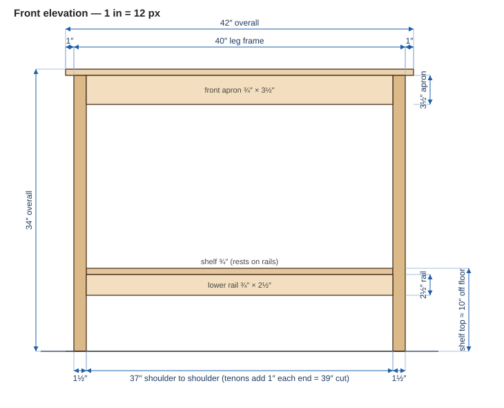
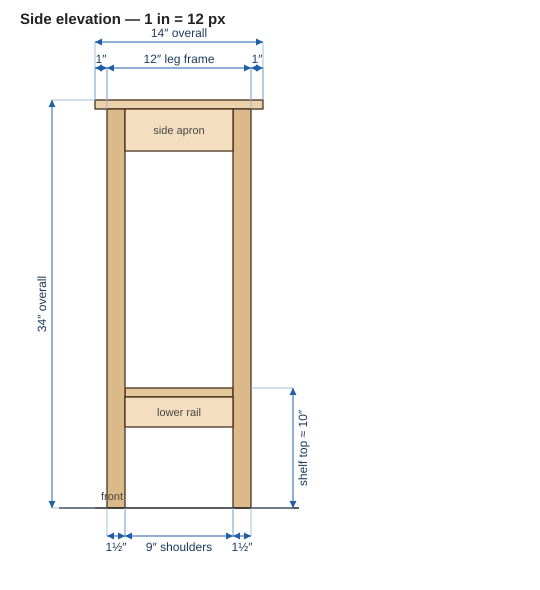
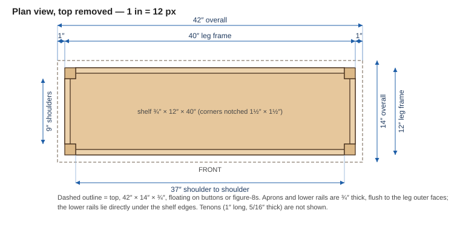
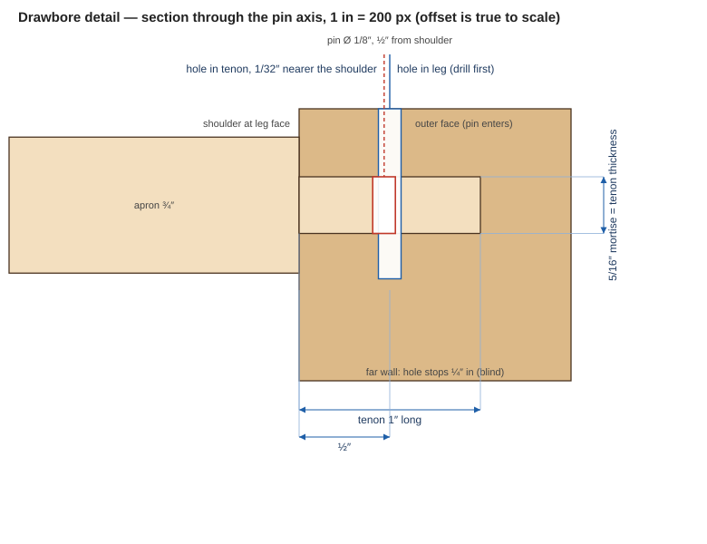

A **proposed** build — fully dimensioned and detailed, but not yet cut. A narrow wall console for an entry/hallway: drop keys and mail on top, baskets or shoes on the lower shelf. Solid cherry, hand-tool build (stock ripped and thickness-planed by machine; all joinery cut by hand).

- **Overall size:** 42" W × 14" D × 34" H
- **Top overhang:** 1" all around the leg frame
- **Lower shelf:** ~10" off the floor, resting on the lower rails
- **Joinery:** mortise-and-tenon frame, drawbored; floating solid top

## Drawings (true scale)

Drawn at 1″ = 12 px from the dimensions on this page. Click to open full size.

**Front elevation**

**Side elevation**

**Plan view, top removed**

> **Variant:** want somewhere to sit and put shoes on? See [Cherry Console + Slide-Under Chest Bench](cherry-console-with-bench) — the same console with an open lower half and a blanket-chest seat that slides underneath.

## Why these proportions

The shallow 14" depth is the point of a hallway piece — it hugs the wall and stays out of the traffic path. 34" tall sits at about waist height, comfortable for setting things down (anywhere 30–34" works; taller reads more console-like). 42" long gives presence without dominating a corridor. Legs are 1½" square — slender but honest for this span; go to 1¾" if you want it chunkier. The lower shelf earns its keep both as storage and as a structural tie that stiffens the whole frame.

## Materials

Species: **solid cherry**, clear finish. Cherry darkens dramatically with light over the first few months (pale pink → deep reddish-brown) — plan around that (see notes).

| Stock | Used for | Rough qty (approx) |
|---|---|---|
| **8/4** (2" rough) | Legs only | 5–6 bd ft |
| **4/4** (1" rough) | Top, aprons, lower rails, shelf | 18–20 bd ft |

Only the legs need stock heavier than 4/4. A finished 1½"-square leg cannot come out of 4/4 — rough 4/4 only nets ~¾" of flat, clean stock after jointing and planing out cup/twist. Buy 8/4 and keep the legs seamless. (6/4 is too close to 1½" finished to survive jointing unless you drop the legs to ~1⅜".)

Lamination alternative: two face-glued pieces of 4/4 make a ~1½" blank, but on a 1½"-square leg the glue line lands on two visible faces and will age to a slightly different shade. On a clear-finished cherry piece, 8/4 is worth it. If you do laminate, orient the seam to a back corner.

The 4/4 estimate leaves margin for grain-matching the top and shelf glue-ups and for working around cherry's gum streaks and sapwood.

## Cut list

Dimensions are thickness × width × length. **Cut to the length in the table** — the tenon lengths are already baked in.

| Part | Qty | Stock | T × W × L (cut to this) | Tenons / notes |
|---|---|---|---|---|
| Legs | 4 | 8/4 | 1½" × 1½" × 33¼" | Mortised on two adjacent faces |
| Long aprons (front/back) | 2 | 4/4 | ¾" × 3½" × 39" | 1" tenon each end, mitered tips |
| Short aprons (sides) | 2 | 4/4 | ¾" × 3½" × 11" | 1" tenon each end, mitered tips |
| Long lower rails (front/back) | 2 | 4/4 | ¾" × 2½" × 39" | 1" tenon each end, mitered tips |
| Short lower rails (sides) | 2 | 4/4 | ¾" × 2½" × 11" | 1" tenon each end, mitered tips |
| Top | 1 | 4/4 | ¾" × 14" × 42" | No joinery; floats on frame |
| Lower shelf | 1 | 4/4 | ¾" × 12" × 40" | Notch corners 1½" × 1½"; rests on rails |

### Key reference dimensions

- **Shoulder-to-shoulder** (what actually keeps the frame square):
  - Long aprons & long rails: **37"**
  - Short aprons & short rails: **9"**
- The extra 2" on each part = two 1" tenons living inside the legs. Set your shoulder gauge to 37" / 9" and the tenon length falls out on its own.
- Mortises: ~5/16" wide × ~1" deep. Two tenons meet inside each leg corner — **miter their tips at 45°** so they don't collide.

## Build sequence

1. Mill 4/4 down to a true ¾" in stages, resting between passes — cherry moves as internal tension releases. Leave leg blanks a hair oversized off the planer and take the last shaving by hand.
2. Lay out and cut all mortises and tenons. Fit each tenon to its mortise before any glue-up.
3. Glue up two end units: each = a pair of legs + short apron + short lower rail.
4. Connect the two ends with the long aprons and long rails.
5. **Dry-clamp the whole frame** and confirm the 37" and 9" shoulder distances land square before committing.
6. Drawbore the tenons — pins pull the joints tight without clamping across the 42" span. See [Drawboring](#drawboring) below for sizes and the step-by-step.
7. Drop the shelf onto the four lower rails.
8. Attach the top with figure-8 fasteners or wooden buttons so the solid top can float (expand/contract seasonally). **Do not glue the top down.**

## Drawboring

Drawboring means the pin hole in the leg and the pin hole in the tenon are deliberately **about 1/32″ out of line**. A tapered pin driven through both pulls the tenon deeper into the mortise and closes the shoulder, then locks the joint mechanically. On a 42″ frame that replaces a long clamp, and the joint stays tight even if the glue ever lets go.

The blue hole is drilled in the leg; the red hole is drilled in the tenon, centered 1/32″ nearer the shoulder. The drawing is true to scale.

### Sizes for this table

| Item | Value | Why |
|---|---|---|
| Pin diameter | **1/8″** | The tenon is only 5/16″ thick; a 1/4″ pin would leave ~1/32″ of wood each side |
| Offset | **1/32″** toward the shoulder | Hardwood pins this small tolerate up to ~3/64″; more can crush or split the tenon |
| Pin position | **½″ in from the leg face** | Mid-tenon on a 1″ tenon, clear of the end grain and of the mitered tip of the neighboring tenon |
| Pins per tenon | **2** on the 3½″ aprons (about 1″ from each edge); 1–2 on the 2½″ rails | Spreads the pull across the width of the tenon |
| Hole depth in leg | Through the near wall, across the mortise, **¼″ into the far wall** | Blind, so no pin end shows on the far side |

**Stagger the pins at each leg corner.** Two tenons meet inside the leg, and their pins are drilled from the two adjacent outer faces. If the long-apron pin and the short-apron pin sit at the same height they cross inside the leg. Put the long-apron pins at about ¾″ and 2¾″ below the top edge, and the short-apron pin at about 1¾″ (mid-height).

### Steps

1. Cut and fit every mortise and tenon dry. It should seat by hand or with light taps, not with force.
2. **Drill the leg.** Use a sharp brad-point bit and a backing block. Start on the leg's **outer** face (so the pin dots show on the faces that are meant to be seen) and drill square through the near wall, across the mortise, and ¼″ into the far wall.
3. **Mark the tenon.** Seat the tenon fully, put the bit back into the leg hole and tap it so the point dimples the tenon cheek.
4. **Offset and drill the tenon.** Pull the tenon, move the mark 1/32″ toward the shoulder, and drill at that new mark. A drill press with a fence keeps it square to the cheek; clamp scrap behind to prevent blowout.
5. **Make the pins.** Straight-grain cherry or 1/8″ hardwood dowel, with a 3/8″ taper at the tip so it finds the offset hole.
6. **Glue-up.** Glue on the tenon cheeks and shoulders, none on the pins. Seat the joint, then drive the pin until it stops; you should feel the shoulder draw in.
7. When the glue has set, saw the pins flush and scrape them clean.

### For this build

- Do the **end units first** (short, easy), then assemble the long aprons and rails into both ends together. Use hide glue or an extended-open-time glue so you are not racing the clock over 42″.
- Drive the pins **one corner at a time**. A single pipe clamp is only for starting the joints, not for holding them.
- **Test on scrap first:** make one joint in cherry with the same 5/16″ tenon and 1/8″ pin. A good result is a closed shoulder with no cracks around the pin; if the tenon splits, reduce the offset.

## Domino option

A Festool Domino can cut the apron joints instead of hand-cut tenons. The plan's 5/16″ mortise is 7.9 mm, so an **8 mm Domino** matches it, and a 40 mm Domino sits 20 mm (¾″) deep in each part.

**The one rule at a leg corner:** two mortises entering from adjacent faces cross inside a 1½″ leg. The hand-cut plan avoids that by mitering the tenon tips. Loose tenons can't be mitered, so **no two Domino mortises in a leg may be at the same height** — stagger them.

| Joint | Domino | Cut length (was) |
|---|---|---|
| Long aprons (×2) | 1 × 8×40 per end, centred **24 mm (≈ ⅞″) below the apron's top edge** | **37″** (39″) |
| Short aprons (×2) | 1 × 8×40 per end, centred **66 mm (≈ 2⅝″) below the apron's top edge** | **9″** (11″) |
| Lower rails (×4) | Keep the hand-cut mitered tenons | 39″ and 11″ (unchanged) |

- With the Domino, **cut length = shoulder-to-shoulder** (37″ and 9″); there is no tenon allowance to add.
- Keep the aprons flush to the leg faces and centre each 8 mm mortise on the apron's ¾″ thickness.
- The 2½″ lower rails are too short to stagger two 40 mm Dominoes at the same corner, so they stay hand-cut. Their mortises sit well below the apron Dominoes, so nothing collides.
- One 8×40 Domino has noticeably less glue area than the full-width tenon it replaces. That is fine for a hallway console; the lower rails and shelf stiffen the frame.
- **Drawboring does not carry over** to the Domino joints (a 1/8″ pin through an 8 mm Domino is marginal). Clamp the aprons instead, with hide glue or an extended-open-time glue so you can square a 42″ frame before it sets.

## Hand-tool & cherry notes

- **Tear-out:** cherry planes beautifully but tears where grain reverses (near figure or the pith). Keep the smoother sharp and finely set, read grain direction before each pass, and keep a card scraper handy for the top glue-up and any tricky patches.
- **Color / clamps:** don't leave clamps, tape, or stickers on exposed surfaces during glue-up or curing — cherry tans unevenly and you'll get pale patches that never catch up.
- **Squeeze-out:** scrape off all glue squeeze-out before finishing. Finish over dried glue blocks the darkening and leaves permanent ghost lines.

## Adjustments to consider

- Stretch to 48" long, or drop height to 30".
- Add a drawer in the front apron (would change the front apron to a rail + drawer pocket).
- Bump legs to 1¾" square for a heavier look (still cut from 8/4).
