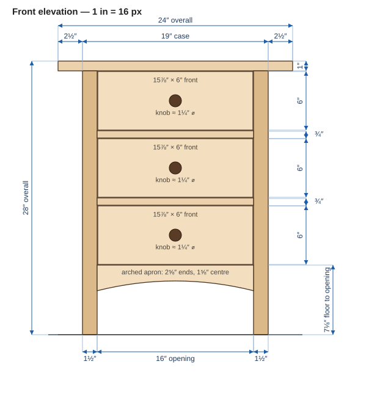
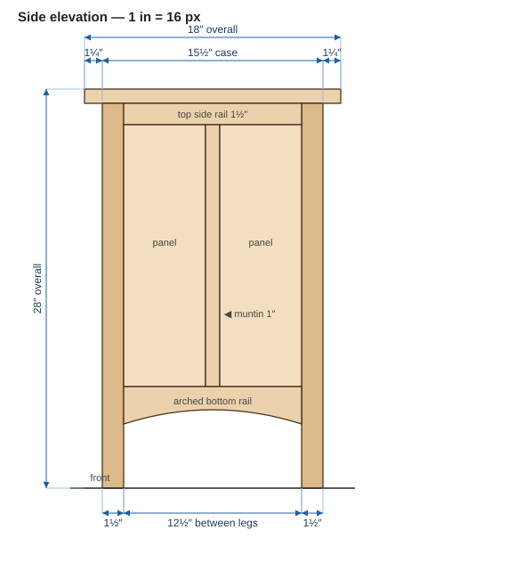
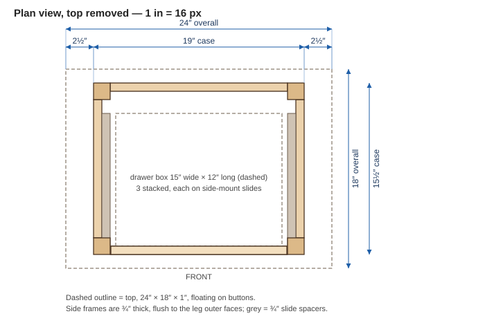
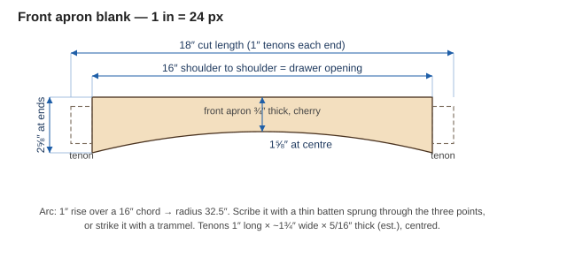

A **proposed** build — a copy of the Vermont Furniture Designs *Heartwood Shaker 3-Drawer Nightstand* ([product page](https://vermontwoodsstudios.com/products/heartwood-shaker-3-drawer-night-stand), [archive](https://web.archive.org/web/2024/https://vermontwoodsstudios.com/products/heartwood-shaker-3-drawer-night-stand)), with the proportions taken from the maker's photos and drawing. Three equal drawers stacked under a top that flares out past the case at the ends, four straight legs, an arched apron across the front, and frame-and-panel sides.

> **Provenance of the numbers.** The maker publishes only the overall size and the construction notes. **(stated)** = from the maker's page. **(derived)** = worked out from other numbers here so everything closes. **(est.)** = measured off the maker's front photo, dimensioned drawing and three-quarter photo — good to about ±¼″ at best. The front/back overhang in particular is **borrowed from a sibling model** (the Heartwood Shaker End Table), because it cannot be read from a front view. Check the (est.) items before cutting.

## Stated by the maker

| Item | Value |
|---|---|
| Overall | **24″ W × 18″ D × 28″ H** (stated) |
| Drawers | 3, dovetailed; beech sides, backs and bottoms; high-end metal slides (stated) |
| Knobs | Matching hardwood (stated) |
| Case | Solid-wood sides; hardwood-plywood back (stated) |
| Species | Cherry, maple or walnut (stated) |
| Finish | Cherry/walnut: hand-rubbed linseed oil + wax. Maple: tung oil + wax (stated) |

## Drawings (true scale)

Drawn at 1″ = 16 px from the dimensions on this page. Click to open full size.

**Front elevation**

**Side elevation**

**Plan view, top removed**

**Arched front apron**

## The ratios

| Derived | Working | Result |
|---|---|---|
| Case width | 24 − 2 × 2½ (end overhang) | **19″** (derived) |
| Case depth | 18 − 2 × 1¼ (front/back overhang) | **15½″** (derived) |
| Drawer opening between legs | 19 − 2 × 1½ | **16″** (derived — matches the ≈16″ measured on the photo and drawing) |
| Drawer front width | 16 − 2 × 1/16 | **15⅞″** (derived) |
| Drawer stack | 3 × 6″ + 2 × ¾″ rails + 6 × 1/16″ reveals | **19⅞″** (derived) |
| Floor to bottom of lowest opening | 28 − 1 (top) − 19⅞ | **7⅛″** (derived — matches ≈ 7¼″ measured) |
| Front apron, ends / centre | 7⅛″ band: ends 2⅝″, centre 1⅝″ | 1″ rise (est.) |

| Proportion | Value |
|---|---|
| Width : height | 24 : 28 ≈ **0.86 : 1** |
| Width : depth | 24 : 18 = **4 : 3** |
| Case width ÷ overall width | 19 ÷ 24 ≈ **0.79** (each end overhang ≈ 10.4 %) |
| Drawer front height ÷ width | 6 ÷ 15⅞ ≈ **0.38** |
| Drawer stack ÷ overall height | 19⅞ ÷ 28 ≈ **0.71** |
| Floor to opening ÷ overall height | 7⅛ ÷ 28 ≈ **0.25** |

**To resize:** multiply every dimension by one factor *k* and the proportions hold; round the stock thicknesses (¾″ rails, 1½″ legs) to what you have and keep the drawer fronts equal.

## Dimensions that are estimates

| Item | Value | Basis |
|---|---|---|
| End overhang | **2½″** | ≈ 2½″ scaled off both the front photo and the dimensioned drawing |
| Front/back overhang | **1¼″** | Not visible from the front; matches the maker's Heartwood Shaker End Table (listed 1¼″ front/back, 2″ sides) |
| Top thickness | **1″** (thin edge, bevelled underneath) | ≈ 1″ in the front photo; the three-quarter photo shows the edge tapered to roughly ⅜″ |
| Leg section | **1½″ square** | ≈ 1.5″ in the drawing; ≈ 1.1–1.4″ in the photos, so it may be a little lighter. 1½″ makes the 16″ opening close |
| Drawer front height | **6″** | ≈ 6.0″ in both straight-on views |
| Rails between drawers | **¾″** | ≈ 0.85″ visible including reveals |
| Knob | **1¼″ diameter**, centred on each front | Round, ≈ 1¼″ in the front photo |
| Top side rail / muntin | **1½″ / 1″** | Three-quarter photo shows a top rail, one centre muntin and two panels per side |
| Slide clearance | **½″ per side** | Typical side-mount metal slide; confirm against the slide you buy |

## Cut list

T × W × L, cut to length. **1″ tenons are baked into rail lengths.** Cherry for the case and drawer fronts; beech (or maple) for drawer boxes.

### Case

| Part | Qty | Stock | T × W × L | Notes |
|---|---|---|---|---|
| Legs | 4 | 8/4 | 1½″ × 1½″ × 27″ | Height 28 − 1 top. Soft radius on the foot end, as in the photo |
| Front apron (arched) | 1 | 4/4 | ¾″ × 2⅝″ × 18″ | Arch cut on the bottom edge: 1″ rise over the 16″ between shoulders (radius 32½″) — see the apron drawing |
| Front rails | 2 | 4/4 | ¾″ × ¾″ × 18″ | Between drawers. 16″ between shoulders |
| Back top rail | 1 | 4/4 | ¾″ × 1½″ × 18″ | Grooved for the back panel |
| Back bottom rail | 1 | 4/4 | ¾″ × 2⅝″ × 18″ | Straight; grooved for the back panel |
| Back panel | 1 | ¼″ hardwood ply | ¼″ × 16⅜″ × 19⅜″ | Floats in grooves (stated: plywood back) |
| Top side rails | 2 | 4/4 | ¾″ × 1½″ × 14½″ | 12½″ between shoulders; flush to leg outer face |
| Bottom side rails (arched) | 2 | 4/4 | ¾″ × 2⅝″ × 14½″ | Same 1″-rise arch as the front, here over 12½″ |
| Side muntins | 2 | 4/4 | ¾″ × 1″ × as fitted | Between top and bottom side rails; grooved both edges |
| Side panels | 4 | 4/4 resawn | ½″ × 6⅜″ × 19⅛″ | Two per side; float in ⅜″ grooves (width and height include groove depth, less ⅛″) |
| Slide spacers | 2 | 4/4 | ¾″ × 2″ × 12″ | Screwed to the inside of the side frames so the slide face sits at the drawer-box edge |
| Top | 1 | 4/4 | 1″ × 18″ × 24″ | Floats on buttons; underside bevelled toward the edge |

(Rails and aprons are shown flush to the leg faces on the outside. Side-rail tenons are about 5/16″ thick; the front-rail tenon is short because the rail is only ¾″ tall — use ¼″ × ½″.)

### Drawers (× 3, identical)

| Part | Qty each | T × W × L | Notes |
|---|---|---|---|
| Front | 1 | ¾″ × 6″ × 15⅞″ | Cherry, grain-matched top to bottom; 1/16″ reveals |
| Sides | 2 | ½″ × 5″ × 12″ | Beech; dovetailed |
| Back | 1 | ½″ × 4½″ × 14″ | Beech; dovetailed |
| Bottom | 1 | ¼″ × as fitted | Beech; floats in a groove |
| Knob | 1 | 1¼″ ⌀ | Matching cherry, turned or shaped |

The box is 15″ wide overall (½″ slide clearance each side of the 16″ opening), so its interior is about 14″ wide — close to the 14¼″ the maker lists for a sibling nightstand. Box length of 12″ fits a 12″ slide with room behind for the back panel.

## Build sequence

1. Mill the 8/4 for legs, then the 4/4 in stages, resting between passes.
2. Cut mortises and tenons for the legs. Cut the two arches on the front apron and the bottom side rails before assembly.
3. Groove the side rails, muntins and legs for the panels. Make the four panels, finish them before assembly so no bare wood shows when they move.
4. Glue up each side frame (legs + top rail + bottom rail + muntin + two panels). Drawbore the leg joints if you like.
5. Join the two sides with the front apron, the two front rails and the back rails. Dry-clamp first; the opening must be **16″** and the case **19″ × 15½″**.
6. Slide the back panel into its grooves before the last rail goes in.
7. Screw on the slide spacers, then build and dovetail the three drawers and hang them on the slides.
8. Make and fit the knobs.
9. Finish with hand-rubbed linseed oil and wax (cherry), matching the maker.
10. Attach the top with buttons so it can move seasonally. Centre it: **2½″ at each end, 1¼″ front and back.**

## Domino option

A Domino is a **poor fit for the leg joints** on this piece, and a good fit for the muntins.

**Why:** the 1½″ legs take several joints at the same height. At each back corner, the back top rail and the top side rail both enter at the top; at every corner the arched aprons and bottom rails (2⅝″ tall) meet at the same level. Two Domino mortises from adjacent faces cross inside the leg, so they would have to be staggered in height, and 1½″ and 2⅝″ parts don't have room to stagger. The hand-cut plan avoids the collision by mitering tenon tips.

| Joint | Option | Notes |
|---|---|---|
| Leg joints (rails, aprons) | **Hand-cut or router-cut tenons**, tips mitered | As in the cherry console plan |
| Front rails (¾″ × ¾″) | Stub tenon | A ¾″-tall rail is too small for a standard Domino (a 4×20 does not fit) |
| Side muntins (¾″ × 1″, ×2) | **1 × 4×20 Domino per end** | Fits the 1″ width; cut the muntin shoulder-to-shoulder |
| Back panel, side panels | Unchanged | Float in grooves |

- If you still want Dominoes at the leg corners, stagger by height and widen the legs to 1¾″ so the mortises have room — but that changes the 16″ opening, so every other dimension on the page moves with it.

## Open questions

- **Front/back overhang** — 1¼″ is borrowed from the sibling model; the three-quarter photo suggests it is in that range but doesn't prove it.
- **Leg section** — 1½″ closes the 16″ opening, but the photos read as slightly lighter. If you go to 1¼″, either widen the case to 19½″ or widen the opening to 16½″ and the drawer fronts to 16⅜″.
- **Drawer depth** — 12″ box length is my choice; the maker doesn't state it.
