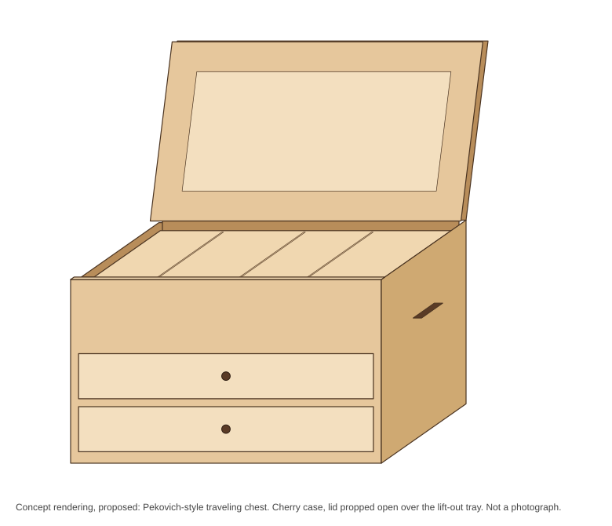
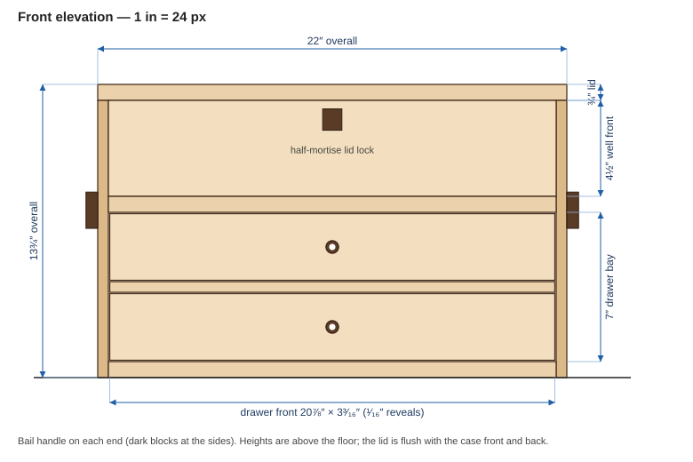
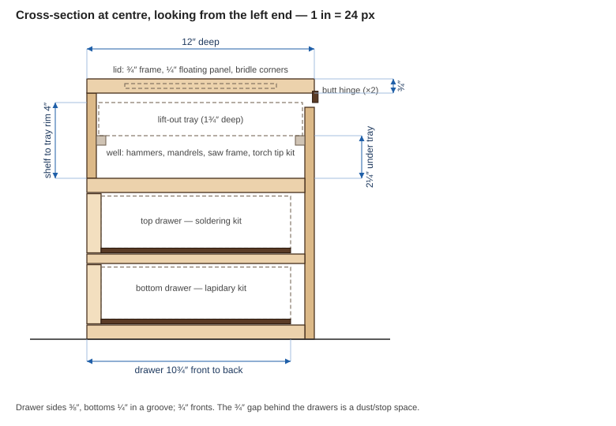
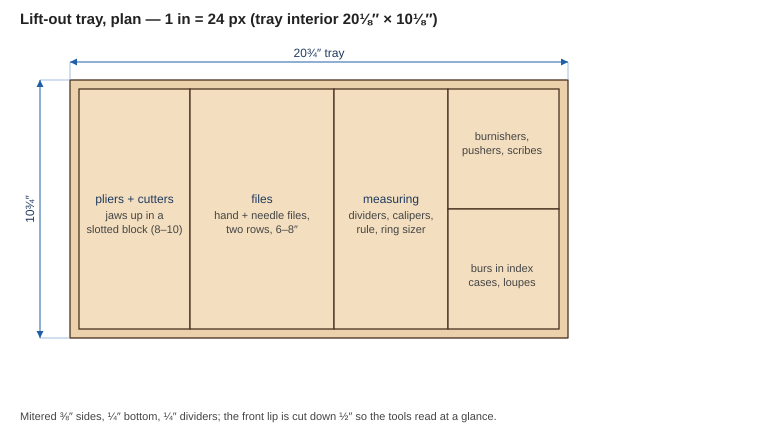
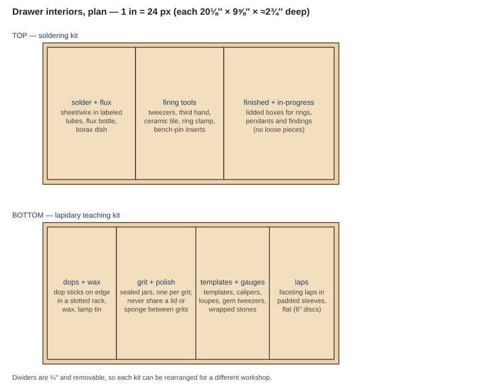

A tool chest for a **jeweler who solders rings and pendants and teaches lapidary workshops** (domed cabochons and flat/faceted stones). It has to do two jobs: sit on a bench as a daily soldering kit, and travel to a workshop with a lapidary teaching kit. Two classic chest styles fit; this page compares them, then lays out a **proposed** build modeled on Mike Pekovich's traveling tool chest, resized and re-organized for jewelry and lapidary tools.

> **Provenance of the numbers.** Pekovich's chest is a course product, and its page publishes **no dimensions, species or drawer count**, so this is a *design inspired by it*, not a copy. **(stated)** = from the course page. **(derived)** = worked out from the sizes I chose so everything closes. **(est.)** = typical sizes of tools and supplies, which vary by brand: put your own tools on the bench and check them before cutting.

**The finished chest (concept rendering)**

Nothing here is built yet, so this is a drawing from the plan sizes, not a photograph.

## Two styles to choose from

| | **Pekovich traveling chest** | **Dutch tool chest** |
|---|---|---|
| Shape | Rectangular case, flat frame-and-panel lid, drawers under an open well | Sloped lid, two tiers, fall front (see below) |
| Made to | Be carried: side handles, lock, modest size | Hold a full set of woodworking hand tools |
| Strength | Tidy small tools: lift-out tray, two drawers, lockable | Big tools: planes, saws, chisels, in a light pine box |
| Weak point here | A well too shallow for long tools | Jeweler's tools are small and need separating; a big open well does not give you that |

**Pick: the Pekovich style.** A jeweler's kit is hundreds of small, fragile or expensive pieces (stones, laps, burs, solder). They want dividers, a lock, and a carry size, and not a big open well. The standard Dutch chest, described next, is the better answer for *planes and saws*.

### The standard Dutch tool chest

For comparison, this is the chest the Dutch style is known for: a woodworker's tool chest, not a jeweler's. I read two pages for it, so what follows is what they say and little more. Christopher Schwarz's book [*Dutch Tool Chests*](https://lostartpress.com/products/dutch-tool-chests) is the place for dimensions and joinery; I could not open that page.

| Item | What the sources say |
|---|---|
| Lid | "Perhaps the chest's most distinctive characteristic is its sloped lid" (stated, [Fine Woodworking](https://www.finewoodworking.com/2021/11/01/how-to-build-a-dutch-tool-chest)). A search summary of a Schwarz video gives about 30°; I did not confirm it |
| Tiers | A top tier for chisels, saws, planes and layout tools, and a bottom sized for molding and joinery planes and tool rolls (stated, Fine Woodworking) |
| Fall front | Has battens; they work best when set no more than ⅛″ inside the case sides (stated, Fine Woodworking) |
| Joinery | Dovetails at the bottom only, plus dadoes, rabbets and cut nails (stated, Fine Woodworking); screws are not required, and cut nails or wooden pegs work (stated, [Popular Woodworking](https://popularwoodworking.com/editors-blog/details-on-the-dutch-tool-chests)) |
| Wood | Pine "or another lightweight wood"; "the cheapest, lightest wood that is available" (stated) |
| Size | One build's interior depth is 11¼″, the width of a 1×12 (stated, Fine Woodworking). Overall sizes are not stated in what I could read; the "big" chest is said to hold as many tools as a full-size English floor chest (stated, Popular Woodworking) |
| Hardware and finish | Strap hinges and lifts; commonly painted, historically often blue (stated, Popular Woodworking) |
| Not found | Overall dimensions, the side profile, dado heights, and any sliding or saw till |

**What it means for a jeweler's chest.** The Dutch chest suits a woodworker's long, heavy tools in a light box that is simple to build. A jeweler's kit is small and needs separating, which is why this page builds the Pekovich style. The one idea worth borrowing is the **two tiers**: small tools on top, heavier ones below. The proposed chest already does this with its tray and drawers.

### What Pekovich's course covers (stated)

From [the course page](https://courses.finewoodworking.com/build-tool-chest-mike-pekovich) ([archive](https://web.archive.org/web/2024/https://courses.finewoodworking.com/build-tool-chest-mike-pekovich)), titled *Build a Traveling Tool Chest with Mike Pekovich*:

| Item | Value |
|---|---|
| Corner joints | Dovetails at the bottom corners, tails cut at the table saw (stated) |
| Shelf | Through-tenons, laid out together with the mortises (stated) |
| Case assembly | Glued up, tenons wedged, then drilled and pinned (stated) |
| Case front | Mortised for a lid lock (stated) |
| Lid | Frame-and-panel, with **bridle joints** at the corners (stated) |
| Drawers | Pinned rabbet drawers (stated) |
| Storage | Lift-out mitered trays, slotted blocks for saws, other tool-holding features (stated) |
| Level / length | Intermediate; over 10 hours of instruction; downloadable plans (stated) |
| Not stated | Overall size, species, drawer count, hinge type, handles |

If you build from this page, buy the course for the joinery: this page does not teach it.

## What the chest has to do

- **Hold two kits that are never used at the same time.** Soldering (daily, bench) and lapidary (workshop days) go in separate drawers, so you can lift out one kit.
- **Stay light enough to carry.** The case alone is about **22 lb** in cherry (**derived**: ½″ case parts, ¾″ shelf and bottom, cherry at about 35 lb/ft³). Tools add roughly 15–20 lb (**est.**). Plan on two bail handles and, at about 40 lb loaded, a second person for stairs.
- **Keep the abrasives apart.** In cabbing, a single grain of a coarse grit on a fine pad leaves scratches that cost a whole polishing step. Each grit gets its own sealed jar, and laps stay in their own sleeves.
- **Keep acid and water out.** Pickle (Sparex or citric) and wet lapidary slurry corrode steel tools and stain wood. The chest holds **dry, clean** tools only; carry wet items in a separate tub.
- **Protect metal and stones.** Many woods give off organic acids, and oak is the usual one to avoid near steel and silver. Use cherry or maple, finish the inside with dewaxed shellac, and wax it. Keep loose stones in lidded boxes or gem papers, not in open tray compartments.
- **Be lockable.** A half-mortise lid lock (the course installs one) deters casual theft but does not stop a determined one. A chest with stones and precious metal also needs insurance, which a lock does not replace.

## The proposed chest

Overall **22″ W × 12″ D × 13¾″ H** (derived: chosen so a 21″ interior fits files and a 12″ mandrel with room), with a lift-out tray and a drawer bay of two equal drawers.

| Item | Value |
|---|---|
| Overall | 22″ × 12″ × 13¾″ (derived) |
| Case height / lid | 13″ case + ¾″ lid (derived) |
| Case parts | ½″ sides, back and well front; ¾″ bottom and shelf (derived) |
| Well front | 4½″ tall (derived) |
| Drawer bay | 7″: two openings 3¼″ with a ½″ rail between (derived) |
| Drawer fronts | 20⅞″ × 3³⁄₁₆″, ¹⁄₁₆″ reveals (derived) |
| Drawer interior | about 20⅛″ × 9⅝″ × 2¾″ (derived) |
| Tray | 20¾″ × 10¾″ × 1¾″, resting on ½″ cleats (derived) |
| Species | Cherry or maple case, maple drawer sides (proposed) |

## Drawings (true scale)

Drawn at 1″ = 24 px from the sizes on this page. Click to open full size.

**Front elevation**

**Cross-section at centre**

**Lift-out tray**

**Drawer layouts**

## What goes where

| Zone | Contents | Why here |
|---|---|---|
| **Tray** | Pliers and cutters (jaws up in a slotted block), needle and hand files, dividers, calipers, steel rule, ring sizer, burnishers, pushers, scribes, burs in index cases, loupes | Used constantly on both kinds of day; lift the tray out and the well is clear |
| **Well** (about 2¼″ under the tray) | Hammers and mallets, a 12″ ring mandrel (bracelet mandrel if it fits), saw frame and blades, torch tips | Heavier, longer, or used less often |
| **Top drawer: soldering** | Solder sheet and wire in labeled tubes, flux, borax dish, tweezers, third hand, a ceramic tile, ring clamp, spare bench-pin inserts, lidded boxes for work in progress | Daily bench kit; sits right under the tray |
| **Bottom drawer: lapidary** | Dop sticks on edge in a slotted rack, dop wax, one sealed jar per grit and polish, cabochon templates, calipers, loupes, gem tweezers, wrapped stones, faceting laps in padded sleeves | Heavy, so it rides low; opens fully for a workshop table |
| **Not in the chest** | Torch, hoses and fuel; pickle pot; wet grinders, saws and the faceting machine; anything wet | Fire, acid and water; the workshop venue normally supplies the machines (see Open questions) |

> **Fire.** The chest is a wooden box. Close it before lighting a torch, keep it out of the soldering area, and never leave a hot tile, torch or alcohol lamp on or inside it.

## Cut list (proposed)

Finished sizes in inches, thickness × width × length. Check against your own layout before cutting.

| Part | Qty | Size | Notes |
|---|---|---|---|
| Sides | 2 | ½ × 12 × 13 | Dovetailed to the well front and back; grooved for the bottom and shelf |
| Well front | 1 | ½ × 4½ × 21 | Mortised for the lid lock |
| Back | 1 | ½ × 21 × 12¼ | Rabbeted into the sides |
| Bottom | 1 | ¾ × 11½ × 21 | In grooves in the sides |
| Shelf | 1 | ¾ × 11½ × 22 | Through-tenoned into the sides: 22″ includes the tenons |
| Drawer rail | 1 | ½ × ¾ × 21 | Full depth |
| Lid frame | 4 | ¾ × 2 × 22 (long), ¾ × 2 × 12 (short) | Bridle corners, grooved ¼″ for the panel |
| Lid panel | 1 | ¼ × 8⅜ × 18⅜ | Floats in the groove |
| Drawer fronts | 2 | ¾ × 3³⁄₁₆ × 20⅞ | Pulls: small wire rings |
| Drawer sides | 4 | ⅜ × 3 × 10 | Maple |
| Drawer backs | 2 | ⅜ × 2¾ × 20⅛ | |
| Drawer bottoms | 2 | ¼ × 9⅝ × 20⅛ | |
| Tray cleats | 2 | ½ × ½ × 21 | Top face 10¾″ above the floor |
| Tray | 1 set | ⅜ sides, ¼ bottom, ¼ dividers | Mitered |

Hardware: two butt hinges and a cord or chain stay (as in the photo), one half-mortise lock, two bail handles, two ring pulls.

## Build order

1. **Mock up and check the tools.** Lay your actual tools on the tray and drawer footprints. Move dividers before cutting any wood. Most fixes here cost nothing.
2. **Mill the stock** and cut the sides, well front, back, bottom and shelf to length.
3. **Cut the joints:** dovetails for the well front and back, grooves for the bottom, rabbet for the back, mortises for the shelf's through-tenons.
4. **Dry-fit,** then glue the case. Wedge and pin the shelf tenons.
5. **Make the lid:** bridle-jointed frame, floating panel, then hang it with two butt hinges and fit the stay and the lock.
6. **Fit the drawer rail, make the drawers,** then plane the fronts to ¹⁄₁₆″ reveals.
7. **Make the tray and cleats,** and cut the dividers last so they fit the finished drawers.
8. **Finish:** dewaxed shellac inside, shellac and wax outside. Let it cure fully before you load the tools.
9. **Handles and pulls.**

## Open questions

- **What the workshops supply.** This plan assumes the venue provides the grinders, trim saw and faceting machine, so the chest carries only hand tools and consumables. If you bring a faceting head or a small cab machine, it needs its own case.
- **The meaning of "flat/faceted ground."** I read it as flat-lapped and faceted stones next to domed cabochons. If it means something else, the laps and dops section changes.
- **Lap size.** The laps drawer assumes 6″ discs. 8″ laps do not fit a 9⅝″ drawer with their sleeves, so check yours.
- **Weight.** About 22 lb empty is heavy for a chest that will go up stairs. Basswood or poplar drawers, or ⅜″ case parts, save about 4 lb; I kept ½″ for the dovetails and handles.
- **Hinge, lock and handle choices.** The course page does not name them; the ones above are my choice.
