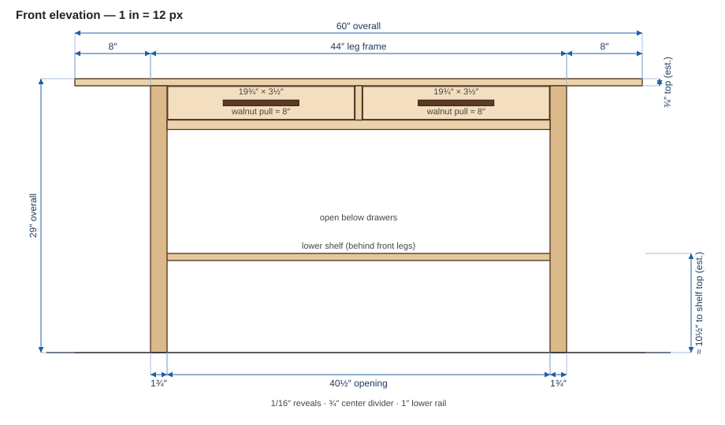
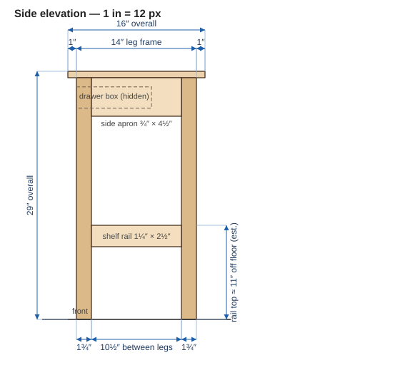
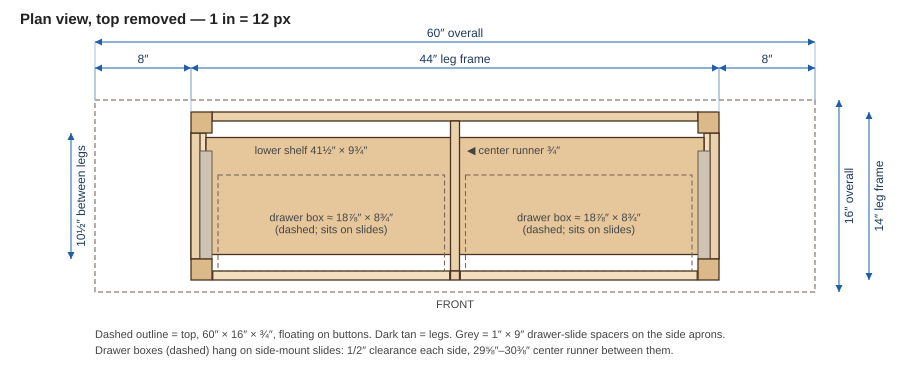

A **proposed** build — a copy of the Vermont Woods Studios / Vermont Furniture Designs *Modern Craftsman 2-Drawer Console Table* ([product page](https://vermontwoodsstudios.com/products/modern-craftsman-2-drawer-console-table), [archive](https://web.archive.org/web/2024/https://vermontwoodsstudios.com/products/modern-craftsman-2-drawer-console-table)), with the **proportions held to the maker's published numbers**. A long, low console: a wide, thin top that overhangs the leg frame by a lot at the ends, two shallow drawers hung right under the top, and a narrow lower shelf carried on chunky side rails.

> **Provenance of the numbers.** Dimensions marked **(stated)** come straight from the maker's *Dimensions* and *Construction Details* panels. Dimensions marked **(derived)** are worked out from the stated ones so everything closes. Dimensions marked **(est.)** are measured off the maker's front and three-quarter photos — good to roughly ±¼″ — and are the ones to sanity-check against the real piece, or against your own taste, before cutting.

## Stated by the maker

| Item | Value |
|---|---|
| Overall | **60″ W × 16″ D × 29″ H** (stated) |
| Top overhang, ends | **8″** (stated) |
| Top overhang, front/back | **1″** (stated) |
| Drawer front (exterior) | **19.75″ W × 3.5″ H** (stated) |
| Drawer interior | **18″ W × 7.5″ D × 2″ H** (stated) |
| Bottom shelf | **41.5″ W × 9.75″ D** (stated) |
| Species | Cherry, maple or walnut (stated) |
| Drawers | Dovetailed; beech sides, back and bottom; metal slides; **walnut pulls** (stated) |
| Finish | Cherry/walnut: hand-rubbed linseed oil + wax. Maple: tung oil + wax (stated) |

## Drawings (true scale)

All three are drawn at 1″ = 12 px from the dimensions on this page, so they can be measured against each other. Click to open full size.

**Front elevation**

**Side elevation**

**Plan view, top removed**

## The ratios

Everything hangs off the **60″ overall width** and the **8″ / 1″ overhangs**. The frame is whatever is left:

| Derived | Working | Result |
|---|---|---|
| Leg frame, width | 60 − 2 × 8 | **44″** (derived) |
| Leg frame, depth | 16 − 2 × 1 | **14″** (derived) |
| Frame opening between front legs | 44 − 2 × 1¾ | **40½″** (derived) |
| Two drawer fronts + divider + reveals | 2 × 19.75 + ¾ + 4 × 1/16 | **40½″** (derived — fills the opening exactly) |
| Shelf width | 44 − 2 × 1¼ (side-rail thickness) | **41½″** (derived — matches stated shelf width) |
| Shoulder-to-shoulder, front↔back | 14 − 2 × 1¾ | **10½″** (derived; shelf is 9¾″, leaving ¾″) |

That the two independent checks (drawers fill 40½″; shelf lands on 41½″ with 1¼″ rails) both close is the evidence that the **1¾″ legs** and **1¼″-thick side rails** are right.

| Proportion | Value |
|---|---|
| Width : height | 60 : 29 ≈ **2.07 : 1** |
| Width : depth | 60 : 16 = **3.75 : 1** |
| Frame width ÷ overall width | 44 ÷ 60 ≈ **0.733** (each end overhang = 13.3 %) |
| Drawer front width ÷ overall width | 19.75 ÷ 60 ≈ 0.33 |
| Drawer front height ÷ overall height | 3.5 ÷ 29 ≈ 0.12 |
| Leg width ÷ overall height | 1¾ ÷ 29 ≈ 0.06 |
| Shelf top height ÷ overall height | ≈ 10½ ÷ 29 ≈ 0.36 (est.) |

**To resize:** multiply every dimension by one factor *k* (so 48″ long → *k* = 0.8) and the proportions hold. Round leg and rail sections to stock, but do **not** change the 8″-end / 1″-front overhang *ratio* independently of the width — the long ends are the look.

## Dimensions that are estimates

| Item | Value | Basis |
|---|---|---|
| Top thickness | **¾″** (est.) | ≈ 14 px against a 3.5″ drawer front at ≈ 66 px in the front photo. Could be 1″; ¾″ keeps the 8″ cantilever light |
| Leg section | **1¾″ square** (est.) | ≈ 1.85″ measured, and 1¾″ is what makes both closures above work |
| Shelf top above floor | **≈ 10½″** (est.) | Front photo, scaled against the 29″ height |
| Lower drawer rail | **¾″ thick × 1″ tall** (est.) | Thin strip under the drawers in the front photo |
| Center divider | **¾″ wide** (est.) | Narrow stile between the drawers |
| Side aprons | **4½″ tall** (est.) | Solid panel under the top at the ends in the three-quarter photo |
| Pull | **8″ × ⅝″ × 1″** (est.), walnut | ≈ 8″ long against the 19.75″ drawer front; stand-off finger pull |

## Cut list

T × W × L, cut to length — **1″ tenons are baked into rail and apron lengths.** Species: cherry (or maple/walnut) for the case; beech (or maple) for drawer boxes.

### Case

| Part | Qty | T × W × L | Notes |
|---|---|---|---|
| Legs | 4 | 1¾″ × 1¾″ × 28¼″ | 8/4 stock. Height = 29 − ¾ top |
| Lower front rail | 1 | ¾″ × 1″ × 42½″ | Under the drawers; 40½″ between shoulders; 1″ tenons |
| Back apron | 1 | ¾″ × 4½″ × 42½″ | 1″ tenons |
| Side aprons | 2 | ¾″ × 4½″ × 12½″ | 10½″ between shoulders; 1″ tenons |
| Center divider | 1 | ¾″ × ¾″ × 3⅝″ | Underside of top to lower front rail; pinned to the front of the center runner |
| Center runner | 1 | ¾″ × 3″ × 12½″ | Lower front rail to back apron, centered; slides mount on both faces. Housed in both |
| Slide spacers | 2 | 1″ × 3″ × 9″ | Screwed to the inside of the side aprons so the slide face sits at the drawer-box edge |
| Shelf side rails | 2 | 1¼″ × 2½″ × 12½″ | Flush to leg outer faces; 10½″ between shoulders; top ≈ 11″ off floor |
| Shelf cleats | 2 | ¾″ × ¾″ × 9¾″ | Glue/screw to rail inner faces to carry the shelf |
| Shelf | 1 | ¾″ × 9¾″ × 41½″ | Sits between the side rails, centered front-to-back (⅜″ setback each side) |
| Top | 1 | ¾″ × 16″ × 60″ | Floats; buttons or figure-8s, never glued |

The runner and spacers are sized for ½″-per-side slides — adjust them if the slides you buy need more or less clearance.

### Drawers (×2, identical)

| Part | Qty each | T × W × L | Notes |
|---|---|---|---|
| Front | 1 | ¾″ × 3½″ × 19¾″ | Cherry, grain-matched to the case; 1/16″ reveals all round |
| Sides | 2 | ½″ × 2½″ × 8½″ | Beech; dovetailed to front and back |
| Back | 1 | ½″ × 2½″ × 18″ (between sides) | Beech |
| Bottom | 1 | ¼″ × as fitted | Beech; in a groove, floating |
| Pull | 1 | 8″ × ⅝″ × 1″ | Walnut; two screws from the inside |

The stated **18″ × 7½″ × 2″ interior** sets the drawer box: 18″ clear between sides gives a box about 19″ wide overall, so ½″-per-side slides fit the 19.875″ opening. The 7½″ box depth sits in a 14″ frame, so there is room behind the drawers — decide whether to close it with a back panel (the maker uses plywood backs on case pieces) or leave it open.

## Build sequence

1. Mill legs from 8/4 and everything else to size; let stock sit between passes — cherry moves.
2. Cut mortises and tenons (5/16″–⅜″ mortises, 1″ deep). Miter tenon tips where two meet inside a leg.
3. Dry-fit the two end frames: leg pair + side apron + shelf side rail. Confirm the **10½″** shoulder distance and that the rail sits flush to the leg outer face.
4. Glue up the ends, then join them with the front and back aprons and the lower front rail. Dry-clamp first and check the **40½″** opening and the **44″ × 14″** frame for square. Drawbore if you like — optional here, since the top and drawers add little racking load.
5. Fit the center runner and divider and check the two drawer openings are equal (≈ 19⅞″ each with 1/16″ reveals).
6. Screw on the slide spacers, add the shelf cleats and drop in the shelf. The shelf carries load, so keep the cleats glued and screwed.
7. Build and dovetail the drawers, fit the slides, then trim the fronts to a 1/16″ reveal.
8. Make the walnut pulls and fit them.
9. Finish: hand-rubbed linseed oil and wax for cherry and walnut (tung oil and wax for maple), matching the maker. Scrape off all squeeze-out first.
10. Attach the top with buttons so it can move seasonally. Center it: **8″ at each end, 1″ front and back.**

## Domino option

A Festool Domino can cut most of the joints instead of hand-cut tenons. The 5/16″ mortise in this plan matches an **8 mm Domino**; a 40 mm Domino goes 20 mm (¾″) into each part, a 50 mm Domino 25 mm (1″).

**Rule at a leg corner:** two mortises entering from adjacent faces cross inside the leg, so **no two Domino mortises in a leg may be at the same height** — stagger them. (The hand-cut plan avoids this by mitering tenon tips, which a loose tenon can't do.)

| Joint | Domino | Cut length (was) |
|---|---|---|
| Back apron (¾″ × 4½″) | 1 × 8×40 per end, centred **25 mm below the apron's top edge** | **40½″** (42½″) |
| Side aprons (×2) | 1 × 8×40 per end, centred **70 mm below the apron's top edge** | **10½″** (12½″) |
| Lower front rail (¾″ × 1″) | 1 × 4×20 per end, centred on the rail | **40½″** (42½″) |
| Shelf side rails (×2, 1¼″ × 2½″) | 1 × 8×50 per end, centred | **10½″** (12½″) |
| Center runner | Keep it housed in the lower front rail and back apron | 12½″ (unchanged) |

- With the Domino, **cut length = shoulder-to-shoulder** (40½″ and 10½″).
- At the back legs the back apron (upper) and side apron (lower) are staggered. At the front legs the side apron (lower-middle of its 4½″) stays clear of the lower front rail's 4×20.
- The 1″ lower front rail is the weak spot — a 4×20 is the largest Domino that fits. It is lightly loaded and the center runner and divider support it, but if you want more, use a shop-made stub tenon.
- Keep the aprons flush to the leg outer faces and centre each mortise on the part's thickness.

## Open questions

- **Top thickness** — ¾″ is estimated; if the real piece reads chunkier, 1″ is the likely answer. Re-check drawer front height (3.5″) against it.
- **Shelf height** — about 10½″ to the shelf top is estimated from photos.
- **Frame joinery** — the maker's page does not say how the legs and rails are joined, so mortise-and-tenon here is my choice, to match the other console plan on this site.
- **Space behind the drawers** — see the note above.
