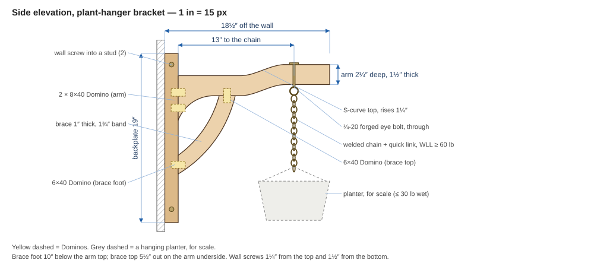
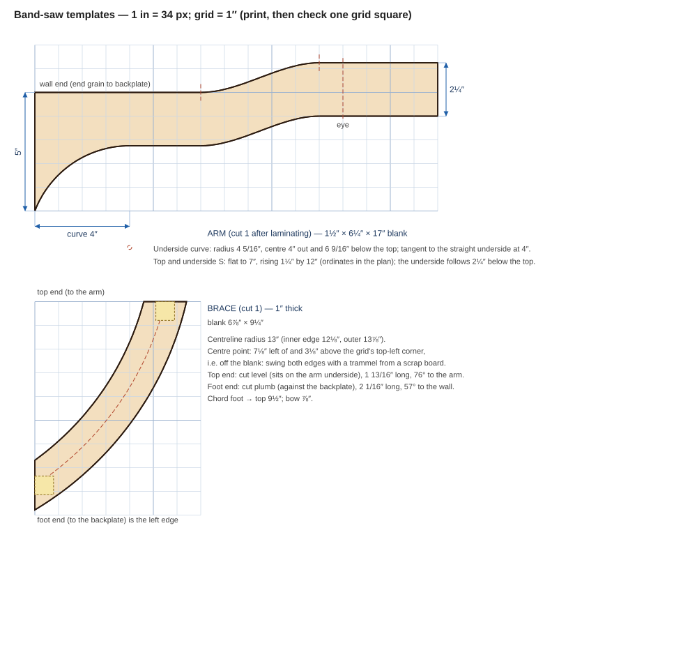

A **proposed** build: a wall bracket with a band-sawn arm whose top rises in a gentle S toward the tip, a curved brace, and a forged eye bolt near the tip for hanging a planter on a chain. The joinery is all **Festool Domino** and the shaping is all **table saw and band saw**, plus a drill. No router is needed.

> **Provenance of the numbers.** This is an original design based on an AI-generated picture you sent, so no maker's dimensions exist. **(design)** = a size I chose. **(derived)** = worked out from those so the parts close. The drawings come from `tools/woodworking/plant_hanger_bracket_drawings.py`. Change a constant there and re-run it, and the SVGs and the printed numbers move together.

## Drawings

Click either drawing to open it full size.

**Side elevation**

**Band-saw templates: arm and brace (1″ grid)**

## Design in one paragraph

A **1½″ × 3½″ × 19″ backplate** screws to a wall stud. A **1½″-thick arm** (two ¾″ laminations) reaches **17″** out from it. The arm is **2¼″ deep** and sweeps down to **5″** where it meets the backplate. Its top runs level for 7″, then rises **1¼″ in a gentle S** by 12″ out and runs level again to the tip; the underside follows the same S, 2¼″ below. A **1″ × 1¾″ curved brace** runs from **10″ below the arm top** on the backplate up to the arm's underside **5½″ out**, on the level stretch before the S. A ¼-20 forged eye bolt **13″ out**, on the level tip, takes the chain. The bracket is sized for a **30 lb** hanging load, which covers a large hanging basket with wet soil.

## The numbers

| Item | Value |
|---|---|
| Overall | **18½″** off the wall × **19″** tall × **3½″** wide (derived); the arm tip is **1¼″** higher than the arm at the wall, still 1¼″ below the backplate top |
| Backplate | 1½″ × 3½″ × **19″**; top **2½″ above** the arm top, bottom 16½″ below (design) |
| Arm | 1½″ thick, **17″** long; **5″** deep at the wall, **2¼″** deep from 4″ out to the tip (design) |
| Arm top S-curve | level to **7″** out, rises **1¼″** by **12″** out, level to the tip. A smoothstep curve: no slope at either end, steepest (about 20°) at 9½″ (design) |
| Arm underside curve | radius **4 5/16″**, tangent to the straight underside 4″ out; it meets the backplate 5″ down (derived) |
| Brace | 1″ thick, **1¾″** band; centreline radius **13″**, bowed ⅞″ outward from its 9½″ chord (design / derived) |
| Brace ends | foot cut plumb, **2 1/16″** long, about 57° to the wall; top cut level, **1 13/16″** long, about 76° to the arm (derived) |
| Chain point | **13″** out from the backplate face, centred on the arm, on the level tip (design). That clears a planter up to about 22″ across from the wall |
| Design load | **30 lb** at the eye bolt (design) |

Arm underside, depth below the top face, measured out from the wall end (for laying out the curve without a compass):

| Out from the wall | 0 | ½″ | 1″ | 1½″ | 2″ | 2½″ | 3″ | 3½″ | 4″ |
|---|---|---|---|---|---|---|---|---|---|
| Depth | 5″ | 4 1/16″ | 3½″ | 3 1/16″ | 2¾″ | 2½″ | 2⅜″ | 2¼″ | 2¼″ |

Arm top S-curve, height above the top at the wall (the underside is the same line 2¼″ lower):

| Out from the wall | 7″ | 8″ | 9″ | 9½″ | 10″ | 11″ | 12″ to the tip |
|---|---|---|---|---|---|---|---|
| Rise | 0 | ⅛″ | 7/16″ | ⅝″ | 13/16″ | 1⅛″ | 1¼″ |

**Why the S sits where it does.** The two places a tool has to sit flat on the arm stay level and straight. The **brace's Domino landing** is the underside between 4″ and 7″ out: the machine's face sits on it, and the brace's top end is cut level to meet it. The **eye bolt** is on the level tip, so it goes in square and its washer seats flat. The S fills the 5″ between them.

## Stock

**White oak**, as in the picture; ash, cherry or walnut work too. About **1¾ bd ft net**, so buy **about 2½**: 8/4 for the backplate (or laminate two pieces of 4/4), 5/4 for the brace, and 4/4 for the arm laminations.

## Cut list

Finished sizes. Leave the arm and brace blanks rectangular until their Dominos are cut (see *Build order*).

| Part | Qty | T × W × L | Notes |
|---|---|---|---|
| Backplate | 1 | 1½″ × 3½″ × **19″** | |
| Arm laminations | 2 | ¾″ × **6¼″** × **17″** | Glue face to face to 1½″ × 6¼″ × 17″ (or use one piece of 8/4). The blank is 5″ + the 1¼″ rise |
| Brace blank | 1 | 1″ × **6⅞″ × 9¼″** | Squared first; the brace's two end cuts are the blank's top and left edges |

**Hardware:**

| Item | Qty | Notes |
|---|---|---|
| Wall screws | 2 | ¼″ × 4″ countersunk structural screws (or #14 × 4″ wood screws) with **brass cup washers**, into a stud |
| Eye bolt | 1 | ¼-20 × 3″ **forged shoulder** eye bolt, with a fender washer and nylon-insert nut. Check the stamped working load limit |
| Chain + link | as needed | Welded chain and a quick link, each with a stated **working load limit ≥ 60 lb** (2× the design load). Most decorative "lamp chain" isn't rated. Add a swivel if you want to turn the plant toward the light |

## Domino schedule

| Joint | Domino | Qty | Depth (part A / part B) | Notes |
|---|---|---|---|---|
| Arm → backplate | **8 × 40** | 2 | 20 mm in the arm end / 20 mm in the backplate face | Centres **1⅞″ and 3⅝″** below the arm top at the wall, on the glue line. In the square blank that's 3⅛″ and 4⅞″ below its top edge |
| Brace top → arm underside | **6 × 40** | 1 | 20 / 20 | Centre 5½″ out, on the level landing; plunged straight up into the arm **after** the arm is band-sawn |
| Brace foot → backplate | **6 × 40** | 1 | 20 / 20 | Centre 10″ below the arm top |

**Registering the angled brace joints.** Nothing on this bracket is cut at an angle on the Domino. Both of the brace's end cuts are **square edges of its rectangular blank**: the top end is the blank's top edge (it sits level on the arm) and the foot is the blank's left edge (it sits plumb on the backplate). So:

1. Square the 6⅞″ × 9¼″ blank and trace the template onto it. The brace's ends land on the blank's top and left edges.
2. Cut both brace mortises **while the blank is still rectangular**: one in the top edge 5½″ in from the left edge, one in the left edge 7¾″ down from the top. The fence references the blank's broad face, so each mortise is centred in the 1″ thickness and perpendicular to its edge.
3. Cut the mating mortise **square into the backplate's front face** (10″ below the arm top, on the centreline).
4. Then band-saw the brace. Its mortises point exactly where the joints need them: straight up into the arm and straight back into the backplate.

**The arm** works the same way in two steps:

1. In the square 6¼″ blank, cut the two **end mortises** for the backplate. The wall end is a straight, square cut that the S doesn't touch. Mark the mortise centres from the arm's top line, which sits 1¼″ below the blank's top edge at that end (3⅛″ and 4⅞″ down from the edge), and line up the Domino's centre mark on them.
2. Band-saw the arm, then **true the level landing** on the underside between 4″ and 7″ out with a block plane or a sanding block on a flat stick. Check it with a square off the wall end: it should be at 90°. Then cut the **brace-top mortise** into it at 5½″ out, with the Domino's face flat on the landing and the fence on the arm's side face. The haunch curve starts at 4″, the S at 7″, and the mortise is centred between them.

**Assembly order matters.** The brace's top Domino runs vertically, and its foot and the arm's Dominos run horizontally. Glue the **brace to the arm first**. Once that cures, the arm and brace slide onto the backplate in one **horizontal** move.

## Band-saw templates

Print the templates page at 100% and check one 1″ grid square with a rule. Or lay out from the numbers:

- **Arm top:** draw the top line level for 7″ from the wall end, then plot the S from the rise table (one point per inch is enough; 9½″ is the midpoint) and bend a thin batten through the points. Run it level from 12″ to the tip. Draw the underside S the same way, 2¼″ below.
- **Arm underside at the wall:** from the level underside at 4″ out, swing a **4 5/16″ radius** from a centre 4″ out and **6 9/16″ below the top edge** (off the blank, so clamp a scrap below it) from that point to the wall end, where it meets the end 5″ down. The ordinate table above gives the same curve. Saw to the waste side, then fair the curves with a spokeshave or a drum sander. Saw the top S on its own first, and keep that offcut: taped back on, it gives the blank a flat top to rest on while you saw the underside.
- **Brace:** the edges are concentric arcs, **12⅛″** (inner) and **13⅞″** (outer), from a centre **7⅛″ left of and 3⅛″ above** the blank's top-left corner. Screw a scrap board to the bench beside the blank and swing both arcs with a trammel or a stick with a nail and pencil. The centreline (13″) is dashed on the template.
- Keep the offcuts. The concave waste from the brace makes a matching **clamping caul** for both brace joints.

## Table-saw steps

1. **Rip and crosscut** the backplate, the two arm laminations and the brace blank. Glue the arm laminations face to face and let them cure.
2. **Square the ends:** cut the brace blank square and the arm's wall end dead square. These are the faces the Dominos reference.

## Load check

- **Load:** a 10–12″ hanging basket with wet soil is typically 10–20 lb. Everything is sized for **30 lb**.
- **Moment at the wall:** 30 lb × 14½″ (13″ to the chain + the 1½″ backplate) ≈ **435 in-lb**. The backplate tips about its bottom edge, so the top screw sees roughly 435 ÷ 17¾″ ≈ **25 lb** of pull. A ¼″ structural screw with 2″ in a stud holds several hundred pounds in withdrawal, more than a 10× margin. **It must go into a stud.** Don't hang this on drywall anchors. If there's no stud where you want it, screw a cleat across two studs first.
- **Arm joint:** with the brace foot 7¼″ below the arm's Dominos, the arm pulls off the backplate with about 30 lb × 13″ ÷ 7¼″ ≈ **54 lb**, and the brace pushes back with about the same force. Two glued 8 × 40 Dominos have close to 2 in² of glue surface each per side, which is hundreds of pounds even at a conservative 300 psi. If you want belt and braces, add two #10 × 3½″ screws from the back of the backplate into the arm's end. They're hidden against the wall.
- **Hardware:** the eye bolt, chain and link are the parts to buy rated (WLL ≥ 60 lb).

## Build order

1. Mill the stock and **laminate the arm**.
2. **Mortises** while the blanks are still square: the arm end (2 × 8 × 40), the brace blank's top and left edges (6 × 40 each), and the backplate face (three mortises).
3. **Band-saw** the arm (top S first, then the underside and haunch) and the brace, then fair them. Save the brace offcuts as cauls.
4. **True the landing** on the arm's underside and cut the **brace-top mortise** (6 × 40) into it.
5. **Drill the arm:** a 9/32″ hole for the eye bolt, 13″ out and centred on the arm, square to the level tip. Counterbore ¾″ × ¼″ on the top for the washer and nut; the top is above eye level.
6. **Backplate:** two screw holes on the centreline, **1¼″ from the top and 1½″ from the bottom**, countersunk for the cup washers.
7. **Glue the brace to the arm**, using the offcut caul. When it's cured, glue the arm and brace to the backplate in one move, with a clamp from the arm tip to the back of the backplate and a second on the brace foot over the caul.
8. **Finish** (below), then fit the eye bolt.
9. **Hang the bracket** on a stud and hang the planter from the chain.

## Finish

Use a hardwax oil (Osmo Polyx or Rubio Monocoat). It looks like the oiled oak in the picture and is easy to touch up. Water a hanging planter in the sink, or let it drain before rehanging, so drips don't run down the backplate and the wall.

## Open questions

- **How much S:** 1¼″ of rise reads as "slight" at this size. Change `TOP_RISE` (and `S_X0`/`S_X1` to move it) in the script. It refuses to draw an S that runs into the brace landing or the eye bolt.
- **Brace direction:** the picture's brace appears to bow the other way, toward the inner corner. I bowed it **outward** so both ends meet their faces at a healthy angle (57° and 76°) instead of a long, thin sliver. Flip `BR_SAG` negative in the script if you prefer the look, and check the end-cut lengths it prints.
- **Reach:** 13″ to the chain suits a planter up to about 22″ across. For bigger baskets, lengthen `ARM_L` and `EYE_X` in the script. The load check scales with `EYE_X`, so re-read it.
- **Height on the wall:** pick the height from the chain length and the planter's hanging height, then find the stud.
- **Visible screws:** the brass cup washers are the only visible metal besides the eye bolt. Plug the screws with oak plugs instead if you'd rather hide them.
