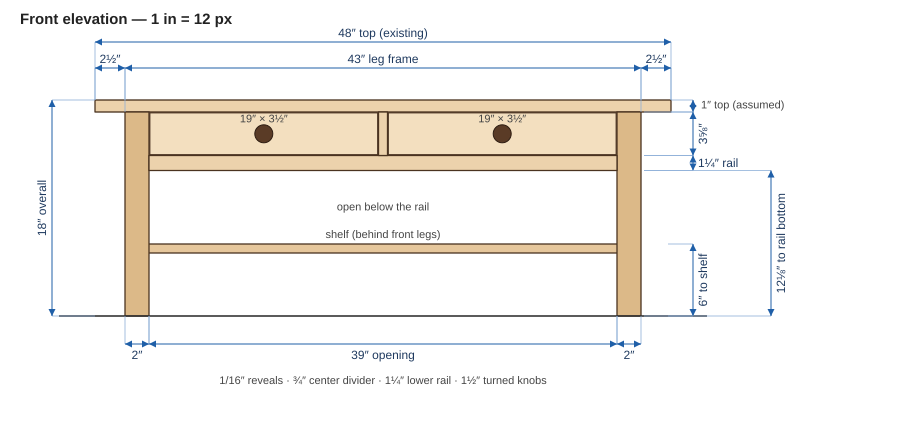
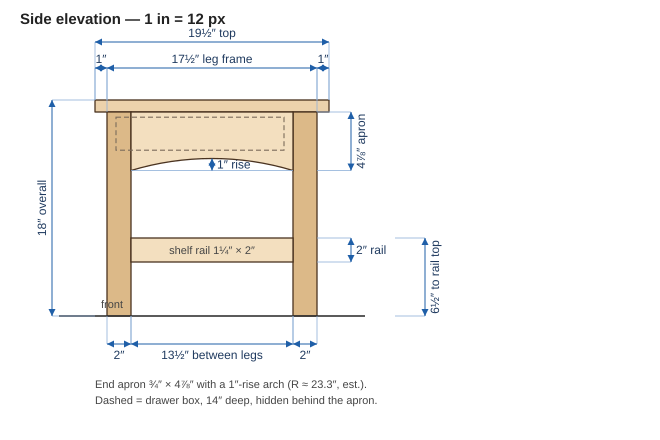
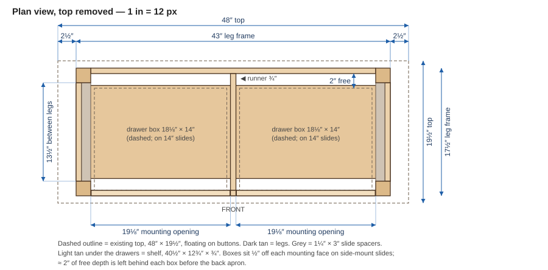
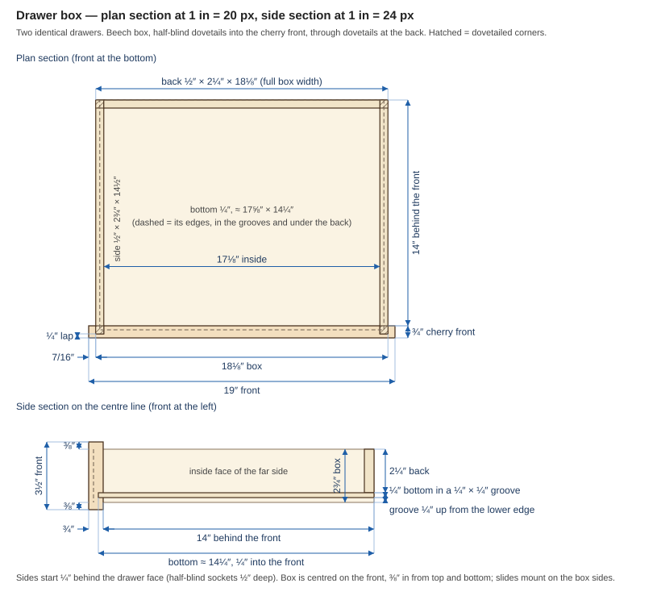
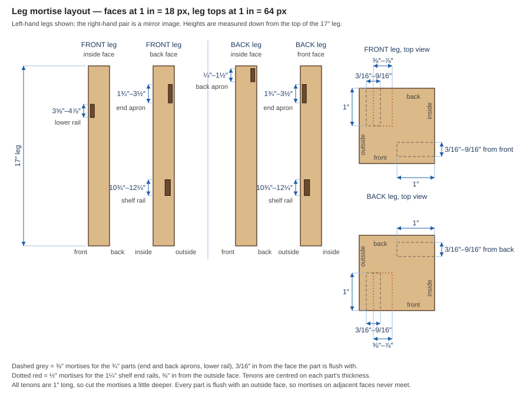

A **proposed** build: a coffee table with two drawers and a lower shelf, modeled on the Vermont Woods Studios *Burlington Shaker 2-Drawer Coffee Table* ([product page](https://vermontwoodsstudios.com/products/burlington-shaker-2-drawer-coffee-table), [archive](https://web.archive.org/web/2024/https://vermontwoodsstudios.com/products/burlington-shaker-2-drawer-coffee-table)), and **fitted to an existing top, 19½″ × 48″**. The look: square-section legs, a top that overhangs the ends by a lot and the front and back by a little, two wide drawers hung right under the top over a thin rail, end aprons with a shallow arch, and a lower shelf sitting on chunky end rails.

> **Provenance of the numbers.** The maker publishes very little. **(stated)** = from the maker's page or from you. **(derived)** = worked out so everything closes. **(est.)** = measured off the maker's photos or chosen by me, and the numbers to sanity-check before cutting. **The top's thickness is not known**: I assumed 1″, so measure it first (see *Open questions*).

## Stated

| Item | Value |
|---|---|
| Maker's overall size | **61″ W × 20″ D × 22″ H**, the only size offered (stated) |
| Maker's drawers | 2 wide drawers, "narrow depth design" (stated) |
| Species | Cherry, maple or walnut (stated) |
| Finish | Cherry/walnut: hand-rubbed linseed oil + wax. Maple: tung oil + wax (stated) |
| **Your top** | **19½″ × 48″** (stated by you); thickness not given |

The maker's page does **not** give the top thickness, overhangs, leg size, apron or rail sizes, drawer sizes, shelf size or height, slide hardware or how the frame is joined. Everything below on those is **(est.)** from the photos, or from the other console plans on this site. The photos do show beech-looking dovetailed drawer boxes on black side-mount metal slides with turned knobs, and the image alt-text on the page mentions "metal drawer slides" and "dovetail joints".

**How the maker's piece maps onto your top:** the footprint is almost the same depth (20″ vs 19½″) but 13″ shorter (61″ vs 48″). I kept the depth and overhangs, shortened the length, and so each drawer is about 6″ narrower than the maker's.

## Drawings (true scale)

Drawn at 1″ = 12 px from the dimensions on this page. Click to open full size.

**Front elevation**

**Side elevation**

**Plan view, top removed**

## The numbers

| Derived | Working | Result |
|---|---|---|
| Leg frame, width | 48 − 2 × 2½ | **43″** (derived) |
| Leg frame, depth | 19½ − 2 × 1 | **17½″** (derived) |
| Opening between front legs | 43 − 2 × 2 | **39″** (derived) |
| Two drawer fronts + divider + reveals | 2 × 19 + ¾ + 4 × 1/16 | **39″** (derived; fills the opening exactly) |
| Drawer opening, height | 1/16 + 3½ + 1/16 | **3⅝″** (derived) |
| Apron zone under the top | 3⅝ + 1¼ lower rail | **4⅞″** (derived) |
| Between legs, front to back | 17½ − 2 × 2 | **13½″** (derived) |
| Shelf width | 43 − 2 × 1¼ (end rails) | **40½″** (derived) |
| Shelf depth | 13½ − 2 × ⅜ setback | **12¾″** (derived) |
| Each drawer's mounting opening | (39 − ¾ runner) ÷ 2 | **19⅛″** (derived) |
| Drawer box width | 19⅛ − 2 × ½ slide clearance | **18⅛″** (derived) |
| Free depth behind a box | 17½ − ¾ back apron − (¾ front + 14 box) | **2″** (derived) |
| Leg length | 18 − 1 top | **17″** (derived; = 18″ − your top's thickness) |

The drawer fronts closing exactly at 19″ with the 2″ legs and 2½″ end overhangs is the check that the leg size and the 43″ frame fit together.

| Proportion | Mine | Maker's |
|---|---|---|
| Width : height | 48 : 18 = **2.67 : 1** | 61 : 22 = 2.77 : 1 |
| Width : depth | 48 : 19½ = **2.46 : 1** | 61 : 20 = 3.05 : 1 |
| End overhang ÷ width | 2½ ÷ 48 ≈ 5.2 % | ≈ 3.2 ÷ 61 ≈ 5.2 % (est. from the photo) |
| Leg width ÷ height | 2 ÷ 18 ≈ 0.11 | not stated |
| Shelf top ÷ height | 6 ÷ 18 = 0.33 | ≈ 0.3–0.35 (est.) |

At the maker's width-to-height ratio your 48″ would be about 17¼″ tall. I used **18″** (a typical coffee-table height). **To match the maker's 22″ instead:** make the legs 21″ and shelf top about 7″, and nothing else changes.

## Dimensions that are estimates

| Item | Value | Basis |
|---|---|---|
| Top thickness | **1″** (est.) | Not given for your top; the maker's looks 1″–1½″. Measure yours |
| Leg section | **2″ square** (est.) | Front legs scale to ≈ 2.2″ in the front photo |
| Top overhang, ends | **2½″** (est.) | ≈ 5 % of the length in the photo, so 2½″ on 48″ |
| Top overhang, front/back | **1″** (est.) | Photo shows a shallow front overhang |
| Drawer front | **19″ × 3½″ × ¾″** (est. height) | Photo shows ≈ 3½″–4″ on the 22″ table; 3½″ keeps the drawers useful on a shorter one |
| Lower front rail | **¾″ × 1¼″** (est.) | Narrow strip under the drawers |
| Center divider | **¾″ wide** (est.) | Narrow stile between the drawers |
| End and back aprons | **¾″ thick × 4⅞″ tall** (est.) | Level with the bottom of the lower front rail |
| End apron arch | **1″ rise** over the 13½″ between legs, R ≈ 23¼″ (est.) | Shallow arch visible on the left end in the three-quarter photo |
| End rails for the shelf | **1¼″ × 2″**, tops 6½″ off the floor (est.) | Chunky end stretchers in the photos |
| Shelf | **¾″ thick, top 6″ off the floor** (est.) | Photo; ≈ one third of the height |
| Knobs | **1½″ Ø turned wood** (est.) | Photo; one per drawer, centered |
| Slides | **14″ full-extension side-mount, ½″ per side** (chosen) | Buy first; resize runner and spacers to the real slide |

## Cut list

T × W × L, cut to length. **Tenons are included in the rail and apron lengths** (1″ at each end). Species: cherry, maple or walnut for the case; beech or maple for the drawer boxes.

### Case

| Part | Qty | T × W × L | Notes |
|---|---|---|---|
| Legs | 4 | 2″ × 2″ × **17″** | 8/4 stock; length = 18″ − the top's thickness |
| Lower front rail | 1 | ¾″ × 1¼″ × **41″** | 39″ between shoulders; flush to the leg front faces |
| Back apron | 1 | ¾″ × 4⅞″ × **41″** | Flush to the leg back faces |
| End aprons | 2 | ¾″ × 4⅞″ × **15½″** | 13½″ between shoulders; flush to the leg outer faces; arch the lower edge (1″ rise) |
| Center divider | 1 | ¾″ × ¾″ × **4″** | 3⅝″ from the underside of the top to the lower front rail, plus a ⅜″ stub tenon into the rail |
| Center runner | 1 | ¾″ × 2½″ × **16½″** | 16″ between the divider's back face and the back apron + ½″ tenon into the back apron; top ¾″ below the top's underside |
| Slide spacers | 2 | 1¼″ × 3″ × **13½″** | Screwed to the inside of each end apron, top ½″ below the underside of the top, flush with the leg inner faces so the slide face lines up with the legs |
| Shelf end rails | 2 | 1¼″ × 2″ × **15½″** | 13½″ between shoulders; flush to the leg outer faces; top 6½″ off the floor |
| Shelf cleats | 2 | ¾″ × ¾″ × **12¾″** | Glued to the rails' inner faces, top 5¼″ off the floor, to carry the shelf |
| Shelf | 1 | ¾″ × 12¾″ × **40½″** | Between the end rails, centered front to back (⅜″ setback each side) |
| Top | 1 | your existing **19½″ × 48″** | Floats; never glued |

### Drawers (×2, identical)

| Part | Qty each | T × W × L | Notes |
|---|---|---|---|
| Front | 1 | ¾″ × 3½″ × **19″** | Cherry grain-matched to the case; 1/16″ reveals all round |
| Sides | 2 | ½″ × 2¾″ × **14½″** | Beech; 14″ behind the front + ½″ into the half-blind sockets (¼″ lap); through-dovetailed to the back |
| Back | 1 | ½″ × 2¼″ × **18⅛″** (full box width) | Beech; through-dovetailed; sits on top of the bottom |
| Bottom | 1 | ¼″ × as fitted (≈ 17⅝″ × 14¼″) | In a ¼″ × ¼″ groove ¼″ up from the lower edge of the front and sides; slides in under the back, floating |
| Knob | 1 | 1½″ Ø | Turned, screwed from the inside |
| Slides | 1 pair | 14″ | Full-extension, side-mount, ½″ per side |

**Drawer box:** 18⅛″ wide × 14″ deep (behind the front) × 2¾″ tall. The front is 19″ wide, so it overhangs each side of the box by 7/16″. That lets the box sit ½″ off each mounting face while the front fills its opening with 1/16″ gaps.

## Tenon layout in the legs

At every leg two members come in from adjacent faces. Because each part sits flush to an outside face, the mortises are shallow in one direction and 1″ deep in the other, so they don't cross. Staggering the heights anyway keeps the mortises well apart and leaves more wood in the leg, so no mitered tenon tips are needed. **Measured down from the top of the leg:**

| Joint | Tenon position | Size |
|---|---|---|
| Back apron | **¼″ – 1½″** | ⅜″ thick × 1¼″ tall × 1″ long |
| End apron | **1¾″ – 3½″** | ⅜″ thick × 1¾″ tall × 1″ long |
| Lower front rail | **3⅝″ – 4⅞″** | ⅜″ thick × 1¼″ tall × 1″ long |
| Shelf end rails | centered on the rail (rail top 6½″ off the floor) | ½″ thick × 1½″ tall × 1″ long |

A loose-tenon machine (Domino) works the same way. Cut each part to its shoulder-to-shoulder length (**39″** and **13½″**) and keep the same heights. Use an 8 × 40 for the aprons, and a 4 × 20 for the lower front rail (it is only 1¼″ tall).

## Build sequence

1. Mill the legs from 8/4 and everything else to size. Let the stock sit between passes, since cherry moves.
2. Cut the mortises and tenons using the table above. Keep the aprons flush to the leg outer faces.
3. **Cut the end-apron arch:** a 1″ rise over 13½″ is an arc of radius about 23¼″. Bend a thin stick against two nails at the shoulders and a third at the 1″ rise to draw it, then bandsaw and fair with a plane or sanding block.
4. Dry-fit the two end frames: leg pair + end apron + shelf end rail. Confirm the **13½″** shoulder distance and that the rail is flush to the leg outer faces.
5. Glue up the ends, then join them with the back apron and the lower front rail. Dry-clamp first and check the **39″** opening and the **43″ × 17½″** frame for square.
6. Fit the **divider** (into the rail) and the **runner** (divider to back apron). Check the two drawer openings are equal at **19⅛″**.
7. Screw on the slide spacers, glue on the shelf cleats and drop in the shelf. Screw the shelf to the cleats through slots so it can move across its 12¾″ width.
8. Build and dovetail the drawers, fit the slides, then plane the fronts to a 1/16″ reveal all round.
9. Turn and fit the knobs.
10. Finish: scrape off all squeeze-out first, then hand-rubbed linseed oil and wax for cherry or walnut (tung oil and wax for maple), matching the maker.
11. **Attach the top** with figure-8 fasteners or buttons so it can move seasonally; across its 19½″ width it will move roughly ⅛″–3/16″. Fix it at the middle of each end apron and let the other fasteners slide. Center it: **2½″ at each end, 1″ at the front and back.**

## Open questions

- **Top thickness:** I assumed 1″. If yours differs, leg length is **18″ − thickness**, and nothing else changes. A thicker top just looks heavier.
- **Top condition:** is the top flat, and does it have breadboard ends or edge molding? Either would change the overhangs and how it is fastened.
- **Height:** 18″ here; the maker's is 22″. See *The numbers* for the 22″ changes.
- **Arch and shelf height:** both estimated from photos. The arch is decorative only.
- **Frame joinery:** the maker's page doesn't say how the legs and aprons are joined, so mortise-and-tenon here is my choice, to match the other plans on this site.
- **Space behind the drawers:** about 2″ is left behind each box. Decide whether to leave it open or close it with a back panel.
- **Slides:** pick them before cutting the runner and spacers. Some slides need more than ½″ per side.
