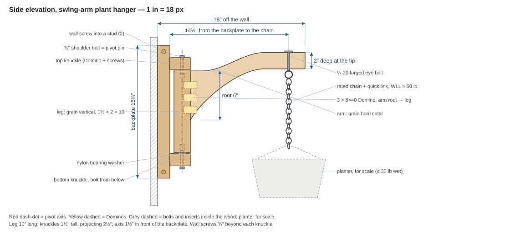
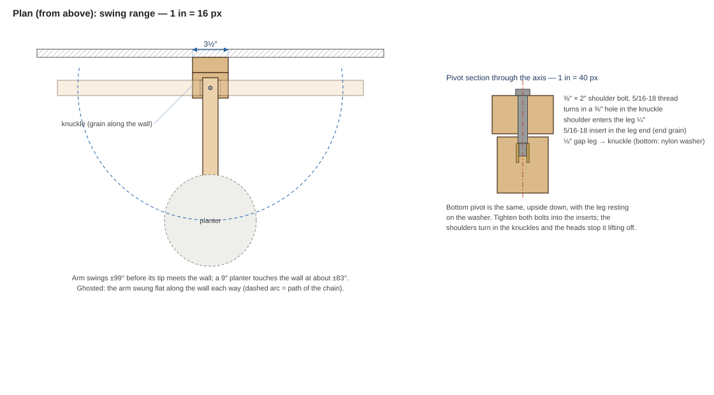
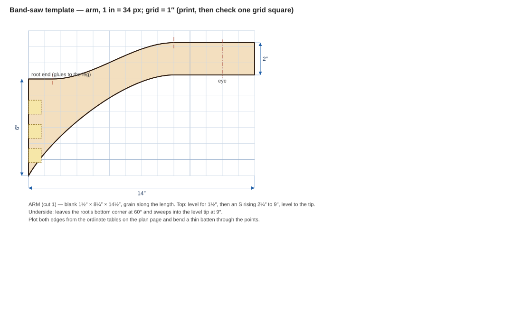

A **proposed** build: a wall-mounted plant hanger whose arm **swings** on a vertical pivot, so you can turn a hanging plant toward the window, rotate it so every side gets light, or swing it in against the wall to water it. The swinging part is a **single curved swoop**: a vertical leg that rises between two knuckle blocks on the backplate and sweeps out into the arm. Joinery is **Festool Domino**, shaping is **band saw and table saw**, and the pivot holes want a **drill press** (or a good drill guide) so they line up.

It's the swing-arm option from the search for alternatives to the fixed [plant-hanger wall bracket](../plant-hanger-bracket/).

> **Provenance of the numbers.** An original design from your sketch, so every number is **(design)** = a size I chose or **(derived)** = worked out from those. The drawings come from `tools/woodworking/swing_arm_plant_hanger_drawings.py`. Change a constant and re-run it, and the SVGs and the printed numbers move together. The script also refuses geometry that would bind or collide (leg corners against the backplate, the arm against the knuckle, an arm thinner than 2″, a Domino into an insert).

## Drawings

Click any drawing to open it full size.

**Side elevation**

**Plan view (swing range) and pivot section**

**Band-saw template: the arm (1″ grid)**

## Why the swoop is two pieces

Sawn from one board, the swoop would have **short grain at the elbow**: the grain would run across the curve where the load is highest, and it could snap there. So the swoop is two pieces, each with the grain running the way it's loaded:

- **Leg** (grain vertical): a straight 1½ × 2 × 10″ stick. Both pivot bolts go into its end grain, the strong direction for them.
- **Arm** (grain horizontal): its root is **6″ deep** where it meets the leg and sweeps out to a 2″-deep tip. Three **8 × 40 Dominos** join the root to the leg's outer face.

The top of the arm starts flush with the top of the leg and the underside leaves the leg face in a smooth curve, so it reads as **one swoop** with a glue line at the elbow. The underside meets the leg at 60° instead of tangent, which avoids leaving a feather-thin sliver of short grain at the bottom of the root.

A truly one-piece swoop is possible as a **bent lamination** (thin strips glued over a form), but that gives a constant-depth curve rather than the deep root in your sketch. It also needs epoxy or urea glue, because PVA creeps under a constant cantilever load.

## How the pivot works

- Two **knuckle blocks** (1½″ tall) are Domino'd and screwed to the backplate, one above the leg and one below it. The **pivot axis is 1½″ in front of the backplate**, enough for the leg's corners to clear the backplate as it turns.
- Each pivot pin is a **⅜″ shoulder bolt** dropped through a knuckle and threaded into a **5/16-18 insert** in the leg's end: from above at the top, from below at the bottom. The smooth shoulder turns in the knuckle's ⅜″ hole and enters the leg ¼″. The bolts tighten into the leg, so they turn with it.
- The leg **rests on a nylon washer** on the bottom knuckle. There's a ⅛″ gap at the top. The bolt heads sit ⅛″ clear of the knuckles, so the arm turns freely but can't be lifted off its pivots.
- **Swing:** the arm goes about **±99°** each way from straight out before its tip meets the wall. A 9″ hanging planter touches the wall at about ±83° and a 12″ planter at about ±77°, so in practice it swings a little short of flat to the wall each way.
- **Holding a position:** it turns freely. For drag so it stays where you put it, use a rubber or felt washer instead of the nylon one under the leg.

## The numbers

| Item | Value |
|---|---|
| Overall | **18″** off the wall × **16¼″** tall (backplate) × **3½″** wide (derived) |
| Chain point | **14½″** out from the backplate face (13″ from the pivot), on the level tip (design) |
| Backplate | 1½″ × 3½″ × **16¼″** (derived: two knuckles, a 10″ leg, a ⅛″ washer, a ⅛″ gap, and 1½″ beyond each knuckle for the wall screws) |
| Knuckles | 1½″ tall × 3½″ wide × **2½″** projection; pivot hole 1½″ from the backplate face, 1″ from the front (design) |
| Leg | 1½″ × 2″ × **10″**, grain vertical (design) |
| Arm | 1½″ thick, **14″** long from the leg face; root **6″** deep, tip **2″** deep, never thinner than 2″ (design / derived) |
| Arm top | level for 1½″ from the root, then an S rising **2¼″** to 9″ out, level to the tip (design). The level start keeps the arm under the knuckle as it swings |
| Arm underside | leaves the root's bottom corner at **60°** and sweeps up into the level tip 9″ out (design) |
| Design load | **30 lb** at the chain (design) |

Arm ordinates for laying out the template without printing it, measured **down from the top edge of the 8¼″ blank**, along its length from the root end:

| From the root end | 0 | ½″ | 1″ | 1½″ | 2″ | 3″ | 4″ | 5″ | 6″ | 7″ | 8″ | 9″ to the tip |
|---|---|---|---|---|---|---|---|---|---|---|---|---|
| Top edge | 2¼″ | 2¼″ | 2¼″ | 2¼″ | 2 3/16″ | 2″ | 1 11/16″ | 1¼″ | 13/16″ | ⅜″ | ⅛″ | 0 |
| Underside | 8¼″ | 7½″ | 6⅞″ | 6 5/16″ | 5 13/16″ | 4⅞″ | 4⅛″ | 3 7/16″ | 2⅞″ | 2 7/16″ | 2⅛″ | 2″ |

## Stock

**White oak** (quartersawn if you can get it) or ash; cherry and walnut work too. The parts come to about **2¼ bd ft** finished, all at 1½″ thick. Everything comes out of **one 8/4 board, 10″ wide × 3 ft**. See the shopping list.

## Cut list

| Part | Qty | T × W × L | Notes |
|---|---|---|---|
| Backplate | 1 | 1½″ × 3½″ × **16¼″** | Grain vertical |
| Knuckles | 2 | 1½″ tall × 3½″ × **2½″** | **Grain runs along the 3½″** (side to side, parallel to the wall). Then the pin's push is taken along the grain and can't split the block |
| Leg | 1 | 1½″ × 2″ × **10″** | Grain vertical; ends dead square |
| Arm blank | 1 | 1½″ × **8¼″** × **14½″** | Grain along the length; root end dead square (the Dominos and the glue line reference it) |

## Shopping list

Everything for one hanger. Quantities include a few spares where noted.

**Lumber**

| Buy | Qty | Notes |
|---|---|---|
| White oak, **8/4 (2″ rough), at least 10″ wide × 36″** | 1 board (about 5 bd ft) | Mill to 1½″. Crosscut a 15″ piece for the **arm** (8¼″ wide). From the remaining 21″, rip a 3½″ strip for the **backplate**, a 3½″ strip for both **knuckles** and a 2″ strip for the **leg**. Pick a board with straight grain and no checks for the arm |
| *or* 4/4 white oak, at least 8½″ wide × 30″ | 2 boards | Instead of 8/4: laminate two ¾″ layers face to face for every part. Glue up and let it cure a day before milling |

**Hardware**

Each item has an example product link with a photo, so you can match it on the shelf. Any equivalent part works. The store links aren't paired with Wayback archives (the site's usual habit): retail product pages are rarely archived and change often.

| Buy | Qty | Spec | Example (photo) |
|---|---|---|---|
| Shoulder bolts (pivot pins) | 2 | **⅜″ shoulder diameter × 2″ shoulder length, 5/16-18 thread** (½″ of thread), socket head, stainless | [Zoro 2DMK5, 2-pack](https://www.zoro.com/zoro-select-shoulder-screw-516-18-thr-sz-12-in-thr-lg-2-in-shoulder-lg-18-8-stainless-steel-2-pk-2dmk5/i/G0875752/). Big-box stores rarely stock this size |
| Threaded inserts | 2 (+3 spare) | **5/16-18** brass knife-thread inserts for hardwood | [E-Z Lok EZ-400-5 kit at Woodcraft](https://www.woodcraft.com/products/e-z-lok-threaded-insert-kit-5-16-18-brass): 5 inserts plus the **33/64″ drill** and driver. Inserts alone: [E-Z Lok 400-5](https://www.ezlok.com/ezknife-insert-400-5) |
| Bearing washer | 1 (+9) | Nylon, **⅜″ ID × 1⅛″ OD × ⅛″** thick. Optional: rubber, for drag | [Midwest Fastener 72866, 10-pack, at Zoro](https://www.zoro.com/midwest-fastener-flat-washer-for-screw-size-38-nylon-10-pk-72866/i/G402505964/) |
| Forged eye bolt | 1 | **¼-20, 2″ shank, forged with a shoulder** | [Ken Forging N2021-2 (galvanized) at Zoro](https://www.zoro.com/ken-forging-eyebolt-14-20-12in-with-shoulder-n2021-2/i/G0760751/) |
| Fender washer | 1 | ¼″ × 1¼″, for the eye bolt | [Everbilt 6-pack at Home Depot](https://homedepot.com/p/Everbilt-1-4-in-x-1-1-4-in-Zinc-Plated-Steel-Fender-Washer-6-per-Pack-802421/204276338) |
| Nylon-insert lock nut | 1 | ¼-20 | [Everbilt 2-pack at Home Depot](https://homedepot.com/p/Everbilt-1-4-in-20-Zinc-Plated-Nylon-Lock-Nut-2-Pack-825291/317478983) |
| Chain | as needed | **3/16″ welded proof coil**, sold by the foot, with a stated working load limit (this one: 750 lb). Not decorative "lamp chain" | [Everbilt 3/16″ galvanized proof coil at Home Depot](https://homedepot.com/p/Everbilt-3-16-in-x-1-ft-Grade-30-Galvanized-Steel-Proof-Coil-Chain-806656/204630509) |
| Quick link | 1 (+1) | 3/16″, rated (this one: 660 lb WLL) | [National Hardware 3150BC at Zoro](https://www.zoro.com/national-hardware-3150bc-series-quick-link-316-in-trade-660-lb-working-load-steel-zinc-n223-016/i/G213780932/) |
| Wall screws | 2 | **¼″ × 4″ structural screws**, washer head, T-30 star drive (bit included) | [SPAX PowerLag 12-pack at Tractor Supply](https://www.tractorsupply.com/tsc/product/spax-1-4-x-4in-exterior-structural-wood-lag-screws-powerlags-washer-head-t-star-(12-ea)-bit-included). The washer heads stay visible on the backplate's face |
| Knuckle screws | 4 | **#10 × 2½″ flat-head wood screws**, from the back of the backplate | [Everbilt 2-pack at Home Depot](https://www.homedepot.com/p/Everbilt-10-x-2-1-2-in-Phillips-Flat-Head-Wood-Screws-2-per-Pack-825681/317478818) (buy 2) |
| Steel rod (glue-up jig) | 1 | **⅜″ plain steel round rod**, 3 ft. Cut an 18″ piece; it holds the knuckle holes on one axis while the glue sets | [Everbilt 3/8″ × 3 ft at Home Depot](https://homedepot.com/p/Everbilt-3-8-in-x-3-ft-Plain-Steel-Solid-Round-Rod-0007/332733262) |

**Consumables**

| Buy | Qty | Notes |
|---|---|---|
| Domino **8 × 40** tenons | 7 (+3 spare) | 3 for the arm root, 2 per knuckle |
| Wood glue | small bottle | Titebond III |
| 5-minute or 30-minute epoxy | small pack | Set the threaded inserts in epoxy: knife-thread inserts hold better in end grain that way |
| Finish | small can | Hardwax oil (Osmo Polyx or Rubio Monocoat) |
| Paste wax | — | For the pivot holes and shoulders |
| Sandpaper | 120 / 180 / 220 | |
| Felt pads | 2 | Optional, on the backplate edges where the arm's side could knock at full swing |

**Drill bits and cutters to have on hand**

| Bit | For |
|---|---|
| ⅜″ brad-point | Knuckle pivot holes (through) and the ¼″-deep shoulder counterbores in the leg ends |
| **33/64″** (in the E-Z Lok kit; use your insert's own size if different) | Insert holes in the leg ends, ¾″ deep (the inserts are ⅝″ long) |
| 9/32″ | Eye bolt hole through the arm tip |
| ¾″ Forstner | **½″-deep** counterbore on the arm top, so the 2″-shank eye bolt's washer and nut sit below the surface |
| Countersink, pilot bit, ¼″ bit | Countersink and pilot for the #10 knuckle screws (pilot size from the screw maker); a ¼″ clearance hole through the backplate for each wall screw (SPAX needs no pilot in the stud) |
| ¼″ or ⅜″ band-saw blade | ¼″ follows the arm's curves comfortably |

## Domino schedule

| Joint | Domino | Qty | Depth (A / B) | Notes |
|---|---|---|---|---|
| Arm root → leg | **8 × 40** | 3 | 20 mm into the arm's end grain / 20 mm into the leg's outer face | Centres **1¾″, 3¼″ and 4¾″** below the leg top, centred in the 1½″ thickness. The top one stays clear of the top insert |
| Knuckle → backplate | **8 × 40** | 2 per knuckle | 20 / 20 | Side by side, **¾″ either side of centre**, centred on the knuckle's height. They stay well clear of the pivot hole 1½″ out |

Cut the arm's root mortises in the **square blank** before band-sawing; the root end is a straight cut the curves don't touch. Mark the centres from the root's top corner, which sits 2¼″ below the blank's top edge (4″, 5½″ and 7″ down from the edge).

## Getting the pivot holes in line

The arm only swings smoothly if the top and bottom holes share one axis. Three steps:

1. **Knuckles:** clamp the two blocks together, edges flush, and **drill both ⅜″ holes in one pass** on the drill press, 1½″ from the back edge, centred side to side.
2. **Glue the knuckles on with a rod through them.** Push a straight ⅜″ steel rod (or a ⅜″ drill bit's shank, extended with a second piece) through both knuckles, with a spacer block **10¼″ long** between them (leg + washer + top gap). Then Domino, glue and screw them to the backplate. The rod holds them on one axis while the glue sets.
3. **Leg ends:** on the drill press, centred in each end, counterbore **⅜″ × ¼″ deep** for the shoulder, then drill for the insert below it. Set the inserts square in a little epoxy, with the bolt threaded in as a guide.

## Build order

1. Mill the stock. Square the leg's ends and the arm blank's root end.
2. **Mortises:** arm root (3), leg outer face (3), knuckle backs (2 each) and backplate face (4).
3. **Band-saw the arm.** Cut the top S first and tape the offcut back on, so the blank sits flat while you cut the underside. Fair both curves with a spokeshave or a drum sander.
4. **Glue the arm to the leg** (3 Dominos). Clamp across the joint with a caul made from the underside offcut.
5. **Knuckles:** gang-drill, then glue and screw them to the backplate with the alignment rod and spacer (above).
6. **Leg ends:** counterbore and set the inserts. Drill the arm's tip for the eye bolt: 9/32″, 13″ from the pivot, square to the level tip. Counterbore ¾″ × **½″** on top so the washer and nut sit below the surface (the eye bolt's shank is 2″).
7. **Finish** everything (below). Leave the pivot holes and leg ends bare, or wax them.
8. **Hang the backplate** on a stud. Set the leg between the knuckles on the washer, drop the top bolt in, push the bottom bolt up, and tighten both into the inserts. Swing it: it should turn without binding. If it rubs, check the washer and the ⅛″ top gap.

## Load check

- **Load:** a 10–12″ hanging basket with wet soil is typically 10–20 lb. Everything is sized for **30 lb** at the chain.
- **Pivots:** 30 lb × 13″ out from the axis is resisted by a couple between the knuckles, 11¾″ apart: about **33 lb** sideways at each pin. The top pin pulls the top knuckle away from the wall, and the bottom pin pushes the bottom knuckle into it. A ⅜″ steel shoulder in oak bears that easily. The top knuckle's glue joint, two Dominos and two screws see 33 lb of pull-off, a small fraction of what they hold.
- **Arm root:** 30 lb × 12″ ≈ **360 in-lb** at the leg face. The root bears on the leg at its bottom edge and the top Domino is 4¼″ above that, so it sees about **85 lb** of tension, shared with the other two and the glue. A glued 8 × 40 Domino holds hundreds of pounds.
- **Leg:** bending stress about **390 psi** at the arm. Oak is good for well over 10,000.
- **Wall:** 30 lb × 16″ (13″ + the 1½″ axis offset + the 1½″ backplate) ≈ **480 in-lb**. The backplate tips about its bottom edge, so the top screw sees roughly **31 lb** of pull. A ¼″ structural screw with 2″ in a stud holds several hundred. **It must go into a stud**, not drywall anchors.

## Finish

Hardwax oil (Osmo Polyx or Rubio Monocoat) on everything. Water the plant in the sink, or swing it in over a tray, so drips don't run down the backplate.

## Open questions

- **Insert size:** drill sizes differ between insert brands. Use the maker's chart and test in scrap oak first.
- **Rise and swoop:** `RISE`, `S_X0`/`S_X1`, `UNDER_ANGLE` and `K1`/`K2` in the script control the curves. The script refuses any shape that thins the arm below 2″ or brings the arm up under the knuckle's reach.
- **Reach:** for a bigger basket, lengthen `ARM_TIP` and `EYE_R`. The swing limit and the loads print again, so re-read them.
- **Bolt heads:** the top bolt's head shows on top of the top knuckle. A brass or black head makes it look like a hinge pin, or cut a shallow counterbore so it sits flush.
- **Leg and arm proportions:** matched to your sketch (leg about ¾ of the reach). A shorter leg brings the knuckles closer together and raises the pivot forces, so keep the knuckles at least 10″ apart.
