Printable jigs and shop tools for woodworking projects — the woodworking counterpart to the [rodmaking tool set](/docs/rodmaking/printable-rod-tools/). This page covers the printed parts that the [Adjustable Scarf Jig](/docs/woodworking/scarf-jig/) and the [DW745 Mobile Saw Cart](/docs/woodworking/dw745-mobile-saw-cart/) plans already call for, plus **table-saw accessories that fit any SawStop** (they key off the standard ¾″ × ⅜″ miter slot and the flat table, not a model).

All are FDM-printable, generated parametrically, and validated watertight. STLs export in print orientation. Print in **PETG** (or ASA for the saw-cart parts that live in a hot garage), **4+ perimeters, 40% infill** — the ratio gauge at 100%.

**Parametric source:** [`generate_woodworking_stls.py`](/static/woodworking-3d/generate_woodworking_stls.py) — edit the parameter block and re-run (`pip install manifold3d trimesh numpy matplotlib`). The scarf-jig parts come straight from the plan's dimensions. The **saw-cart parts depend on your saw's feet, dust port and hose, and the values in the script are estimates — measure yours and regenerate.**

---

## Scarf jig

### Ratio setting gauge

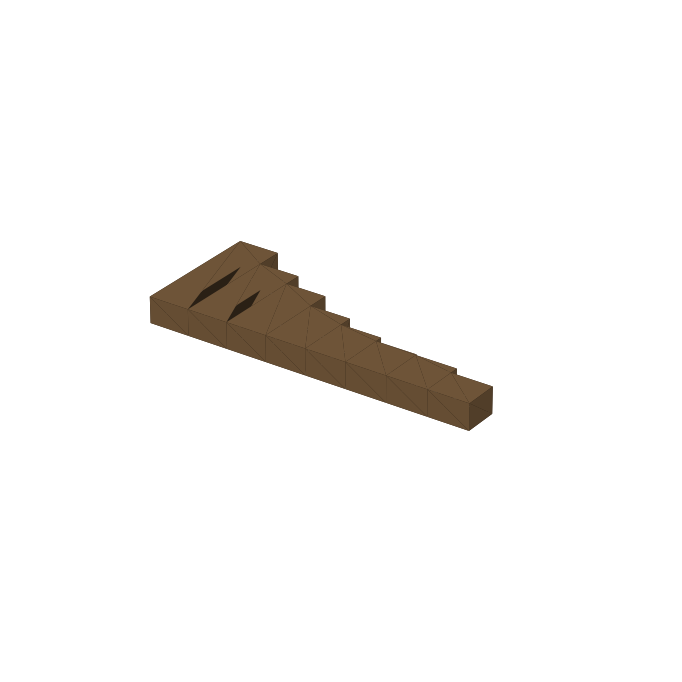

**For:** setting the bed's drop **d** (= 12″ ÷ ratio) without calipers.

A stepped block whose steps are exactly the drop at the 12″ mark for each ratio, tallest to shortest:

| Step | Ratio | Height |
|---:|---|---:|
| 1 | 1:8 | 1.500″ (38.1 mm) |
| 2 | 1:10 | 1.200″ (30.5 mm) |
| 3 | 1:12 | 1.000″ (25.4 mm) |
| 4 | 1:16 | 0.750″ (19.1 mm) |
| 5 | 1:20 | 0.600″ (15.2 mm) |
| 6 | 1:23.3 (Rod 002 splice) | 0.515″ (13.1 mm) |
| 7 | 1:24 | 0.500″ (12.7 mm) |
| 8 | 1:30 | 0.400″ (10.2 mm) |

Stand it on the bed at the 12″ line and raise the bed until the step for your ratio just touches a straightedge across the rails. It prints **on its side** so the heights lie in the print plane and come out exact; **check them with calipers once** after your first print, and adjust the print scale if your printer is off.

[`ratio_gauge.stl`](/static/woodworking-3d/ratio_gauge.stl) · print 1 · no hardware

### Hold-down bar and knobs

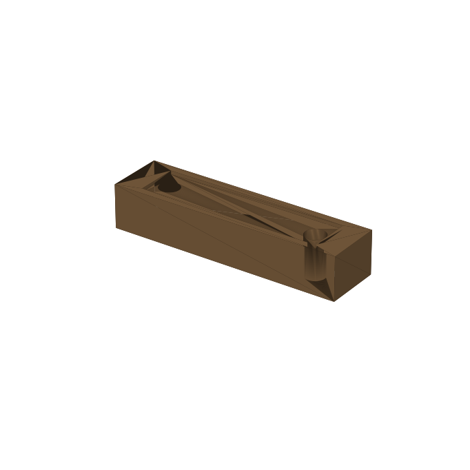

**For:** the plan's ¾″ × ¾″ × 3″ hold-down across the stock's top flat.

The bar has two clearance holes 2″ apart, matching an insert pair in the bed (¼-20 inserts, 1″ either side of center), and a shallow pocket for a cork or rubber pad. Print it with the **pocket facing up**, then flip it over when you fit the pad. Pair it with two fluted knobs, each with a hex pocket that captures a ¼-20 hex-head bolt.

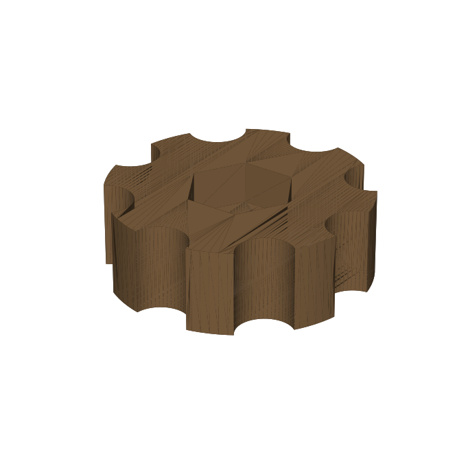

[`hold_down_bar.stl`](/static/woodworking-3d/hold_down_bar.stl) · print 1 + [`hold_down_knob.stl`](/static/woodworking-3d/hold_down_knob.stl) · print 2 · hardware: two ¼-20 × 1¼″ hex-head bolts (length to suit your inserts), cork or rubber pad

### Pegged fence

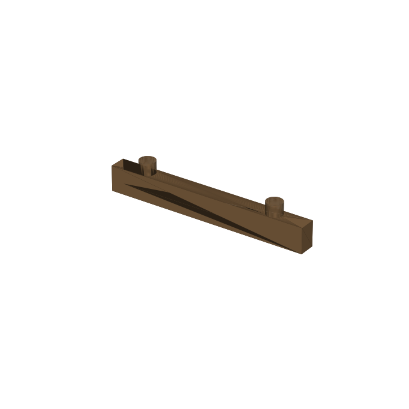

**For:** keeping the stock square to the hinge line without taping a fence on.

A ¼″ × ½″ strip with Ø6 mm pegs that drop into the bed's ¼-20 inserts on the 2″ pitch, so it registers the same way every time. Print **pegs up**. Two two-peg segments plus one single-peg end piece cover the five pairs at 7, 9, 11, 13 and 15″ from the pin. The strip is ¼″ thick (the plan's ⅛″ hardboard fence is thinner) because the peg needs the width; account for that when you set the stock against it.

The hold-down bar uses an insert pair across the bed, so leave that pair's fence peg out — stop the fence before the bar.

[`fence_pair.stl`](/static/woodworking-3d/fence_pair.stl) · print 2 + [`fence_single.stl`](/static/woodworking-3d/fence_single.stl) · print 1 · no hardware

---

## DW745 saw cart

These are fit-to-your-hardware starting points. The turnbutton and hook are generic; the foot cup and rear-port adapter use **estimated** measurements from the plan.

### Turnbutton

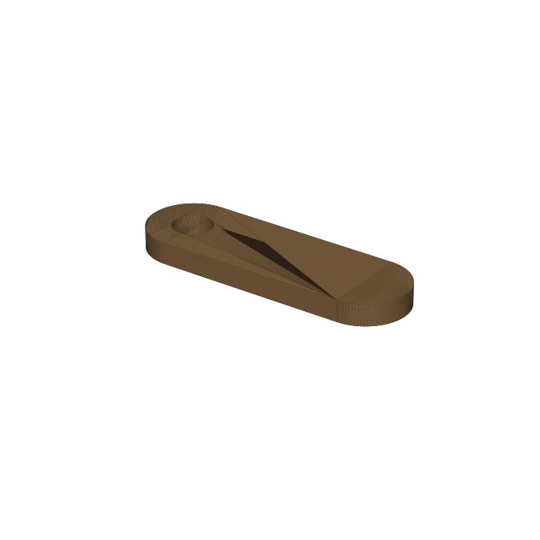

**For:** holding the lift-off front skirt panel against its foam gasket.

A 38 × 12 mm rounded tab, 4 mm thick, with a Ø5.4 mm hole for a #10 screw. A quarter turn clamps the panel; turn it back to lift the panel off.

[`turnbutton.stl`](/static/woodworking-3d/turnbutton.stl) · print 6 (plan calls for 4–6) · hardware: #10 × 1″ wood screw each

### Wall hook

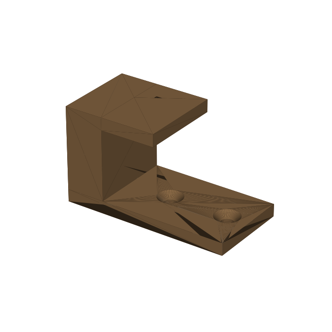

**For:** hanging the fence, miter gauge and cord on the cart's right side.

A J-hook on a 60 × 30 mm plate with two countersunk screw holes. **Mount it with the long axis vertical**, plate against the wall, so the arm projects out and the lip rises at its end. Print 3.

[`wall_hook.stl`](/static/woodworking-3d/wall_hook.stl) · print 3 · hardware: two #8 flat-head wood screws each

### Foot locator cup

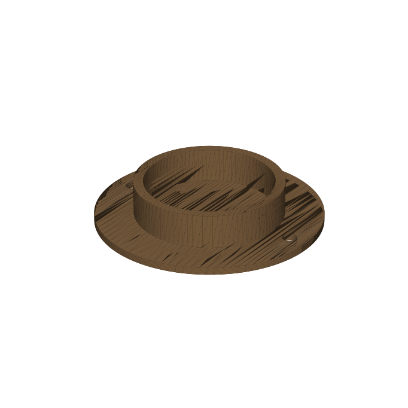

**For:** locating the saw on the support rails by its own weight, replacing the hold-down knobs the skirt would hide.

A Ø40 mm cup, 14 mm deep, on a Ø70 mm flange with two screw holes. **The Ø40 mm foot diameter is an estimate** — measure the saw's rubber feet, set `FOOT_D` in the script, and regenerate. The plan also suggests a TPU liner; print that separately if you want one.

[`foot_cup.stl`](/static/woodworking-3d/foot_cup.stl) · print 4 · hardware: two #8 wood screws each

### Rear-port adapter

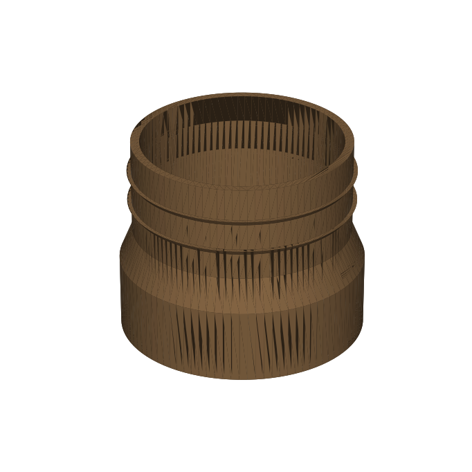

**For:** carrying the saw's rear dust port to a 2½″ hose.

A socket (inside diameter 65.0 mm) that slips over the saw's port, a short cone, and a ribbed spigot that a 2½″ hose pushes over. **The 64.5 mm port diameter is the plan's measurement from one Type 4 saw** — measure yours, set `SAW_PORT_OD`, and regenerate. Print it upright, socket down.

[`rear_port_adapter.stl`](/static/woodworking-3d/rear_port_adapter.stl) · print 1 · hardware: hose clamp

---

## Table saw (any SawStop)

These are **model-agnostic**: they use the miter slot (standard ¾″ × ⅜″, 19.05 × 9.5 mm — **measure yours to confirm**) or the flat table. Nothing here replaces the saw's guard, riving knife or brake; the push devices are accessories.

> **Safety.** Push blocks and push sticks sit between your hand and the blade. Printed PETG is not rated for that: **inspect before each use, discard anything cracked or crazed, never print them in PLA, and keep a commercial push block as a backup.** Print the first one and push scrap with the saw off before trusting the shape.

### Push block

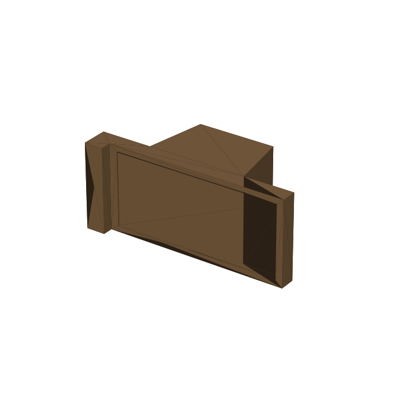

**For:** pushing stock past the blade under your hand's full control.

A heel-and-toe block: a raised grip, a flat base for pressure on the stock, and an 8 mm heel at the back that catches the end of the workpiece so you push it rather than rubbing it. The base underside has a shallow pocket for a ⅛″ rubber pad (spray adhesive). Print it **standing on its side** (the profile lies flat on the bed); it is solid and fairly heavy, so use 3–4 perimeters and 20–30% infill.

[`push_block.stl`](/static/woodworking-3d/push_block.stl) · print 2 · hardware: ⅛″ rubber pad

### Push stick

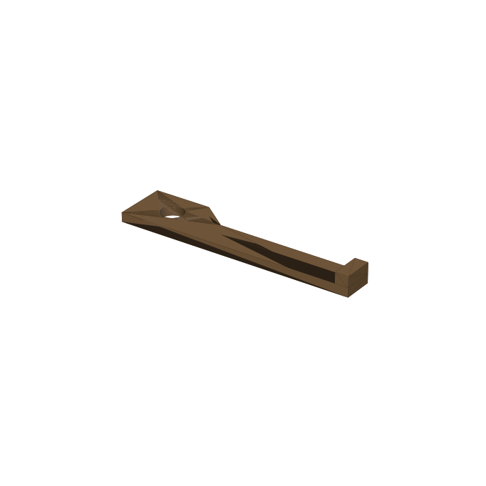

**For:** narrow rips, where there's no room for a block between the blade and the fence.

A 250 mm stick with a wide handle (finger hole included), a slim shaft and a 15 mm hook at the tip that catches the back of the stock. Print it **flat with the hook pointing up**. The hook is only 15 mm deep, so it is for stock about ¾″ and thicker; for thin stock, use a block.

[`push_stick.stl`](/static/woodworking-3d/push_stick.stl) · print 2 · no hardware

### Featherboard (prototype)

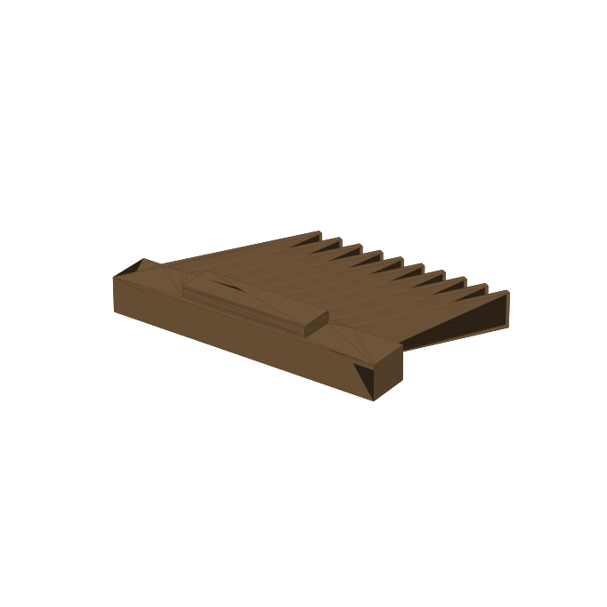

**For:** holding stock against the fence on rips.

Ten fingers leaning 30° toward the feed, on a base with a friction-fit miter-slot runner. **This one is a prototype and is friction-only:** a plain miter slot has no undercut, so there is nothing for a printed part to lock against, and the runner's two crush ribs give a light grip. Treat it as a hold-down for light work, not as a kickback preventer, and **test-fit it in a scrap slot first** — tune `RUNNER_CLEAR` and `CRUSH_RIB` in the script until it needs a firm push. If you want a positive lock, bolt the base to a commercial expanding miter bar instead. Print it **upside down** (runner pointing up) so the fingers stand as vertical walls and flex along their layers.

[`featherboard.stl`](/static/woodworking-3d/featherboard.stl) · print 1 · no hardware

### Setup depth blocks

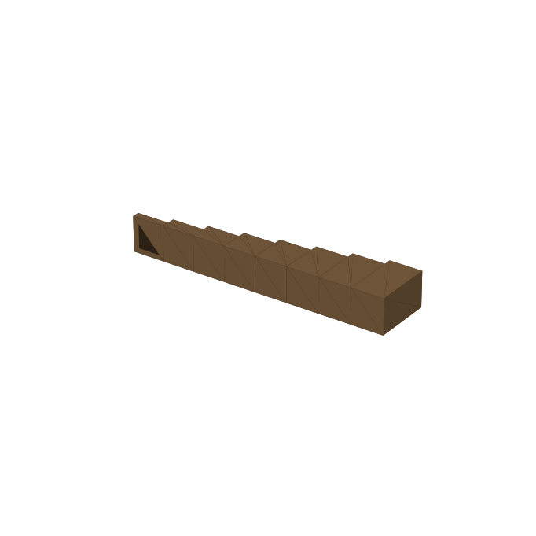

**For:** setting blade height or dado depth without a ruler.

Eight steps, ⅛″ to 1″ in ⅛″ increments. Stand a block next to the blade, lay a straightedge across it, and raise the blade until it just touches. Print it **on its side** so the heights lie in the print plane, and **check them with calipers once**.

[`setup_steps.stl`](/static/woodworking-3d/setup_steps.stl) · print 1 · no hardware

### 90° / 45° blade-angle checker

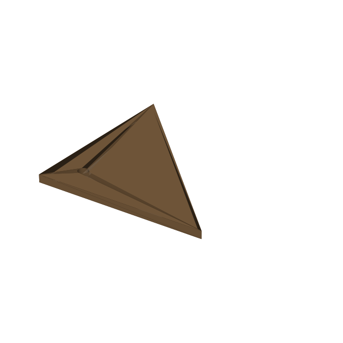

**For:** a quick check that the blade is square to the table (and at 45°) after you tilt it.

A 100 mm right isosceles triangle, 6 mm thick. Stand a leg on the table and the other against the blade body (between the teeth). The accuracy is only as good as your printer, so **check it against a known-good square** before relying on it.

[`angle_checker.stl`](/static/woodworking-3d/angle_checker.stl) · print 1 · no hardware

### Crosscut-sled runner

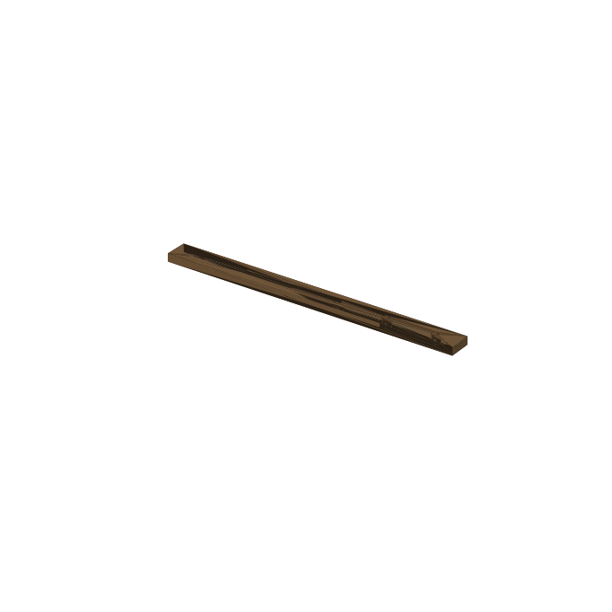

**For:** the miter-slot bars of a crosscut sled.

The [tenoning jig](/docs/woodworking/tenoning-jig/) uses one of these. A 240 mm segment, 18.6 mm wide (0.45 mm under the slot width) and 8.8 mm tall so it stays below the table surface, with six M5 nut pockets on a 40 mm pitch. Lay the sled base on the runners and screw down through it with M5 flat-head machine screws into the nuts. Print 4 and butt them end to end for two 480 mm runners. A runner this tight is a clearance fit, so **tune it with masking tape or thin shims** until it slides without side play, and keep the sled's runners parallel to each other.

[`sled_runner.stl`](/static/woodworking-3d/sled_runner.stl) · print 4 · hardware: 6 M5 nuts and M5 × 25 flat-head screws per segment

---

## Tenoning jig

These print the parts of the [Miter-Slot Tenoning Jig](/docs/woodworking/tenoning-jig/); the wood and the clamp are on that page. It also uses one [sled runner](#crosscut-sled-runner).

### Tenon shim set

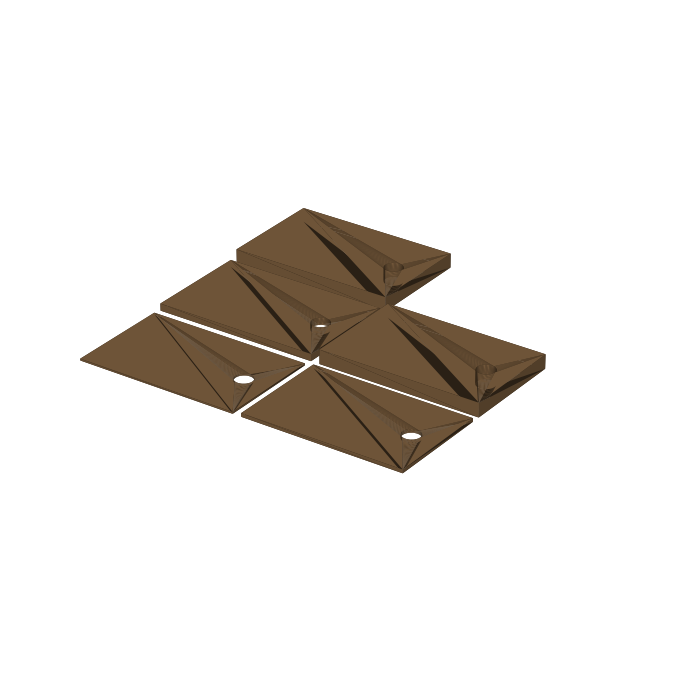

**For:** setting the tenon thickness: s = A − (t + T) ÷ 2, stacked between the fence and the stock.

Five plates — **1/16″, 1/8″, 1/4″, 1/2″ and 1/2″** — laid out on one bed (226 × 222 mm), so any 1/16″ step from 0 to 1-7/16″ is reachable. Print them **flat**; the thickness is set by layer count, so **check each plate with calipers** and adjust the print scale or layer height until they match. Each has a pull hole. Print two sets: one for the foot of the fence and one near the clamp.

[`tenon_shims.stl`](/static/woodworking-3d/tenon_shims.stl) · print 2 · no hardware

### Fence bracket

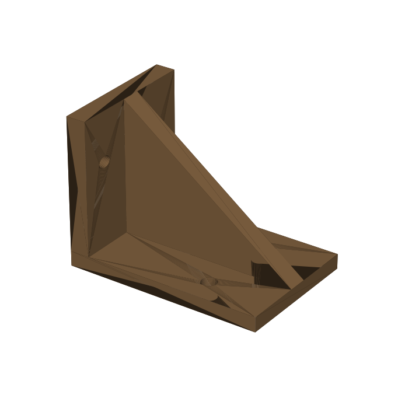

**For:** holding the fence square to the base.

A right-angle bracket with a web and two screw holes per flange (Ø4.6 mm, for #8 screws). Screw it into the base and the back of the fence, one at each end. Print it **on the base flange**.

[`jig_bracket.stl`](/static/woodworking-3d/jig_bracket.stl) · print 2 · hardware: four #8 × 1″ wood screws each

### Jig handle

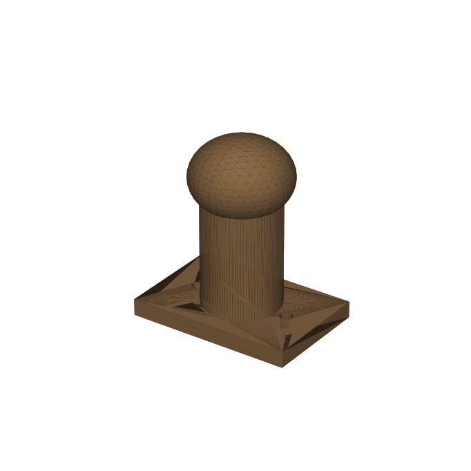

**For:** pushing the jig past the blade.

A flange with two screw holes, a 28 mm post and a rounded top. Screw it to the base behind the fence.

[`jig_handle.stl`](/static/woodworking-3d/jig_handle.stl) · print 1 · hardware: two #8 wood screws

---

## Not yet designed

The plans also call for these printed parts; none of them has an STL yet:

- Scarf jig: the end-alignment gauge and the beam handles.
- Table saw: a flip-stop and a sled stop block; a positively locking featherboard.
- Saw cart: brush retainers, switch bezel, inlet filter frame with sliding shutter, the 4 × 4 × 2½″ wye, manifold collar, collector adapter, cove strips and the cyclone lid.
