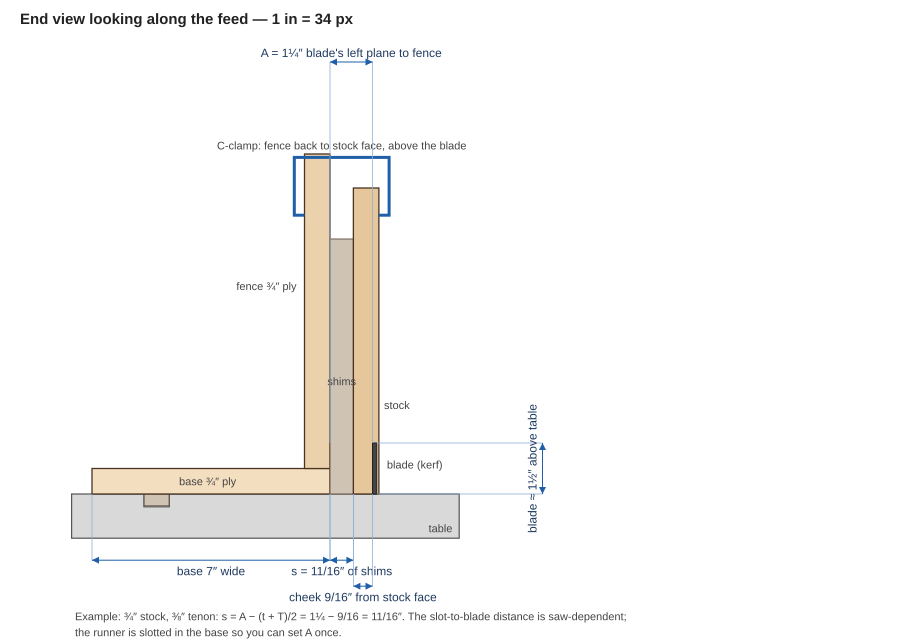
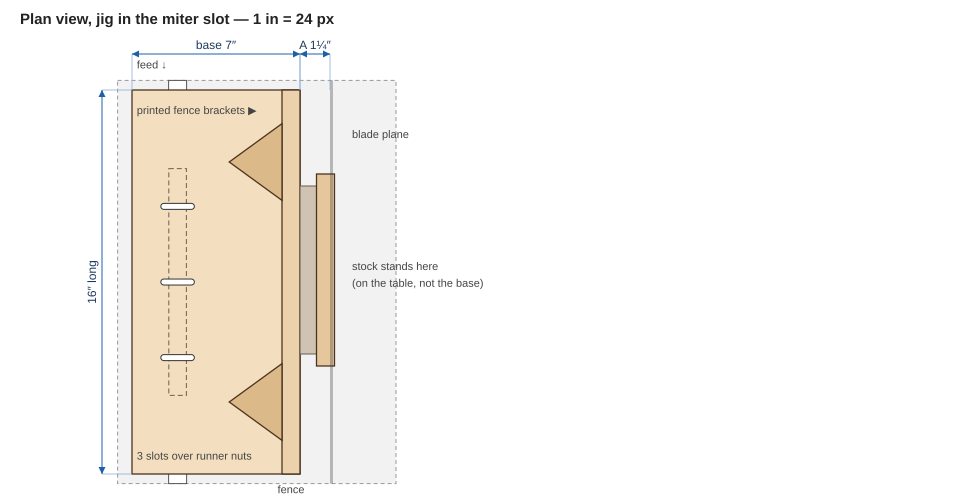

A **proposed** shop jig for cutting the **cheeks** of tenons on the table saw: the stock stands on its end against a vertical fence, the jig rides in a miter slot, and one pass per face cuts each cheek. Plywood base and fence, a printed runner, shim set and brackets, and a plain C-clamp. It uses only the standard ¾″ × ⅜″ miter slot, so it fits any SawStop (measure your slot to confirm).

> **How it works.** The blade's distance from the fence is fixed once the jig is set up. Call the distance from the fence face to the blade's *near* plane **A** (1¼″ here). Stack **shims** between the fence and the stock to move the stock toward the blade. The blade's near plane then lands at **(t + T) ÷ 2** from the stock face, where *t* is the stock thickness and *T* is the tenon thickness. Cut, turn the stock end for end, cut again, and the tenon is centered. **The only setting is the shim stack:** s = A − (t + T) ÷ 2.

This jig cuts the **cheeks only**. The shoulders are cut afterward on a crosscut sled or miter gauge with a stop, which also frees the waste.

> **Safety.** The stock stands on end with its top well above the blade, so **always clamp it** — never hold it by hand — and stand to the side of the blade's plane. Check that the guard or riving knife you are using clears the stock; the cheek kerf is only as deep as the tenon is long, so the riving knife usually runs in the kerf. Run a scrap through with the saw off first.

## Drawings

All dimensions in inches. **Slot-to-blade distance depends on the saw**, so the drawing shows a typical layout; the runner is slotted in the base so you set A once for your saw.

**End view looking along the feed**

**Plan view**

## Shim table (A = 1¼″)

The shim set is **1/16″, 1/8″, 1/4″, 1/2″ and 1/2″**, so every 1/16″ step from 0 to 1-7/16″ is reachable. The stock stands **between the fence and the blade**, and *s* is the stack between fence and stock.

| Stock *t* | Tenon *T* | *s* = A − (*t* + *T*)/2 | Shims |
|---|---|---|---|
| ¾″ | ¼″ | ¾″ | ¼ + ½ |
| ¾″ | ⅜″ | 11/16″ | 1/16 + ⅛ + ½ |
| ¾″ | ½″ | ⅝″ | ⅛ + ½ |
| ¾″ | ⅝″ | 9/16″ | 1/16 + ½ |
| 1″ | ¼″ | ⅝″ | ⅛ + ½ |
| 1″ | ⅜″ | 9/16″ | 1/16 + ½ |
| 1″ | ½″ | ½″ | ½ |
| 1″ | ⅝″ | 7/16″ | 1/16 + ⅛ + ¼ |
| 1½″ | ¼″ | ⅜″ | ⅛ + ¼ |
| 1½″ | ⅜″ | 5/16″ | 1/16 + ¼ |
| 1½″ | ½″ | ¼″ | ¼ |
| 1½″ | ⅝″ | 3/16″ | 1/16 + ⅛ |

For any other size, *s* = A − (*t* + *T*) ÷ 2, in 1/16″ steps; *T* = 2 (A − *s*) − *t*. If *s* comes out negative, the stock is too thick for this A — widen A by moving the base (see "Setting A").

## Parts

### Wood and hardware

T × W × L.

| Part | Qty | Material | Size | Notes |
|---|---:|---|---|---|
| Base | 1 | ¾″ Baltic birch | ¾ × 7 × 16 | Three cross slots, 7/32″ wide × 1⅜″ long, 3⅛″ apart, centered on the base, over the runner's nut pockets |
| Fence | 1 | ¾″ Baltic birch | ¾ × 10 × 16 | Glued and screwed to the base's long edge, standing on it; its face, square to the base, is the reference |
| Runner | 1 | Printed | 18.6 × 8.8 × 240 mm | The [crosscut-sled runner](/docs/woodworking/printed-tools/) from the printed-tools page; nuts in the pockets |
| Brackets | 2 | Printed | | One at each end, on the back of the fence (see below) |
| Handle | 1 | Printed | | Screwed to the base behind the fence |
| Shims | 2 sets | Printed | | One set near the foot of the fence, one near the clamp, so the stock stays parallel |
| Runner screws | 3 | M5 × 25 flat-head | | Down through the base slots into the nuts in the runner |
| Bracket screws | 8 | #8 × 1″ wood screws | | 4 per bracket |
| Clamp | 1 | 4–6″ C-clamp | | Fence back to stock face, above the blade |

### Printed parts

STLs and the parametric source are on the [3D-Printed Shop Tools](/docs/woodworking/printed-tools/) page: the tenon shim set, the fence brackets, the handle and the sled runner.

## Build

1. **Cut the base and fence** to size from the same sheet. Cut the three cross slots in the base.
2. **Glue and screw the fence to the base's long edge**, with its face flush to the base edge. Square it to the base with a machinist's square before the glue sets.
3. **Add the brackets** on the back of the fence, one near each end, screwed into both the fence and the base. They hold the fence square under load.
4. **Fit the runner** under the base: lay it in the miter slot, set the base on top, and run the M5 screws down through the base slots into the nuts. Leave them just snug.

## Setting A (once per saw)

1. Set the blade's height to about 1½″ and the jig in the slot with no shims.
2. Slide the base across (the runner slots allow ±⅜″) until the blade's near plane is **1¼″** from the fence face. Measure with calipers from the fence face to the near side of the blade.
3. Tighten the screws. Make a test cut in scrap with a known shim stack, and measure the tenon. Nudge the base if the tenon is off, and note the final A.

## Using it

1. **Set the blade height** to the tenon length. Use the setup depth blocks to check.
2. **Stack the shims** for your stock and tenon sizes (table above) at the foot of the fence and again near the clamp.
3. **Stand the stock on its end** against the shims, with the face you want against them. Clamp it with the C-clamp, fence back to stock face, above the blade.
4. **Push the jig past the blade.** The kerf is the first cheek.
5. **Turn the stock end for end** (180° about its length) so the opposite face is against the shims, clamp, and cut the second cheek. Both cheeks sit the same distance from their faces.
6. **Cut the shoulders** on a crosscut sled or miter gauge with a stop block, freeing the waste.
7. **Test the fit** in the mortise and adjust the shims by 1/16″ if needed.

## Open questions

- **Slot-to-blade distance** on your saw determines whether the jig's base fits left of the blade with A = 1¼″. If your slot is closer, shorten the base; if it is far, the base can be wider.
- **Guard clearance.** A crown guard may interfere with tall stock; remove it only if you have a safe alternative.
- **Stock width.** The clamp and fence are set for stock up to about 5″ wide; wider stock needs a taller fence.
