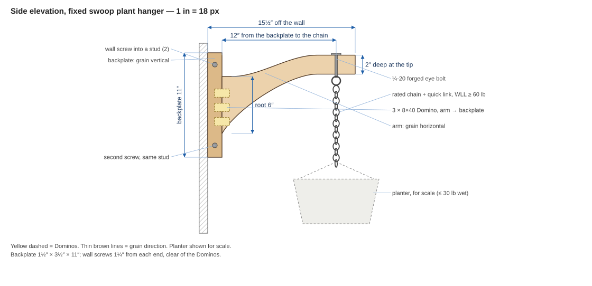
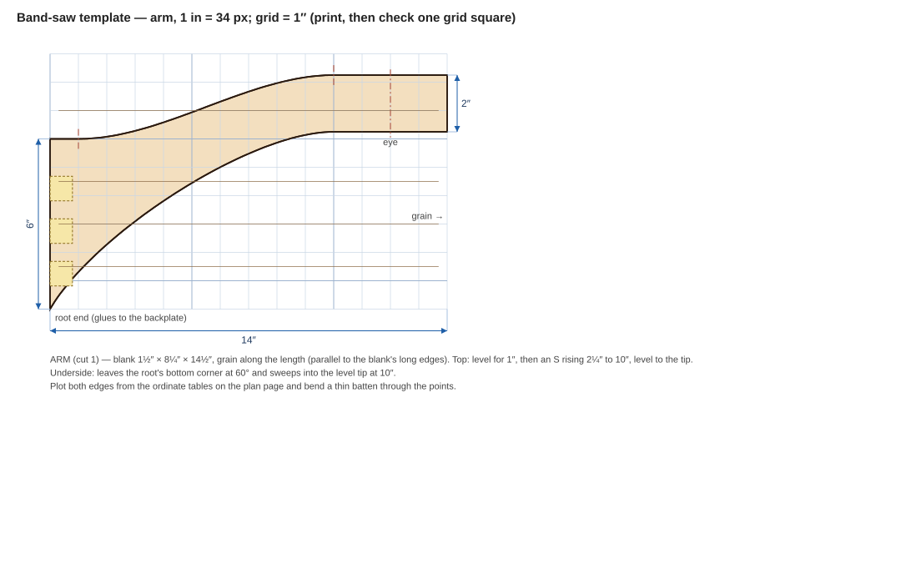

A **built** design (made a couple of times): the [swing-arm plant hanger](/docs/woodworking/furniture-plans/swing-arm-plant-hanger/) with the swing taken out. It keeps the **backplate** and the same **band-sawn swoop arm**, but the arm is Domino'd straight to the backplate's face. There is no leg, no knuckle blocks and no pivot hardware, so the only metal is the wall screws and the eye bolt. Joinery is **Festool Domino** and shaping is **band saw and table saw**; no drill press is needed.

If you want a plainer fixed bracket with a brace instead of a swoop, see the [plant-hanger wall bracket](/docs/woodworking/furniture-plans/plant-hanger-bracket/).

> **Provenance of the numbers.** Derived from the swing-arm plan, so every number is **(design)** = a size I chose or **(derived)** = worked out from those. The drawings come from `tools/woodworking/swoop_plant_hanger_drawings.py`. Change a constant and re-run it, and the SVGs and the printed numbers move together. The script refuses geometry that thins the arm below 2″, puts a Domino or wall screw where it doesn't fit, or **leaves the grain too weak (see below)**.

## Drawings

Click either drawing to open it full size.

**Side elevation**

**Band-saw template: the arm (1″ grid)**

To print it full size, use the [tiled PDF](/static/woodworking/swoop-hanger-templates-print.pdf): 2 letter sheets with a 1″ grid, overlap guides and a scale bar. Print at **100% / Actual size** (not "Fit to page"), check the bar with a ruler, then tape the sheets along the red dashes.

## Keeping the grain strong

A swoop sawn from a plank has a built-in weak spot: wherever the curve cuts across the grain, the fibres are cut short and the wood there is much weaker. Three choices keep that away from the load:

- **Backplate: grain vertical.** It's a plain straight board, so it has no short grain at all. The wall screws go through its face into the stud, and the load reaches it through the Dominos in its face.
- **Arm: grain along its length, one piece.** The grain runs level from the root to the tip, parallel to the blank's long edges. The one place the arm has to carry its full load, the deep root, has long grain on both faces. Don't saw the swoop out of a board whose grain runs across it, and don't build it from a vertical post plus a horizontal arm with a corner joint: that puts short grain exactly at the elbow, where the load is highest.
- **Curves where the load is already low.** The top edge crosses the grain at no more than **21°**, and it does that between 1″ and 10″ out, where the arm's bending stress is small. The underside leaves the backplate at 60° to the grain, but that's the **compression** side of the **6″-deep** root, where the stress is a few dozen psi. The steepest cuts are on the least stressed wood.

The script checks this instead of leaving it to judgement. Along the arm it works out the bending stress at 30 lb. At each point it also works out how strong the wood is across the cut edge's angle to the grain (Hankinson's formula, with white oak at 15,000 psi along the grain and 800 psi across it, **(est.)**), and refuses any shape with less than **10×** margin. This shape's worst point is **18×**, 3¾″ out, where the arm has lost most of its depth but the lever is still long. Make the S steeper or the arm thinner and it stops with a message.

**Picking and marking the blank.** The arm is the only part where this matters. Pick a flat-sawn or quartersawn board, **straight grain, no runout** in the blank (if the face lines drift off the board's edge, the board isn't straight enough), and no knots or checks in the top 4″ from the root. Trace the template so that the **blank's long edges run with the grain**, then check the face on both sides after you cut the top S: the grain should look like it flows through the swoop, with fibres leaving the edge only gently.

**The glue joint.** The arm's root end is **end grain**, which glues poorly by itself. The three **8 × 40 Dominos** carry the joint, and each one is long grain against the sides of its mortise on both parts. Nothing structural relies on the end-grain glue.

## The numbers

| Item | Value |
|---|---|
| Overall | **15½″** off the wall × **11″** tall (backplate) × **3½″** wide (derived) |
| Chain point | **12″** out from the backplate face, on the level tip (design) |
| Backplate | 1½″ × 3½″ × **11″**: 2½″ above the arm's top at the wall, 2½″ below its root (design) |
| Arm | 1½″ thick, **14″** long from the backplate face; root **6″** deep, tip **2″** deep, never thinner than 2″ (design / derived) |
| Arm top | level for 1″ from the root, then an S rising **2¼″** to 10″ out, level to the tip (design) |
| Arm underside | leaves the root's bottom corner at **60°** and sweeps up into the level tip 10″ out (design) |
| Wall screws | two ¼″ × 4″ structural screws, **1¼″** from each end of the backplate, on the centreline (design) |
| Design load | **30 lb** at the chain (design) |

Arm ordinates for laying out the template without printing it, measured **down from the top edge of the 8¼″ blank**, along its length from the root end:

| From the root end | 0 | 1″ | 2″ | 3″ | 4″ | 5″ | 6″ | 7″ | 8″ | 9″ | 10″ to the tip |
|---|---|---|---|---|---|---|---|---|---|---|---|
| Top edge | 2¼″ | 2¼″ | 2 3/16″ | 1 15/16″ | 1 11/16″ | 1 5/16″ | 15/16″ | 9/16″ | 5/16″ | 1/16″ | 0 |
| Underside | 8¼″ | 6 15/16″ | 6″ | 5⅛″ | 4 7/16″ | 3 13/16″ | 3¼″ | 2¾″ | 2⅜″ | 2⅛″ | 2″ |

## Stock

**White oak** (quartersawn if you can get it) or ash; cherry and walnut work too. The parts are about **1⅔ bd ft** finished, all at 1½″ thick, and come out of **one 8/4 board, 9″ or wider × 30″**.

## Cut list

| Part | Qty | T × W × L | Notes |
|---|---|---|---|
| Backplate | 1 | 1½″ × 3½″ × **11″** | **Grain vertical.** Ends dead square. Straight grain with no runout through the screw holes |
| Arm blank | 1 | 1½″ × **8¼″** × **14½″** | **Grain along the length**; root end dead square (the Dominos and the glue line reference it) |

## Shopping list

Everything for one hanger. The store links aren't paired with Wayback archives (the site's usual habit): retail product pages are rarely archived and change often. Hardware that the swing-arm version needs for its pivot (shoulder bolts, inserts, bearing washer, steel rod, knuckle screws) isn't used here.

**Lumber**

| Buy | Qty | Notes |
|---|---|---|
| White oak, **8/4 (2″ rough), at least 9″ wide × 30″** | 1 board (about 4 bd ft) | Mill to 1½″. Crosscut a 15″ piece for the **arm** (8¼″ wide). From the remaining piece, rip a 3½″ strip for the **backplate**. Pick the arm's piece first, with straight grain and no checks |
| *or* 4/4 white oak, at least 8½″ wide × 24″ | 2 boards | Instead of 8/4: laminate two ¾″ layers face to face for each part. Glue up and let it cure a day before milling |

**Hardware**

| Buy | Qty | Spec | Example (photo) |
|---|---|---|---|
| Forged eye bolt | 1 | **¼-20, 2″ shank, forged with a shoulder** | [Ken Forging N2021-2 (galvanized) at Zoro](https://www.zoro.com/ken-forging-eyebolt-14-20-12in-with-shoulder-n2021-2/i/G0760751/) |
| Fender washer | 1 | ¼″ × 1¼″, for the eye bolt | [Everbilt 6-pack at Home Depot](https://homedepot.com/p/Everbilt-1-4-in-x-1-1-4-in-Zinc-Plated-Steel-Fender-Washer-6-per-Pack-802421/204276338) |
| Nylon-insert lock nut | 1 | ¼-20 | [Everbilt 2-pack at Home Depot](https://homedepot.com/p/Everbilt-1-4-in-20-Zinc-Plated-Nylon-Lock-Nut-2-Pack-825291/317478983) |
| Chain | as needed | **3/16″ welded proof coil**, sold by the foot, with a stated working load limit (this one: 750 lb). Not decorative "lamp chain" | [Everbilt 3/16″ galvanized proof coil at Home Depot](https://homedepot.com/p/Everbilt-3-16-in-x-1-ft-Grade-30-Galvanized-Steel-Proof-Coil-Chain-806656/204630509) |
| Quick link | 1 (+1) | 3/16″, rated (this one: 660 lb WLL) | [National Hardware 3150BC at Zoro](https://www.zoro.com/national-hardware-3150bc-series-quick-link-316-in-trade-660-lb-working-load-steel-zinc-n223-016/i/G213780932/) |
| Wall screws | 2 | **¼″ × 4″ structural screws**, washer head, T-30 star drive (bit included) | [SPAX PowerLag 12-pack at Tractor Supply](https://www.tractorsupply.com/tsc/product/spax-1-4-x-4in-exterior-structural-wood-lag-screws-powerlags-washer-head-t-star-(12-ea)-bit-included). The washer heads stay visible on the backplate's face |

**Consumables**

| Buy | Qty | Notes |
|---|---|---|
| Domino **8 × 40** tenons | 3 (+3 spare) | The arm root takes three |
| Wood glue | small bottle | Titebond III. PVA creeps under a constant cantilever load, so for a long-lived hanger use epoxy or urea (Unibond) glue on this joint instead |
| Finish | small can | Hardwax oil (Osmo Polyx or Rubio Monocoat) |
| Sandpaper | 120 / 180 / 220 | |

**Drill bits and cutters to have on hand**

| Bit | For |
|---|---|
| 9/32″ | Eye bolt hole through the arm tip |
| ¾″ Forstner | **½″-deep** counterbore on the arm top, so the 2″-shank eye bolt's washer and nut sit below the surface |
| ¼″ bit | A clearance hole through the backplate for each wall screw (SPAX needs no pilot in the stud) |
| ¼″ or ⅜″ band-saw blade | ¼″ follows the arm's curves comfortably |

## Domino schedule

| Joint | Domino | Qty | Depth (A / B) | Notes |
|---|---|---|---|---|
| Arm root → backplate | **8 × 40** | 3 | 20 mm into the arm's end grain / 20 mm into the backplate face | Centres **1¾″, 3¼″ and 4¾″** below the arm's top at the wall, centred in the 1½″ thickness. The wall screws (1¼″ above and 7¼″ below that line) stay clear of them |

Cut the arm's root mortises in the **square blank** before band-sawing; the root end is a straight cut the curves don't touch. Mark the centres from the root's top corner, which sits 2¼″ below the blank's top edge (4″, 5½″ and 7″ down from the edge). Cut the matching mortises in the backplate's face, on its centreline, 4¼″, 5¾″ and 7¼″ down from the **top of the backplate** (the backplate's top is 2½″ above the arm's top).

## Build order

1. Mill the stock. Square the backplate's ends and the arm blank's root end.
2. **Mortises:** arm root (3) and backplate face (3).
3. **Band-saw the arm.** Cut the top S first and tape the offcut back on, so the blank sits flat while you cut the underside. Fair both curves with a spokeshave or a drum sander.
4. **Drill the arm's tip** for the eye bolt: 9/32″, 12″ from the root, square to the level tip. Counterbore ¾″ × **½″** on top so the washer and nut sit below the surface (the eye bolt's shank is 2″).
5. **Backplate:** drill the two ¼″ screw holes on the centreline, 1¼″ from each end.
6. **Glue the arm to the backplate** (3 Dominos). Clamp across the joint with a caul made from the underside offcut, and check the arm is square to the backplate before the glue sets. Let it cure a full day before hanging anything.
7. **Finish** everything (below).
8. **Hang the backplate** on a stud, then fit the eye bolt, chain and planter.

## Load check

- **Load:** a 10–12″ hanging basket with wet soil is typically 10–20 lb. Everything is sized for **30 lb** at the chain.
- **Arm root:** 30 lb × 12″ = **360 in-lb** at the backplate face. The root bears on the backplate at its bottom edge and the top Domino is 4¼″ above that, so it sees about **85 lb** of tension, shared with the other two and the glue. A glued 8 × 40 Domino holds hundreds of pounds.
- **Arm bending:** the worst combination of stress and cut grain is 3¾″ out, with an **18×** margin (see *Keeping the grain strong*). The arm's bending stress peaks at about **135 psi** (5–6″ out); oak is good for over 10,000.
- **Wall:** 30 lb × 13½″ (12″ + the 1½″ backplate) ≈ **405 in-lb**. The backplate tips about its bottom edge, so the top screw sees roughly **42 lb** of pull. A ¼″ structural screw with 2″ in a stud holds several hundred. **It must go into a stud**, not drywall anchors. If there's no stud where you want it, screw a cleat across two studs first.
- **Hardware:** the eye bolt, chain and link are the parts to buy rated (WLL ≥ 60 lb).

## Finish

Hardwax oil (Osmo Polyx or Rubio Monocoat) on everything. Water the plant in the sink, or let it drain before rehanging, so drips don't run down the backplate and the wall.

## Open questions

- **Glue for the root joint:** the arm carries a constant load on an end-grain joint that Dominos do most of the work for. Titebond III is likely fine at 85 lb across three Dominos; epoxy is the cautious choice if the hanger will carry a full basket for years.
- **Rise and swoop:** `RISE`, `S_X0`/`S_X1`, `UNDER_ANGLE` and `K1`/`K2` in the script control the curves. The script refuses any shape that thins the arm below 2″ or has less than 10× grain margin.
- **Reach:** for a bigger basket, lengthen `ARM_L` and `EYE_X`. The loads and the grain margin print again, so re-read them.
- **Backplate height:** it's sized to the arm (2½″ of backplate above and below). A taller backplate puts the screws further apart and lowers the top screw's pull.
- **Strength figures:** the 15,000 psi and 800 psi in the grain check are typical clear white oak values, not measurements of your board. The 10× margin is there to cover that.
