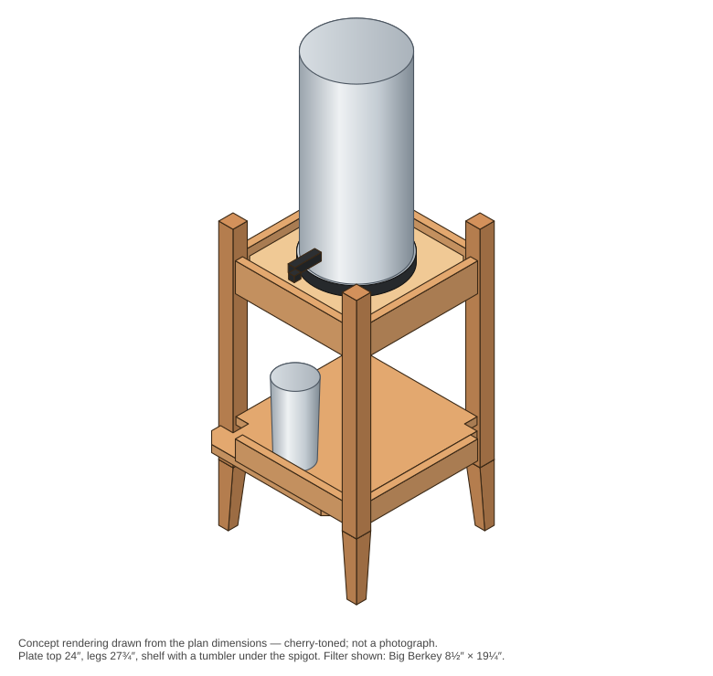
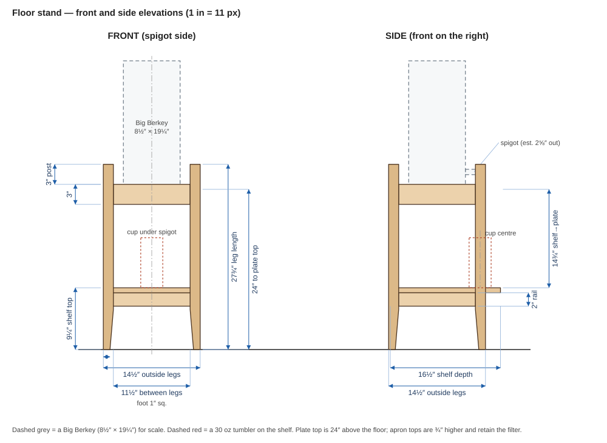
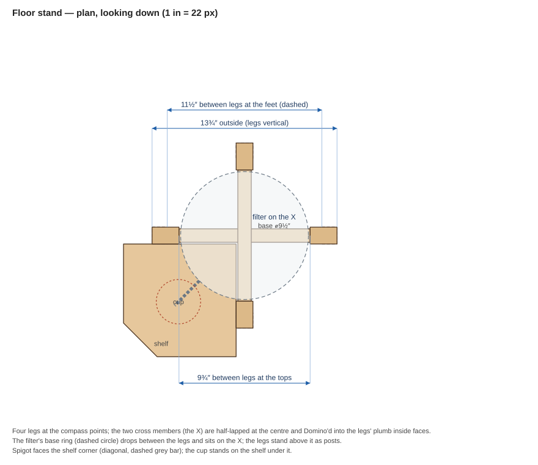
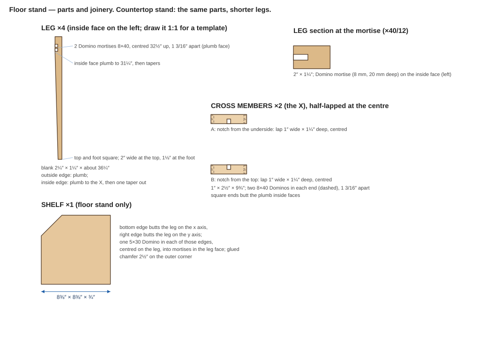

A **proposed** build: a hardwood floor stand for a gravity-fed stainless water filter, sized for a **BOROUX 3-Gallon** (23″ tall, 9½″ base) and still taking a Berkey, British Berkefeld or anything of that size. A small shelf holds a tumbler under the spigot. Everything is milled stock, table-saw and band-saw cuts, **Festool Domino** joints and a half-lap: no turning and no compound angles.

**How it works.** Four **vertical** legs stand at the compass points, in the style of the oak Berkey stands. Each leg is 2″ wide at the top and **narrows to 1⅛″ at the foot**: its outside edge is plumb and its **inside face is plumb down to the bottom of the X, then tapers outward**, so the gap between the legs opens toward the floor. A cross member is **Domino'd** square into each pair's plumb inside faces, and the two cross members **half-lap into an X**. The filter's base ring **drops between the four legs and sits on the X**, with the legs standing 2″ above it as short posts. A small corner shelf sits between two of the legs, under the spigot; the Berkey photo has none, so leave it out if you want the plainer, more elegant stand.

> **Provenance of the numbers.** **(maker)** = a filter maker's published figures, rounded; sources disagree by up to an inch, so **measure your own filter before cutting** (see *Fit*). **(derived)** = worked out from those so everything closes. **(chosen)** = a design decision of mine. **(est.)** = a guess I couldn't verify (spigot height and reach, weight), flagged in *Open questions*. The drawings come from `tools/woodworking/water_filter_stand_drawings.py`; change a constant there and the SVGs and the numbers it prints move together (the tables on this page are written by hand).

## Renderings

Concept view drawn from the plan dimensions (a BOROUX 3-Gallon is shown, 23″ tall on the X). It is an illustration, not a photograph. Click the figure to open it full size.

## Height

| Figure | Value |
|---|---|
| Legs | **35¾″** (33¾″ X top + 2″ post) |
| Top of the X (filter base) | **33¾″** |
| Shelf top | **23″** |
| Between shelf and X | **10¾″** |
| Posts above the X | **2″** (**chosen**: the Berkey oak-stand photo shows only a short post) |
| Cross members | **2½″** tall (**chosen**) |
| 3-Gallon on the stand, overall | **56¾″** (23″ filter on the 33¾″ X) |
| Spigot | nozzle underside at **34″**, ¼″ above the X (**maker**; its reach, about 2⅝″, is **est.**) |
| Footprint | **13¾″** outside, vertical legs; **9¾″** between at the tops, **11½″** at the feet (**chosen**) |
| Leg shape | **2″** at the top, **1⅛″** at the foot; outside edge plumb, inside face plumb down to 31¼″ then tapering outward (**est.** from the Berkey oak-stand photo) |
| Filter base it accepts | **9½″ diameter or less**, with ⅛″ of slack each side |
| Weight | designed for a ~35 lb full filter (**est.**) |

- **The stand is tall.** The filter base is at **33¾″** and the shelf at **23″**. The shelf is then roughly hip height, so a pitcher or tumbler comes up to you instead of you bending to a shelf at 9″, and the spigot sits near counter height. The cost is a taller object: a full 3-Gallon is **56¾″ overall**.
- **Where it lives.** A full 3-Gallon is **56¾″ overall**, so the stand does not fit under a standard 54″ wall cabinet; put it in the open (kitchen corner, pantry, living room, home office).
- **The lid is at 56¾″.** If you refill by pouring from a pitcher, that is above many people's shoulder. To lower it, change `F_BAR_TOP`, `F_H` and `F_SHELF_TOP` in the script; the drawings follow, but the numbers on this page need updating by hand. An X at 24″ puts a 3-Gallon at 47″.
- **Open space under the spigot is about 11″**, from the 23″ shelf to a nozzle underside at 34″ (the maker's figure). Nothing crosses the cup: the spigot faces a corner between two legs, where there is no cross member (the X runs along the legs' axes, not the diagonals).
- **There is no "front", only a corner.** With legs at the compass points, the spigot points at the open diagonal and the shelf fills that corner.
- **The filter nests between plumb faces.** The legs' inside faces are vertical from the top down to the bottom of the X, so the gap is **9¾″ everywhere the filter touches**, from the X up through the 2″ posts. A 9½″ base slips in and is centred, with ⅛″ to spare.
- **The joints stay square.** The legs are vertical and only the inside edge is tapered, so the bars butt a **plumb** face with **square** ends, the Dominos register off flat, square surfaces, and the top and the foot of every leg are cut square. Carrying the plumb face down to the *bottom* of the X is **my simplification** (**chosen**).

## Fit: which filters this takes

The legs' inside faces are **9¾″ apart** from the top of the legs down to the bottom of the X, which is the tight spot. A filter's lowest section has to fit there. Filter sizes are the makers' published figures, rounded (the Berkey site gives its own sizes, and retailers disagree by about an inch on height). BOROUX heights are derived (its published overall height on a 33¾″ shelf, minus the shelf), not from a filter spec.

| Filter | Base dia. | Height | Slack each side | Total height on the stand |
|---|---|---|---|---|
| BOROUX 1.8-Gallon | 9½″ | 17½″ (derived) | ⅛″ | 51¼″ |
| **BOROUX 3-Gallon** | 9½″ (body not published; measure) | 23″ (derived) | ⅛″ | **56¾″** |
| Travel Berkey (1.5 gal) | 7½″ | 18″ | 1⅛″ | 51¾″ |
| Big Berkey (2.25 gal) | 8½″ | 19¼″ | ⅝″ | 53″ |
| Royal Berkey (3.25 gal) | 9½″ | 23″ | ⅛″ | 56¾″ |
| Imperial Berkey (4.5 gal) | 10″ | 26″ | **does not fit** | 59¾″ |
| British Berkefeld stainless 8.5 L (~2.25 gal) | 10¼″ (260 mm; Doulton lists 224 mm) | ~19¼″ | **does not fit** | 53″ |
| British Berkefeld stainless 12 L | 9¾″ (246 mm) | ~23¾″ | 0 (no slack) | 57½″ |
| Crown Berkey (6 gal) | 11″ | 30″ | **does not fit** | 63¾″ |

- **Up to the BOROUX 3-Gallon, Royal Berkey and the Travel and Big Berkeys** fit as drawn. The Berkefeld 12 L has no slack: widen a little. For **Imperial, Crown or the 8.5 L Berkefeld**, set `GAP` in the script to the filter's base plus ¼″ and re-run. That widens the tops, the feet and the bars (the shelf stays fixed, so check that the cup still lands on it; the script asserts this), so re-read every number it prints. The Crown and Imperial also go to 60–64″ tall on the floor stand: drop the X to about 24″ (`F_BAR_TOP`).
- **The BOROUX 3-Gallon's body is wider than its base.** BOROUX publishes only the 9½″ base limit; the width above the base ring is not given. The legs stand **2″ above the X**, so the filter's lowest 2″ must fit between them; above that nothing constrains it. Measure the lowest 2″ of yours.
- **Why the ¼″ matters:** the filter should drop in without scraping and the base ring needs room. The legs, not the gap, keep it from walking, so a loose fit is fine.

## Drawings (true scale)

**Floor stand — front and side**

**Floor stand — plan**

**Floor stand — parts and joinery**

## The numbers

| Item | Value |
|---|---|
| Leg height (vertical) | **35¾″** |
| Leg width at the top / at the foot | **2″ / 1⅛″** |
| Leg thickness | **1¼″** |
| Outside, all the way down | **13¾″** (the legs are vertical) |
| Inside faces | **9¾″** apart, plumb down to **31¼″** (bottom of the X), then tapering outward to **11½″** apart at the feet |
| Top of the X (filter base) | **33¾″** |
| Posts above the X | **2″** |
| Cross members | 1″ × 2½″ × **9¾″**, butting the legs |
| Domino mortises in each leg (8×40) | two, centred **32½″** up and 1 3/16″ apart |
| Shelf top | **23″** |
| Shelf | ¾″ × **8⅜″ × 8⅜″**, outer corner chamfered 2½″ |
| Under the spigot | shelf 23″ to the nozzle at 34″ = about **11″** clear |

How the pieces close:

| Derived | Working | Result |
|---|---|---|
| Outside width | 9¾″ between + 2 × 2″ leg width | **13¾″** |
| Leg height | 33¾″ X top + 2″ post | **35¾″** |
| Inside edge below the kink | 2″ − 1⅛″ = ⅞″ outward over 31¼″ | **1.6°** from vertical |
| Between legs at the feet | 9¾″ + 2 × ⅞″ | **11½″** |
| Bar length | equals the gap between the legs | **9¾″** (the Dominos are 20 mm into the bar and 20 mm into the leg) |
| Domino mortise depth | 8×40 Domino ÷ 2 | **20 mm (13/16″)**, leaving about 1⅜″ of leg beyond it (the leg is 2″ wide at 32½″) |

## Cut list

Stock: white oak (the oak Berkey stand is the model), cherry, walnut or maple. Finished sizes; mill a little long and trim after the joinery is cut.

| Part | Qty | T × W × L | Notes |
|---|---|---|---|
| Legs | 4 | 1¼″ × **2¼″** blank × **36¼″** | Square top and foot. **Two 8×40 Domino mortises** each on the jointed (plumb) inside edge; the two legs that meet the shelf also get **one 5×30 mortise** on the face that looks into the shelf corner. Then one straight taper on the inside edge from 31¼″ down to the foot, taking the leg from 2″ to 1⅛″ wide. Ease the arrises 3/16″ |
| Cross members | 2 | 1″ × 2½″ × **9¾″** | Square ends, **two 8×40 Domino mortises in each end**. Half-lap at the centre: 1″ wide × 1¼″ deep, **bar A notched from the underside, bar B from the top** |
| Shelf | 1 | ¾″ × **8⅜″** × 8⅜″ | Outer corner chamfered 2½″. **One 5×30 Domino mortise** in each of the two edges that meet the legs |
| Dominos | 10 | 8 × 40 (8) and 5 × 30 (2) | Beech is fine indoors; buy a few spares of each |

**Board feet:** about 4 net; buy **about 6 bd ft** (6/4 for the 2¼″-wide leg blanks, straight and quartersawn or rift, because they are long and thin; 5/4 for the 1″ bars, since 4/4 mills to only about ⅞″; 4/4 for the shelf).

## Build sequence

1. **Mill** the leg blanks to 1¼″ × 2¼″ × 36¼″ with one **jointed, square edge** (it becomes the plumb inside face), and the bars to 1″ × 2½″ × 9¾″, ends dead square. A 36″ leg is long and thin: pick straight, quartersawn or rift stock, and let it rest a day after milling. Cut the legs to final length with **square** ends.
2. **Domino the legs while they are still square blanks.** Cut the **two 8×40 mortises** in the jointed edge, centred **32½″ above the foot end** and 1 3/16″ apart (set the machine's fence height to centre them on the 1¼″ thickness, about 16 mm; clamp a scrap beside the blank to widen the machine's footing on the narrow edge). On the two legs that meet the shelf, also cut the **one 5×30 mortise** on the face that looks into the shelf corner: **22⅝″ above the foot end**, centred on the leg's width at that height (about 1⅛″ in from the jointed edge). Mark all four legs' foot ends and cut every mortise from a stop or a story stick so the four match. Cutting them before the taper means no mortise is ever cut on a sloped face.
3. **Taper the inside edge.** One straight cut on each leg, from **31¼″ above the foot** (the bottom of the X) down to the foot, removing ⅞″ at the foot: a taper jig on the table saw, or the band saw and a plane. Everything above 31¼″ stays plumb. Make a pattern from the parts drawing (it is a 1:1 template if printed full size) and check each leg against it.
4. **Cut the bars.** Crosscut to **9¾″** exactly, the length that sets the gap at the tops, then cut the **two 8×40 mortises in each end** (1″ bar: centre the 8 mm slot, about 13 mm from each face). The bars butt the legs square; dry-fit with Dominos and check the gap is 9¾″.
5. **Cut the half-laps.** Mark the centre of each bar. Notch **bar A from its underside** and **bar B from its top**, each **1″ wide × 1¼″ deep** (half the 2½″ height), with a dado stack or several passes. Dry-fit them: the tops of both bars should come out flush, the X flat, with no rocking. Pare the notch to a snug but not tight fit.
6. **Glue the two panels.** Glue **panel B** first: two legs and bar B with four 8×40 Dominos, Titebond III, clamped across the legs. The bar holds the tops exactly 9¾″ apart and the legs are vertical, so the frame comes out square; check it is flat. Glue **panel A** the same way. Use the standard (narrow) mortise width for these joints, so the Dominos index exactly and the bars stay on their marks.
7. **Engage the X.** The panels are two flat frames; lower **panel A onto panel B** from above so the half-laps engage. Leave the lap unglued (or add one screw through each lap if you want it fixed).
8. **Glue the shelf (floor stand).** Chamfer the outer corner 2½″ and cut the **5×30 mortise in each of the two edges that meet the legs**, centred on each leg face, so the edges butt the leg faces with no gap. Glue the shelf in with Dominos into both legs, check the legs stay square to each other, and clamp until dry. The glued shelf also **ties the two frames together**, so the stand no longer comes apart (see *Stability*).
9. **Sand and finish** before the filter goes on (see *Finish*).
10. **Check for rock.** Stand it on a flat floor and shim or sand a foot if it rocks. Then wall-anchor it (see *Stability*).

## Finish

Water **will** drip on this stand. Use something water-resistant: wipe-on or spray polyurethane, spar varnish, or a hardwax oil, with at least three coats on the top of the X, the shelf and the leg tops. Seal the **underside of the shelf** as well as the top, or the unfinished side will cup. A stainless filter also sweats in a humid room; a thin cork or felt disk on the X under the base ring keeps the finish from marking.

## Stability and safety

- **Load:** a full filter plus its water is roughly 30–65 lb depending on size (**est.**); a full 3-Gallon is about 35 lb (**est.**). The X is two 1″ × 2½″ bars spanning about 11″, tenoned into the legs: at that load it is plenty stiff. Don't build it thinner than 1″ × 2½″.
- **Tipping:** with a full 3-Gallon on the X (centre of mass about 44″ up, **est.**), the floor stand tips at about **9°** from vertical along a leg axis and about **7°** across the open diagonals. Vertical legs on a 13¾″ footprint are the price of the cleaner look. A hard shove at the top could do it, and a child could pull on the spigot. **Anchor it to the wall:** two small L-brackets (or a ⅛″ brass strap) from a back leg to the wall stud. Do this for the floor stand every time, not as an option. If you want more margin without splaying the legs, widen the footprint by raising `GAP` and `W_TOP`, or add a thin base plate under the feet.
- **Knockdown (optional):** with Dominos the shelf is glued to one leg of each frame, which **locks the frames together**, so the floor stand is a permanent assembly. If you want a knockdown stand, leave the shelf out of the glue-up and attach it with 1/4-20 threaded inserts in its edges and black machine screws through the legs instead (two per leg); the two frames then lift apart at the unglued lap. Don't lift the stand by the X with the filter on it.
- **Posts:** the 2″ posts above the X are retainers, not a restraint. A child can pull a filter off by the spigot; if that matters in your house, anchor the stand and add a strap or a bracket.

## Open questions

- **Spigot height and reach:** BOROUX says its 3-Gallon spigot sits at 34″ with the base at 33¾″, so I put the nozzle's underside at 34″ (¼″ above the X; `SPIGOT_UP`). The nozzle's reach (about 2⅝″) is my estimate. With the filter in hand, measure both and check that the cup circle (30 oz tumbler, 3¼″ across) lands on the shelf under it.
- **BOROUX 3-Gallon diameter:** only the 9½″ base limit is published ("compatible with systems with a base diameter of 9.5″ or less"). Measure the lowest 2″ of the body and the base ring before cutting; if the lowest 2″ is over 9½″, widen `GAP`.
- **Height and where it lives:** the 3-Gallon on this stand is **56¾″**, over a 54″ wall-cabinet underside. If you refill from a pitcher or want it under a cabinet, lower `F_BAR_TOP` and `F_H` and re-run, or choose the 1.8-Gallon (51¼″). Imperial and Crown put the lid at 60–64″ on the floor stand.
- **The joinery is mine.** The X and the half-lap are read from photos of the oak Berkey stand. The Domino sizes and spacing, the half-lap and the leg section are my design (a Festool 8×40, about 22 mm wide, is about as strong in shear and glue area as the ½″ × 1¾″ tenon it replaces).
- **Where the inside face stops being plumb:** I read "tapered to vertical" as the inside face being plumb at the top and "tapered leg" as the leg narrowing toward the foot. The plan carries the plumb face down to the *bottom* of the X (31¼″) so the bar shoulders stay square (**chosen**). If the transition should be higher, lower or a curve, change `kink()` in the script (and bevel the bar shoulders if you move it above the bar's bottom edge).
- **Leg proportions:** the 2″ top width, 1⅛″ foot width and 1¼″ thickness are read off a photo of an oak Berkey stand, scaled against a stand of about 36″. The photo shows the taper beginning just below the X and a short post above it; if yours should differ, change `W_TOP`, `FOOT_W`, `LEG_T` and `F_POST` and re-run. A 1¼″-thick leg 36″ tall is slender: use 1½″ if it feels light.
- **The shelf is optional.** The Berkey oak stand in the photo has none. Without it the stand needs no corner Dominos and the two frames can knock down (the lap is unglued). Set the cup on the floor instead; the spigot is at 34″, so a tall tumbler fits under it on the floor stand with the shelf removed.
- **Shelf attachment:** four 5×30 Dominos, glued, two per leg along the leg's width. For heavier use (a full pitcher), glue a ¾″ × ¾″ cleat under the shelf along each leg-side edge or add a screw from below.
- **Footprint:** the legs are vertical, so the footprint is just 13¾″ square. The diagonal tips first (about 7°). A wall anchor is required; for a free-standing stand, add a base plate.
- **Hardware:** wall brackets and felt pads aren't in the cut list. The Dominos are, but not the glue (Titebond III; epoxy if the stand lives somewhere damp).
