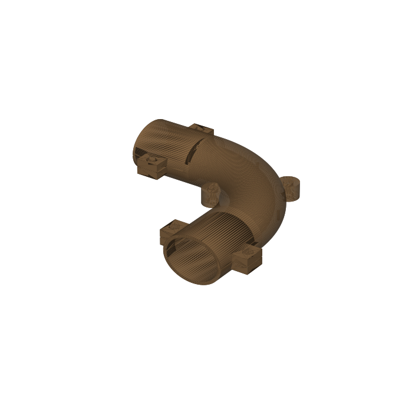

A **proposed** overhead dust pickup for the table saw: a rigid C-shaped arm of **1¼″ Schedule 80 pipe** that runs out from the cabinet, up and over the table, with a flexible hose dropping to the blade guard from the far end. It is the arrangement commercial overarm collectors use, worked out here from the function alone rather than from anyone's drawings. The pipe is bought; the only printed parts are the **two 90° elbows** at the corners of the C. The Y fitting at the cabinet (two hoses to one port) is one you already own, so it is not designed here.

> **Status.** Designed, not yet built or test-fit. Every printed dimension below is computed from published Schedule 80 pipe sizes, so **measure your actual pipe** and re-run the generator if it differs.

## Layout

```
                     hose to blade guard
          ┌─────────────────────────╮
          │  upper bar (pipe)        │
   elbow  ╭─╮                       coupler
          │ │ riser (pipe)
   elbow  ╰─╯
          └──────────────────────  lower bar (pipe) ──╮ hose to the Y at the cabinet
```

Two elbows, one riser between them. Everything else is straight pipe, couplers and hose.

| Part | Qty | Source |
|---|---:|---|
| 1¼″ Schedule 80 pipe | cut to fit | hardware store |
| 90° elbow | 2 | printed (this page) |
| Hose cuffs / couplers | 2 | not yet designed; see below |
| Y fitting | 1 | already owned |
| Flexible hose | to suit | your dust-collection hose |

## The pipe

| | in | mm |
|---|---:|---:|
| Outside diameter | 1.660 | 42.16 |
| Wall (Sch 80) | 0.191 | 4.85 |
| Inside diameter | 1.278 | 32.46 |

These are the standard nominal figures for 1¼″ Sch 80 (the same OD as Sch 40; Sch 80 simply has a thicker wall). The elbow fits the **outside** diameter, so Sch 40 pipe would fit it too, but the airway would be a little bigger than the elbow's bore. Plain PVC pipe also builds static when dust runs through it. If that worries you, run a bare copper wire inside or along the arm and ground it to the collector.

## The elbow



A sleeve fitting rather than a spigot one: each leg is a **socket that slides over the pipe**, with a ledge at the bottom of the socket that the pipe butts against. That puts the bore at exactly the pipe's inside diameter, so there is **no step for chips to catch on** and the airway is smooth through the bend.

| | mm | in | label |
|---|---:|---:|---|
| Socket bore | 42.3 | 1.666 | (derived) pipe OD + 0.15 mm each side |
| Socket depth | 45.0 | 1.77 | (chosen) |
| Airway bore | 32.5 | 1.278 | (derived) = pipe ID |
| Bend radius, to the airway centerline | 76.2 | 3.00 | (chosen) 1.8 × the pipe OD |
| Outside radius | 24.1 | 0.95 | (derived) 3 mm of wall around the socket |
| **Take-off** (corner to pipe end) | 82.2 | 3.24 | (derived) bend radius + 6 mm of leg |

It prints as **two identical halves** split on the bend plane. Each half lies with its flat face on the bed, so there are **no supports** anywhere: the bore prints as a dome and the bolt pockets open upward. The second half is the first rotated 180° about the diagonal of the bend, so you print the same STL four times for two elbows.

How the halves hold together:

- **Clamp ears.** Each socket has an ear on each side with an **M4 bolt and nut** in hex pockets (the bolt head and nut sit in the same pocket shape, so the halves stay identical). The socket's mating faces are cut back 0.4 mm, so tightening the bolts closes a gap and **clamps the pipe**. The result is a socket that grips the pipe without glue or set screws.
- **Sweep lugs.** Two more M4 bolts through lugs on the inside and outside of the bend at 45° hold the middle of the elbow shut against the arm's weight.
- **Locating pins.** Two small holes in each mating face take offcuts of **1.75 mm filament** as dowels, so the halves can't slide while you tighten.
- **Seal.** Run a thin bead of silicone or epoxy on the mating faces before you bolt the halves together, or the seam will leak.

[`dust_elbow_half.stl`](/static/woodworking-3d/dust_elbow_half.stl) · print 4 (two elbows) · hardware per elbow: six M4 × 12 mm hex-head bolts and six M4 nuts, two 8 mm pieces of 1.75 mm filament

**Print settings.** PETG, mating face down, **4 perimeters, 30–40% infill**. About 92 cm³ solid, so roughly 40 g per half. The clamp relies on the 0.4 mm relief, so **test-print one socket on a short piece of your pipe** before printing all four: it should slide on by hand and grip firmly when the bolts are snug. Tune `SOCK_CLEAR` (loose) and `CLAMP_RELIEF` (grip) in the generator; PVC pipe OD varies by a few thousandths.

## Cut list

The arm is a closed C, so the pipe lengths come from the centerline layout:

> **pipe length = corner-to-corner centerline distance − 2 × 3.24″**

where 3.24″ is the take-off in the table above (the pipe seats on the ledge, not at the corner). For example, a 14″ riser measured corner to corner uses 14 − 6.47 = **7.53″** of pipe. Measure corner to corner on the real saw: lay string along the intended centerline, mark the two corners, and measure between them.

| Piece | Qty | Length |
|---|---:|---|
| Riser | 1 | corner to corner − 6.47″ |
| Upper bar | 1 | corner to hose coupler, less 3.24″ at the elbow end |
| Lower bar | 1 | corner to hose coupler, less 3.24″ at the elbow end |

Cut square (a miter box or a chop saw with a plastic-cutting blade works), deburr the outside edge, and test-fit dry before you tighten anything.

## Mounting and use

- The arm is a **cantilever**: the upper bar and its hose are carried at the elbows. Support the lower bar with a bracket or two to the saw's extension or the wall, and let the hose hang from the upper bar's end without pulling on it.
- Keep the hose route clear of the fence's travel and the user's push area.
- Keep the arm clear of where a kicked-back workpiece goes, and don't use it as a handle.
- This is dust collection, not a guard: it **does not replace** the blade guard, riving knife or brake.

## Not yet designed

- **Hose cuffs.** Two fittings to join the pipe to your hose at the coupler ends. They depend on the hose's diameter, so measure it first. The same sleeve-over-pipe design on one end and a tapered or ribbed hose spigot on the other would do it.
- A **bracket** for the lower bar.

## Open questions

- Pipe OD and wall on the actual stock (the figures here are nominal).
- Hose size and the blade-guard port it connects to.
- Whether a 3″ bend radius is tight enough for the space between the table edge and the lower bar.
- How the clamp relief behaves on your printer. This one needs a test print.

**Parametric source:** [`generate_woodworking_stls.py`](/static/woodworking-3d/generate_woodworking_stls.py), the same script as the other [printed shop tools](/docs/woodworking/printed-tools/).
